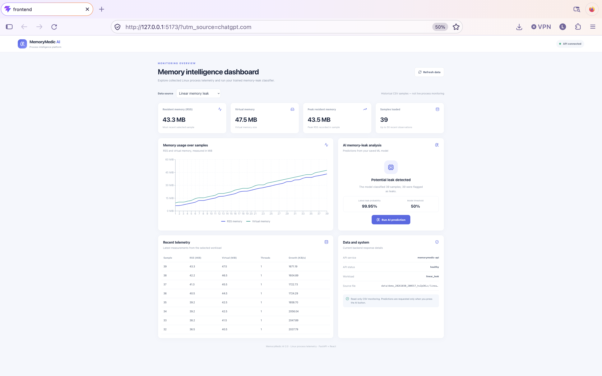
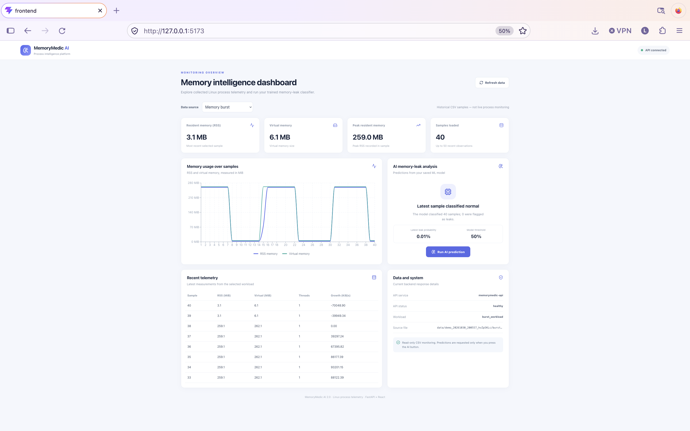
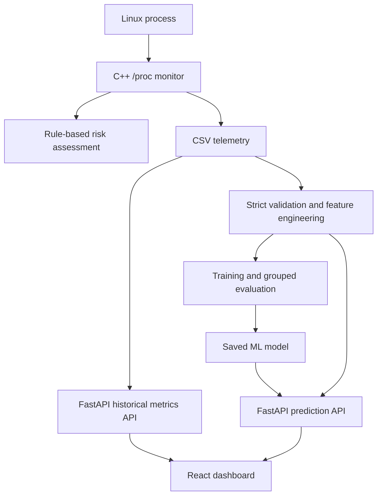
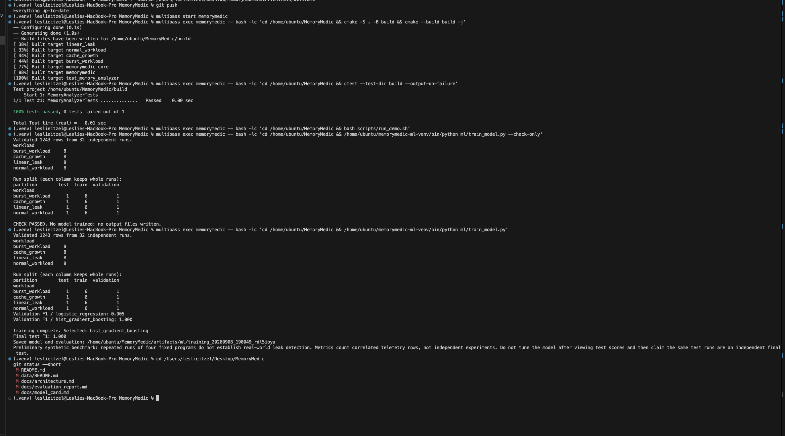

# MemoryMedic AI 2.0

**Linux Process-Memory Monitoring | Machine Learning | FastAPI | React**

**Author:** Leslie Raya  
**Repository:** [leslieraya555/MemoryMedic](https://github.com/leslieraya555/MemoryMedic)  
**Project status:** Working research and portfolio prototype; not a production monitoring service.

[](https://github.com/leslieraya555/MemoryMedic/actions/workflows/ci.yml)
[](https://github.com/leslieraya555/MemoryMedic/actions/workflows/backend-ci.yml)
[](https://github.com/leslieraya555/MemoryMedic/actions/workflows/frontend-ci.yml)

## Overview

MemoryMedic is an end-to-end experimental system for collecting Linux process-memory telemetry and identifying patterns associated with potential memory leaks. The original C++ monitor reads Linux `/proc` information, calculates memory-growth indicators, produces a rule-based risk assessment, and exports telemetry to CSV. A Python pipeline validates telemetry, engineers causal time-series features, trains classification models, and performs saved-model inference.

**MemoryMedic AI 2.0** connects the existing machine-learning pipeline to a **FastAPI backend** and **React/Vite dashboard**. Users can choose a historical workload, inspect RSS and virtual-memory charts, review recent measurements, and request an AI prediction.

The dashboard currently displays **historical CSV data**; it does **not** stream newly collected process measurements in real time. The model is evaluated on controlled synthetic programs, not general-purpose production applications.

## Dashboard preview

### Normal workload


### Linear memory leak



### Memory burst



### Cache growth


These images are **functional demonstrations on synthetic workloads**, not evidence of reliable detection on unfamiliar production software.

## Features

| Component | Implemented capability |
| --- | --- |
| C++ Linux monitor | Reads selected process information from `/proc` and logs measurements |
| Rule-based memory assessment | Calculates recent memory-growth indicators and reports a heuristic risk category |
| CSV collector | Records timestamped measurements with run identifiers and labels for controlled workloads |
| Machine-learning pipeline | Validates input, calculates 12 features, compares candidate classifiers, and saves a trained model |
| Prediction CLI | Applies a locally trusted saved model to telemetry CSV files |
| FastAPI service | Provides health, historical telemetry, and prediction endpoints |
| React dashboard | Displays telemetry cards, charts, source information, and requested ML classifications |
| Automated verification | C++ tests, Python regression tests, backend tests, frontend build checks, and GitHub Actions |

**Important distinction:** the C++ monitor's rule-based score and the Python ML classifier are separate assessments. The C++ executable does not directly load the Python model. The FastAPI backend connects saved ML inference to the dashboard.

## Architecture



The training and inference paths are related but distinct: training produces the saved model; the prediction API loads an existing model and computes features for the supplied telemetry. Live streaming, automatic remediation, and eBPF collection are **not implemented**.

## Technology stack

| Layer | Tools |
| --- | --- |
| Linux monitoring | C++17, Linux `/proc`, CMake |
| Data processing and ML | Python, pandas, NumPy, scikit-learn, joblib |
| REST API | FastAPI, Pydantic, Uvicorn |
| Dashboard | React, JavaScript, Vite, Recharts, Lucide React |
| Testing | CTest, Python unittest, pytest, frontend build/lint checks |
| Automation | GitHub Actions |

## Repository layout

```text
MemoryMedic/
├── .github/workflows/
│   ├── ci.yml
│   ├── backend-ci.yml
│   └── frontend-ci.yml
├── backend/
│   ├── app/
│   │   ├── main.py
│   │   ├── metrics.py
│   │   └── predictions.py
│   ├── tests/
│   └── requirements.txt
├── data/
│   └── README.md
├── docs/
│   ├── images/
│   ├── architecture.md
│   ├── evaluation_report.md
│   ├── interview_guide.md
│   └── model_card.md
├── frontend/
│   ├── src/
│   │   ├── App.jsx
│   │   ├── App.css
│   │   ├── index.css
│   │   └── main.jsx
│   ├── package.json
│   └── vite.config.js
├── include/memorymedic/
├── ml/
│   ├── feature_engineering.py
│   ├── train_model.py
│   ├── predict_csv.py
│   ├── requirements.txt
│   └── tests/
├── scripts/
│   ├── collect_dataset.sh
│   ├── run_demo.sh
│   └── verify_fresh_copy.sh
├── src/
├── tests/
├── workloads/
├── CMakeLists.txt
├── README.md
└── START_HERE.md
```

Generated virtual environments, compiled executables, experiment collections, saved models, and temporary logs are local artifacts; they are not all included in a Git clone.

## Controlled workloads

| Workload key | Expected behavior | Synthetic label |
| --- | --- | --- |
| `normal_workload` | Stable allocation and repeated memory access | `normal` |
| `burst_workload` | Temporary large allocations that are released | `normal` |
| `cache_growth` | Gradual growth followed by a bounded cache | `normal` |
| `linear_leak` | Continuous retained allocation without deletion | `leak` |

These fixed programs are useful for an initial integration benchmark but do not cover all real-world memory behavior. A rising RSS curve is not, by itself, proof of a leak.

## Requirements

**For the dashboard and API on macOS:** Python and an appropriate virtual environment, Node.js compatible with the project's Vite version (the CI uses Node.js 22), npm, and a locally available trained MemoryMedic model to run predictions.

**For C++ telemetry collection and model training:** Linux with `/proc`, CMake 3.20+, a C++17 compiler, Python, and the dependencies listed in `ml/requirements.txt`. You can use an Ubuntu Multipass instance from macOS.

### 1. Clone or open the project

```bash
git clone https://github.com/leslieraya555/MemoryMedic.git
cd MemoryMedic
```

If you already have the repository locally, **do not clone it again**. Instead, in your Mac terminal:

```bash
cd ~/Desktop/MemoryMedic
git status --short
```

### 2. Run the FastAPI backend on your Mac

From the repository root, use the existing environment if present:

```bash
cd ~/Desktop/MemoryMedic
python3 -m venv backend/.venv
backend/.venv/bin/python -m pip install -r ml/requirements.txt -r backend/requirements.txt
PYTHONPATH=. backend/.venv/bin/python -m uvicorn backend.app.main:app --reload --host 127.0.0.1 --port 8001
```

Leave this terminal open while using the dashboard.

**API URLs:**

- Swagger documentation: <http://127.0.0.1:8001/docs>
- Health check: <http://127.0.0.1:8001/health>
- Example metrics: <http://127.0.0.1:8001/api/v1/metrics?workload=normal_workload&limit=50>

The health endpoint checks the API process; it does **not** prove that a trained model is present or that all data sources are available.

### 3. Run the React dashboard on your Mac

Open a **second terminal**:

```bash
cd ~/Desktop/MemoryMedic/frontend
npm ci
npm run dev -- --host 127.0.0.1 --port 5173
```

Open <http://127.0.0.1:5173> in your browser.

The `frontend/vite.config.js` configuration proxies `/health` and `/api` requests to the FastAPI service at port 8001. Keep both servers running. If either port is already in use, check the existing process before starting a duplicate.

### 4. Test the dashboard manually

1. Confirm the header displays a connected API after the backend responds.
2. Select each workload from the **Data source** dropdown.
3. Confirm that the historical telemetry chart and recent measurements load.
4. Click **Run AI prediction** and inspect the returned classification.
5. Compare the results with the four screenshots above.

Predictions require a compatible, trusted saved model in `artifacts/ml/training_*/memorymedic_model.joblib`. That model is generated locally by training, not guaranteed to exist in a fresh Git clone. Without it, the prediction endpoint may return HTTP 503 even if `/health` succeeds.

## Backend API reference

| Method | Endpoint | Purpose |
| --- | --- | --- |
| `GET` | `/` | Basic service information |
| `GET` | `/health` | API process health response |
| `GET` | `/api/v1/metrics` | Historical CSV telemetry selected by `workload` and `limit` |
| `POST` | `/api/v1/predict` | Classify validated telemetry with the saved ML model |

`GET /api/v1/metrics` accepts one of `normal_workload`, `burst_workload`, `cache_growth`, and `linear_leak`, with a `limit` from 1 to 500. It reads the latest matching `data/demo_*/<workload>.csv` file. The prediction endpoint validates measurements, calculates features, and returns model scores and classifications. Swagger documents the exact request schema.

### Quick health and metrics checks

```bash
curl -sS http://127.0.0.1:8001/health
curl -sS 'http://127.0.0.1:8001/api/v1/metrics?workload=linear_leak&limit=5'
```

If the second command returns 404, generate a completed demo CSV in Ubuntu first or provide the expected demo data in your local project.

## Build and test the C++ collector in Ubuntu

From macOS, enter your existing Multipass instance (if it is configured):

```bash
multipass start memorymedic
multipass shell memorymedic
```

Inside Ubuntu, go to the repository copy or mounted folder:

```bash
cd /home/ubuntu/MemoryMedic
sudo apt-get update
sudo apt-get install -y build-essential cmake git python3 python3-venv python3-pip
cmake -S . -B build -DCMAKE_BUILD_TYPE=Release -DBUILD_TESTING=ON
cmake --build build --parallel 2
ctest --test-dir build --output-on-failure
./build/memorymedic --help
```

The C++ tests cover the existing analyzer/risk scenarios; passing them does not benchmark real-world leak detection.

### Run a controlled demonstration

```bash
bash scripts/run_demo.sh 25 500 8
```

The script generates a timestamped `data/demo_*/` directory containing four workload CSVs and logs. These are historical captures for later review and prediction, not a persistent real-time monitoring service.

### Collect a new training dataset

Create a Python environment inside Ubuntu if necessary:

```bash
python3 -m venv "$HOME/memorymedic-ml-venv"
source "$HOME/memorymedic-ml-venv/bin/activate"
python -m pip install -r ml/requirements.txt
```

Then run:

```bash
bash scripts/collect_dataset.sh 5 40
python ml/train_model.py --check-only
python ml/train_model.py
```

The collector requests **five independent runs per workload** at 40 seconds each. The trainer checks completed collections and assigns whole `run_id` groups to training, validation, and held-out test sets. Each successful training run writes a new directory under `artifacts/ml/` containing the model and evaluation records. Do not overwrite the historical September results when running a new experiment.

### Verify a fresh published copy

The repository provides an isolated Linux verification helper:

```bash
bash scripts/verify_fresh_copy.sh
```

For a full fresh-copy collection, training, and prediction check (which generates new datasets), use:

```bash
bash scripts/verify_fresh_copy.sh --full
```

Run these commands **inside Ubuntu**. The script clones the public repository into a separate directory and saves its own logs and artifacts.

## Historical model evaluation — September 2026

The recorded historical benchmark evaluated 1,243 telemetry observations from **32 independent runs** of four fixed synthetic programs (eight runs per workload).

| Partition | Independent runs | Observations |
| --- | ---: | ---: |
| Training | 24 | 933 |
| Validation | 4 | 154 |
| Held-out test | 4 | 156 |

Candidate classifiers included logistic regression and histogram-based gradient boosting. The selected gradient-boosting classifier achieved the strongest validation F1 score.

| Held-out synthetic metric | Recorded value |
| --- | ---: |
| Accuracy | 100% |
| Precision | 100% |
| Recall | 100% |
| F1 score | 1.000 |
| True negatives / true positives | 117 / 39 |
| False positives / false negatives | 0 / 0 |

**Interpret carefully:** the 156 held-out observations came from just four independent held-out executions of already represented synthetic workload programs. This result does not demonstrate perfect accuracy on unfamiliar applications, calibrated probabilities, or production readiness. A new training run can produce different scores.

See the [full evaluation report](docs/evaluation_report.md) and [model card](docs/model_card.md) for data-partitioning, metrics, and limitations.

## Machine-learning features and data quality

The model uses 12 numerical features:

| Feature | Interpretation |
| --- | --- |
| `rss_kb` | Resident memory |
| `virtual_memory_kb` | Virtual address-space size |
| `peak_rss_kb` | Highest recorded RSS |
| `threads` | Thread count |
| `rss_growth_kb_s` | Recent RSS growth slope |
| `minor_faults_s` | Minor page-fault rate |
| `major_faults_s` | Major page-fault rate |
| `rss_delta` | Change in RSS from preceding sample within a run |
| `rss_mean_10` | Causal rolling RSS mean over up to 10 observations |
| `rss_std_10` | Causal rolling RSS standard deviation |
| `vm_to_rss_ratio` | Virtual-to-resident memory ratio |
| `fault_ratio` | Major-fault fraction of all page faults |

The validator rejects invalid raw measurements, missing fields, non-finite values, and duplicate timestamps within a run. Rolling features are computed separately for each `run_id` using only current and earlier observations. Labels and run identities are not classifier inputs. Valid data checks are not equivalent to evidence of model generalization.

## Testing and continuous integration

### Local backend tests (macOS)

```bash
cd ~/Desktop/MemoryMedic
PYTHONPATH=. backend/.venv/bin/python -m pytest backend/tests -v
```

The documented local integration verification recorded **13 passing backend tests**.

### Frontend build and lint (macOS)

```bash
cd ~/Desktop/MemoryMedic/frontend
npm ci
npm run build
npm run lint
```

The frontend repository has build and lint scripts. **It does not currently include a dedicated automated React component-test suite.** That is a recommended next step.

### Original Python model regression tests (Ubuntu or compatible Python environment)

```bash
python -m unittest discover -s ml/tests -p 'test_*.py' -v
```

The recorded original Python regression suite contains **21 tests**.

### GitHub Actions workflows

- [MemoryMedic CI](https://github.com/leslieraya555/MemoryMedic/actions/workflows/ci.yml): C++ build/CTest, Python regression checks, and shell script syntax.
- [Backend API CI](https://github.com/leslieraya555/MemoryMedic/actions/workflows/backend-ci.yml): FastAPI backend tests and Python syntax.
- [Dashboard CI](https://github.com/leslieraya555/MemoryMedic/actions/workflows/frontend-ci.yml): React dependency install, production build, and build-file verification.

Check [all GitHub Actions runs](https://github.com/leslieraya555/MemoryMedic/actions) for the status of the exact commit you want to publish. A green build verifies its configured checks, not production memory-leak reliability.

### Existing evidence



The more recent backend tests and four-workload dashboard screenshots are documented separately in the [evaluation report](docs/evaluation_report.md). A saved backend test log is available at [docs/memorymedic-terminal-output.txt](docs/memorymedic-terminal-output.txt).

## Troubleshooting

| Issue | Recommended check |
| --- | --- |
| `Port 5173 is already in use` | A Vite process may already be running; inspect `lsof -nP -iTCP:5173 -sTCP:LISTEN` on your Mac before starting another. |
| `Port 8001 is already in use` | Inspect `lsof -nP -iTCP:8001 -sTCP:LISTEN`; reuse or stop the existing API. |
| API health works but prediction fails with 503 | Confirm `artifacts/ml/training_*/memorymedic_model.joblib` exists and matches the environment and feature schema. |
| Metrics endpoint returns 404 | Generate a `data/demo_*/<workload>.csv` file for the requested workload. |
| Dashboard shows API disconnected | Start the FastAPI server on port 8001 and check Vite's proxy configuration. |
| `/proc` access fails on macOS | Perform C++ collection inside Ubuntu/Linux; `/proc` is a Linux interface. |
| `npm` says `package.json` cannot be found | Run npm commands from the `frontend/` directory, not the project root. |
| `git push` says everything is up to date | Save the edited README, review `git status`, stage the specific file, commit, and push. |

## Known limitations

1. The benchmark contains one synthetic leak implementation and three normal workload implementations, not a representative selection of production software.
2. Dashboard charts display the latest matching historical CSV data, not live telemetry streams.
3. The model's output scores have not been demonstrated to be calibrated probabilities for production processes.
4. Benchmark rows within each process run are correlated; the number of independent test runs is much smaller than the number of observations.
5. Detection latency, false alerts per monitoring hour, and monitoring resource overhead have not been comprehensively benchmarked.
6. Automatic remediation, multi-host deployment, eBPF collection, and alert delivery are not implemented.
7. Model inference depends on an existing trusted local joblib artifact and compatible Python/scikit-learn environment.

## Roadmap

- [x] Implement Linux process-memory collector in C++.
- [x] Add four synthetic workload programs and CSV collection.
- [x] Validate telemetry and train an ML classifier with grouped partitions.
- [x] Build the FastAPI metrics and prediction service.
- [x] Build the React historical monitoring dashboard.
- [x] Add backend tests and configured GitHub Actions build checks.
- [x] Record and link screenshots for the four controlled workloads.
- [ ] Add automated React component and browser integration tests.
- [ ] Benchmark unfamiliar workloads, false alarms, and detection latency.
- [ ] Measure collection overhead and run-to-run performance variation.
- [ ] Evaluate probability calibration and grouped cross-validation.
- [ ] Add genuinely live process telemetry streaming.
- [ ] Evaluate an approved staging alerting/deployment architecture.

**Checked items reflect implemented or recorded project functionality, not a claim that all requirements for production deployment have been met.**

## Project documentation

- [Evaluation and verification report](docs/evaluation_report.md)
- [Architecture](docs/architecture.md)
- [Model card](docs/model_card.md)
- [Interview preparation guide](docs/interview_guide.md)
- [Dataset documentation](data/README.md)
- [Repository setup and verification guide](START_HERE.md)
- [GitHub repository](https://github.com/leslieraya555/MemoryMedic)

## Author

**Leslie Raya**  
[GitHub](https://github.com/leslieraya555) · [MemoryMedic repository](https://github.com/leslieraya555/MemoryMedic)

This project is intended for education, research, software-engineering demonstrations, and further experimentation. Its results should not be used as the sole basis for production process-remediation decisions.
