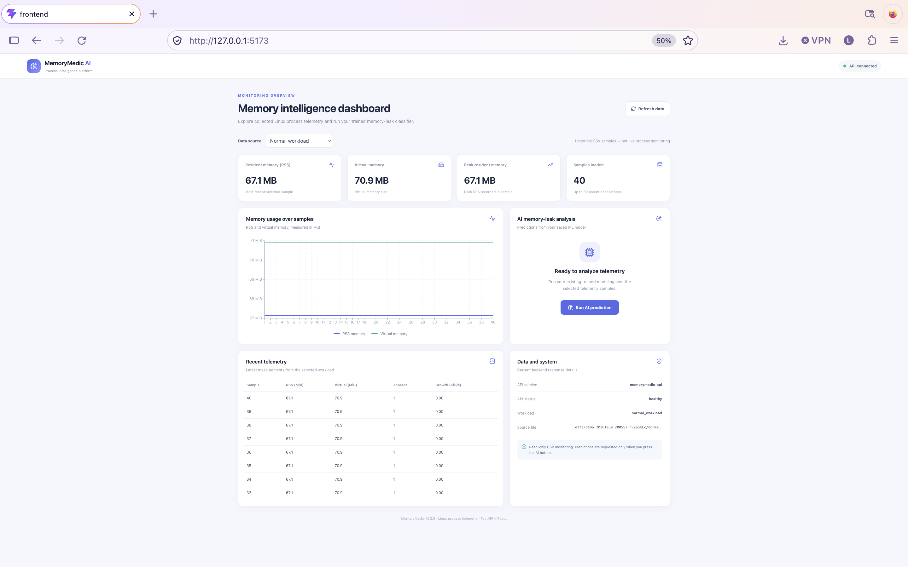
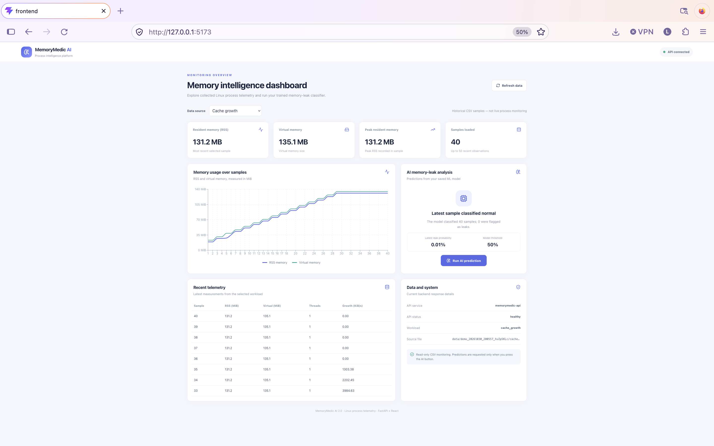
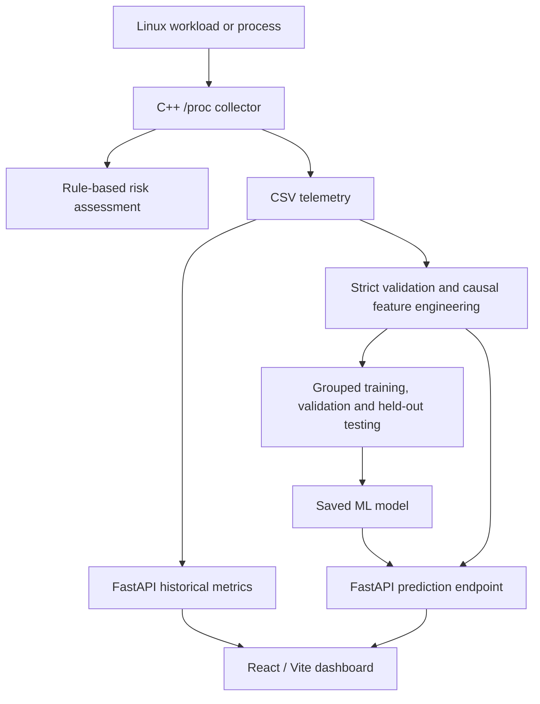
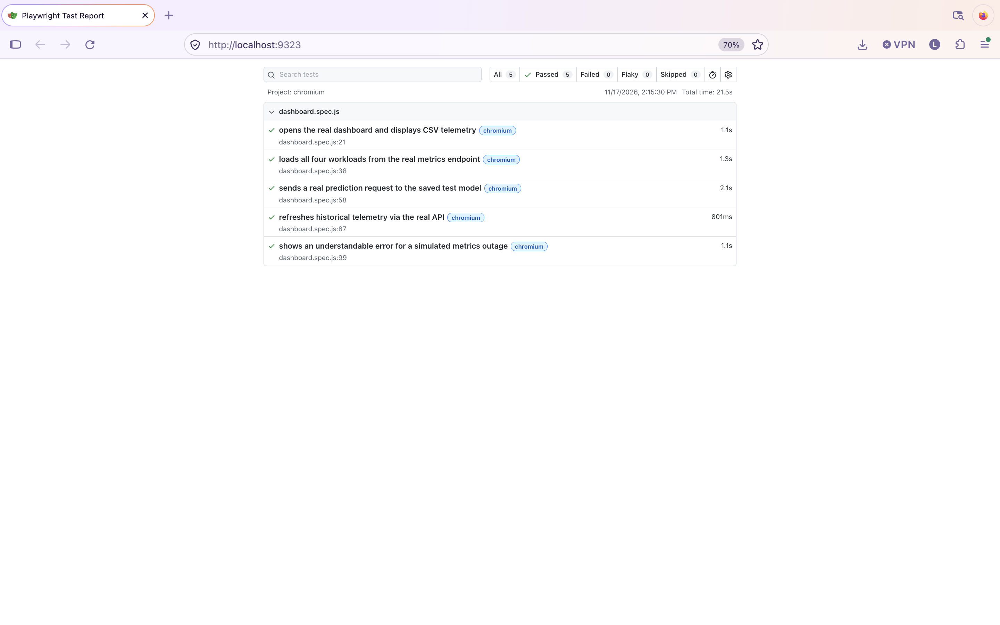
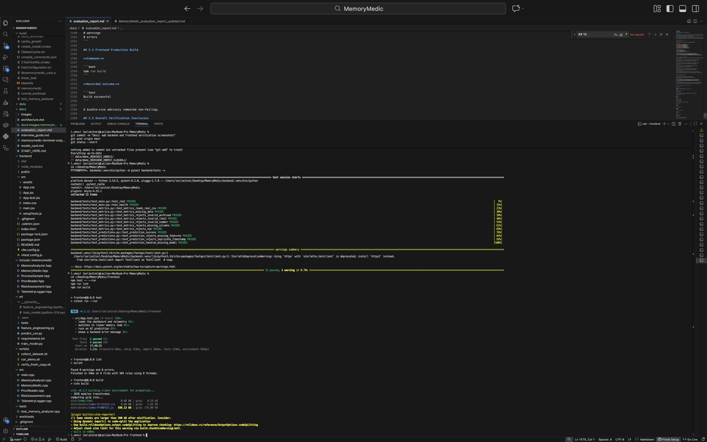

# MemoryMedic AI 2.0

**Linux Process-Memory Monitoring · Machine Learning · FastAPI · React**

**Author:** Leslie Raya  
**Repository:** [leslieraya555/MemoryMedic](https://github.com/leslieraya555/MemoryMedic)  
**Status:** Working research and software-engineering portfolio prototype — **not production-ready**.

[](https://github.com/leslieraya555/MemoryMedic/actions/workflows/ci.yml)
[](https://github.com/leslieraya555/MemoryMedic/actions/workflows/backend-ci.yml)
[](https://github.com/leslieraya555/MemoryMedic/actions/workflows/frontend-ci.yml)

## Overview

**MemoryMedic AI 2.0** is an experimental end-to-end system that captures Linux process-memory measurements, engineers time-series features, classifies telemetry associated with potential memory leaks, and presents historical results in an interactive dashboard.

Its original **C++17 monitor** reads Linux `/proc` measurements, calculates memory-growth indicators, produces a separate rule-based risk assessment, and records timestamped CSV telemetry. The **Python ML pipeline** validates collections, computes causal features, trains classifiers using independent-run partitions, and saves a model for later inference. A **FastAPI backend** exposes historical telemetry and predictions to a **React/Vite frontend**.

**Important:** The browser currently displays **historical CSV samples, not a real-time stream from running processes**. Classification scores have not been validated as calibrated probabilities for unfamiliar production applications. The C++ heuristic assessment and the Python ML classifier are separate methods; the C++ executable does not directly load the ML model.

## Contents

- [Dashboard preview](#dashboard-preview)
- [Implemented features](#implemented-features)
- [Architecture](#architecture)
- [Technology stack](#technology-stack)
- [Repository structure](#repository-structure)
- [Synthetic workloads](#synthetic-workloads)
- [Requirements](#requirements)
- [Run the API and dashboard on macOS](#run-the-api-and-dashboard-on-macos)
- [Build and collect telemetry on Ubuntu](#build-and-collect-telemetry-on-ubuntu)
- [Train and evaluate the ML model](#train-and-evaluate-the-ml-model)
- [API endpoints](#api-endpoints)
- [Historical benchmark results](#historical-benchmark-results)
- [Testing and continuous integration](#testing-and-continuous-integration)
- [Evidence and screenshots](#evidence-and-screenshots)
- [Troubleshooting](#troubleshooting)
- [Limitations](#limitations)
- [Development roadmap](#development-roadmap)
- [Documentation](#documentation)

## Dashboard preview

Each image shows a selected **controlled synthetic workload** and its saved-model prediction in the historical dashboard.

### Normal workload



### Linear memory leak


### Memory burst


### Cache growth



These captures demonstrate dashboard functionality on selected examples; they are **not** evidence of general-purpose or real-world detection accuracy.

## Implemented features

| Component | What it does |
| --- | --- |
| Linux process monitor | Reads measurements for one selected PID from the Linux `/proc` filesystem. |
| Memory analysis | Calculates RSS trends and other memory-growth indicators. |
| Heuristic risk assessment | Produces a separate rule-based risk classification in the C++ monitor. |
| CSV telemetry logger | Writes timestamped process measurements and independent run identifiers. |
| Workload collector | Executes four controlled workloads separately and records individual CSVs and logs. |
| Strict data validation | Rejects invalid readings and incomplete or inconsistent training collections. |
| ML pipeline | Engineers 12 numerical features, compares candidate classifiers, and evaluates by independent run. |
| Saved-model inference | Loads a trusted local model to classify telemetry as `normal` or `leak`. |
| FastAPI service | Serves health information, historical CSV metrics, and prediction requests. |
| React dashboard | Displays memory charts, telemetry cards, workload selection, and requested predictions. |
| Automated testing | Uses CTest, Python `unittest`, backend `pytest`, Vitest, lint, and build checks. |
| GitHub Actions | Runs configured C++/ML, backend, and frontend verification workflows. |

## Architecture



**Training and inference are different workflows.** Training creates a saved model. Inference loads that saved model and evaluates supplied telemetry. The dashboard does not directly train models, and the current system does not automatically repair or stop processes.

## Technology stack

| Area | Technologies |
| --- | --- |
| Process monitoring | C++17, Linux `/proc`, CMake, CTest |
| Data and ML | Python, pandas, NumPy, scikit-learn, joblib |
| Web API | FastAPI, Pydantic, Uvicorn, pytest |
| User interface | React, JavaScript, Vite, Recharts, Lucide React |
| Frontend tests | Vitest, React Testing Library, jsdom, Oxlint |
| CI | GitHub Actions |

## Repository structure

```text
MemoryMedic/
├── .github/workflows/
│   ├── ci.yml
│   ├── backend-ci.yml
│   └── frontend-ci.yml
├── backend/
│   ├── app/
│   │   ├── main.py
│   │   ├── metrics.py
│   │   └── predictions.py
│   ├── tests/
│   └── requirements.txt
├── data/
│   ├── README.md
│   └── *_demo.csv                 # Bundled example CSVs
├── docs/
│   ├── images/
│   ├── architecture.md
│   ├── evaluation_report.md
│   ├── interview_guide.md
│   ├── memorymedic-terminal-output.txt
│   └── model_card.md
├── frontend/
│   ├── src/
│   │   ├── App.jsx
│   │   ├── App.test.jsx
│   │   ├── setupTests.js
│   │   ├── App.css
│   │   ├── index.css
│   │   └── main.jsx
│   ├── package.json
│   ├── vite.config.js
│   └── vitest.config.js
├── include/memorymedic/       # C++ headers
├── ml/
│   ├── feature_engineering.py
│   ├── train_model.py
│   ├── predict_csv.py
│   ├── tests/
│   └── requirements.txt
├── scripts/
│   ├── collect_dataset.sh
│   ├── run_demo.sh
│   └── verify_fresh_copy.sh
├── src/                       # C++ implementation
├── tests/                     # C++ tests
├── workloads/                 # Four synthetic C++ workloads
├── CMakeLists.txt
├── README.md
└── START_HERE.md
```

Generated build files, Python environments, full collection batches, trained models, and logs may exist **only on the machine where they were created**. A clean clone does not automatically contain those artifacts.

## Synthetic workloads

| Workload key | Intended behavior | Synthetic label |
| --- | --- | --- |
| `normal_workload` | Approximately stable resident memory | `normal` |
| `burst_workload` | Temporary allocation spikes that are released | `normal` |
| `cache_growth` | Increasing memory use that eventually stabilizes | `normal` |
| `linear_leak` | Repeated allocation retained without release | `leak` |

**Memory growth is not automatically a memory leak.** The project intentionally includes burst and cache examples to illustrate this distinction. The original benchmark contains one synthetic leak implementation, not a diverse catalog of real defects.

## Requirements

**For the API and dashboard on macOS:**

- Python 3 with virtual-environment support; the dependencies are in `ml/requirements.txt` and `backend/requirements.txt`.
- Node.js and npm compatible with the checked-in frontend dependencies (frontend CI uses Node.js 22).
- A local trusted saved model **for prediction requests**, and accessible `data/demo_*` CSVs **for historical dashboard metrics**.

**For native telemetry collection and training:**

- Ubuntu or another Linux system exposing `/proc`.
- CMake 3.20 or newer, a C++17 compiler, Python 3, and the dependencies in `ml/requirements.txt`.
- Optionally, an existing Ubuntu Multipass instance on macOS.

## Run the API and dashboard on macOS

### 1. Open the existing repository

If you already cloned the project onto your Desktop, use:

```bash
cd ~/Desktop/MemoryMedic
git status --short
```

For a **new** clone instead:

```bash
git clone https://github.com/leslieraya555/MemoryMedic.git
cd MemoryMedic
```

### 2. Start the FastAPI backend — terminal 1

In VS Code, open **Terminal > New Terminal** and run:

```bash
cd ~/Desktop/MemoryMedic
python3 -m venv backend/.venv
backend/.venv/bin/python -m pip install -r ml/requirements.txt -r backend/requirements.txt
PYTHONPATH=. backend/.venv/bin/python -m uvicorn backend.app.main:app --reload --host 127.0.0.1 --port 8001
```

Keep this terminal running. The API should be accessible at:

- [Interactive API documentation](http://127.0.0.1:8001/docs)
- [Health endpoint](http://127.0.0.1:8001/health)

A successful health response confirms the service is running; it **does not** guarantee that a trained model or usable demonstration CSVs are present.

### 3. Start the React dashboard — terminal 2

Open another VS Code terminal:

```bash
cd ~/Desktop/MemoryMedic/frontend
npm ci
npm run dev -- --host 127.0.0.1 --port 5173
```

Open [http://127.0.0.1:5173](http://127.0.0.1:5173).

The checked-in `frontend/vite.config.js` proxies `/health` and `/api` to port **8001**. Leave both terminal sessions running while using the dashboard.

### 4. Try the dashboard

1. Confirm the header reports that the API is connected.
2. Use **Data source** to choose `normal_workload`, `linear_leak`, `burst_workload`, or `cache_growth`.
3. Inspect the RSS/virtual-memory chart and recent measurements.
4. Press **Run AI prediction** to request the saved classifier's predictions.
5. Compare the selected demonstration with the screenshots above.

**Data/model prerequisites:** The metrics API reads the latest matching `data/demo_*/<workload>.csv` file; predictions require a compatible trusted artifact in `artifacts/ml/training_*/memorymedic_model.joblib`. A clean checkout may have neither. If you collected or trained **inside a separate Ubuntu VM**, those files do not automatically appear in the Mac checkout unless that directory is shared or the files are copied into the appropriate local paths.

## Build and collect telemetry on Ubuntu

The following C++ collection steps are **Linux-only**. If you already configured a Multipass instance named `memorymedic`, start it from macOS:

```bash
multipass start memorymedic
multipass shell memorymedic
```

Inside Ubuntu (adjust the path if your clone is elsewhere):

```bash
cd /home/ubuntu/MemoryMedic
sudo apt-get update
sudo apt-get install -y build-essential cmake git python3 python3-venv python3-pip
cmake -S . -B build -DCMAKE_BUILD_TYPE=Release -DBUILD_TESTING=ON
cmake --build build --parallel 2
ctest --test-dir build --output-on-failure
./build/memorymedic --help
```

### Run a controlled demonstration

From the Ubuntu repository root after building:

```bash
bash scripts/run_demo.sh 25 500 8
```

The demonstration generates a uniquely named `data/demo_*/` folder with workload CSVs and logs. This produces **recorded samples**, not a live web stream. See [dataset documentation](data/README.md) for collection details.

### Collect independent training data

Inside Ubuntu:

```bash
cd /home/ubuntu/MemoryMedic
python3 -m venv "$HOME/memorymedic-ml-venv"
source "$HOME/memorymedic-ml-venv/bin/activate"
python -m pip install -r ml/requirements.txt
bash scripts/collect_dataset.sh 5 40
```

`5 40` requests **five independent executions of each of the four workloads**, with a requested duration of 40 seconds per execution. The collector saves original CSVs, a run manifest, logs, and a completion marker. Keep partial/failed collections for inspection, but do not train on them as successful batches.

## Train and evaluate the ML model

With the Ubuntu ML virtual environment activated and completed collection batches available:

```bash
cd /home/ubuntu/MemoryMedic
python ml/train_model.py --check-only
python ml/train_model.py
```

The first command validates data and eligible grouped splits **without training**. The second trains and evaluates the model, saving each successful run to a separate `artifacts/ml/training_*/` directory. Recorded outputs include:

```text
artifacts/ml/training_<timestamp>_<id>/
├── memorymedic_model.joblib
├── evaluation.json
├── splits.csv
├── requirements-used.txt
└── COMPLETE.txt
```

For saved-model CLI inference, select the model generated by your run, then use the repository's prediction script:

```bash
python ml/predict_csv.py data/linear_leak_demo.csv \
  --model artifacts/ml/training_<your-run>/memorymedic_model.joblib \
  --out artifacts/ml/linear-leak-predictions.csv
```

Replace `training_<your-run>` with the actual generated directory name. Only load trusted model files that you generated or independently verified; joblib files should not be loaded from untrusted sources.

### Reproduce a fresh Linux checkout

The repository includes a helper that clones the published code into an **isolated directory** and saves its own verification logs:

```bash
bash scripts/verify_fresh_copy.sh
```

For the longer check that also collects independent data, trains, and predicts:

```bash
bash scripts/verify_fresh_copy.sh --full
```

Run these only inside Linux. Keep the generated verification directory and logs if you want to document repeatability.

## API endpoints

| Method | Path | Purpose |
| --- | --- | --- |
| `GET` | `/` | Basic API information |
| `GET` | `/health` | Service liveness |
| `GET` | `/api/v1/metrics` | Historical telemetry for a selected workload |
| `POST` | `/api/v1/predict` | Model inference on validated samples |

The metrics endpoint accepts `workload` and `limit` parameters. Supported workload values are the four keys in the [Synthetic workloads](#synthetic-workloads) table. Use the interactive FastAPI documentation for the exact prediction request schema.

Check the running service with:

```bash
curl -sS http://127.0.0.1:8001/health
curl -sS 'http://127.0.0.1:8001/api/v1/metrics?workload=linear_leak&limit=5'
```

A `404` metrics response may mean that a matching generated demo CSV is missing. A `503` prediction response may mean that the trusted trained-model artifact is unavailable or cannot be loaded.

## Historical benchmark results

The **September 2026** benchmark consists of **1,243 telemetry observations from 32 independent synthetic executions**, with eight runs of each of four workload programs. To avoid train/test overlap between correlated observations, the split kept all rows from a given `run_id` in one partition.

| Dataset partition | Independent runs | Telemetry observations |
| --- | ---: | ---: |
| Training | 24 | 933 |
| Validation | 4 | 154 |
| Held-out test | 4 | 156 |
| **Total** | **32** | **1,243** |

Logistic regression and histogram-based gradient boosting were compared using validation F1 score. The historical evaluation selected histogram-based gradient boosting.

| Historical held-out synthetic metric | Result |
| --- | ---: |
| Accuracy | 100% |
| Precision | 100% |
| Recall | 100% |
| F1 score | 1.000 |
| True negatives | 117 |
| False positives | 0 |
| False negatives | 0 |
| True positives | 39 |

**Interpretation:** The selected model classified all 156 held-out observations correctly **within this controlled benchmark**. Those observations came from four held-out runs of synthetic programs whose workload types were represented in training. These results do not establish perfect detection on unfamiliar processes, calibrated real-world probabilities, or production reliability. New training and test runs may produce different outcomes.

See the [full evaluation and verification report](docs/evaluation_report.md) and [model card](docs/model_card.md).

### Machine-learning features

The trained classifier uses 12 numerical features:

| Feature | Meaning |
| --- | --- |
| `rss_kb` | Resident set size |
| `virtual_memory_kb` | Virtual memory size |
| `peak_rss_kb` | Peak observed RSS |
| `threads` | Process thread count |
| `rss_growth_kb_s` | Resident-memory growth rate |
| `minor_faults_s` | Minor page-fault rate |
| `major_faults_s` | Major page-fault rate |
| `rss_delta` | Change in RSS from the preceding sample |
| `rss_mean_10` | Causal rolling RSS mean over up to 10 samples |
| `rss_std_10` | Causal rolling RSS standard deviation |
| `vm_to_rss_ratio` | Virtual-to-resident memory ratio |
| `fault_ratio` | Fraction of faults that are major page faults |

The ML pipeline validates raw measurements and isolates rolling features by run. Run IDs and class labels are **not** model-input features. These protections address specific leakage risks but do not prove generalization outside the collected workloads.

## Testing and continuous integration

### Backend API tests (macOS)

From the repository root:

```bash
cd ~/Desktop/MemoryMedic
PYTHONPATH=. backend/.venv/bin/python -m pytest backend/tests -v
```

**Recorded November 16, 2026 local result:** 13 backend tests passed, with one non-failing deprecation warning.

### Frontend component tests, lint, and build (macOS)

From the frontend directory:

```bash
cd ~/Desktop/MemoryMedic/frontend
npm ci
npm test
npm run lint
npm run build
```

**Recorded November 16, 2026 local result:** 4 Vitest component tests passed; lint reported zero warnings and zero errors; the Vite production build succeeded. A bundle-size advisory was non-failing.

The **existing** `frontend/src/App.test.jsx` uses Vitest and React Testing Library, including mocked API responses. Its tests cover:

1. Loading the dashboard and historical telemetry.
2. Switching to the linear-leak workload.
3. Requesting and displaying an AI prediction.
4. Showing a backend error message.

The **Vitest tests are component tests with mocked responses**, not browser end-to-end tests. A separate Playwright suite now checks the real React/Vite frontend and FastAPI backend in Chromium. The Playwright fixture model tests integration, **not general-purpose ML accuracy**.

### Playwright real-browser end-to-end tests (Chromium)

**Recorded November 17, 2026 local result:** five Playwright Chromium tests passed. They cover dashboard loading, four historical workloads, a prediction API request, historical refresh, and a simulated metrics outage. The browser suite uses a real FastAPI server but isolated synthetic fixture data and a fixture model; this **does not** validate ML performance on unfamiliar applications.

Run from the project root after installing the isolated test dependencies described in [the E2E README](e2e/README.md):

```bash
cd ~/Desktop/MemoryMedic
export MEMORYMEDIC_E2E_PYTHON="$PWD/artifacts/e2e-venv/bin/python"
cd e2e
npm test
npm run report
```

The workflow is [MemoryMedic Browser E2E CI](https://github.com/leslieraya555/MemoryMedic/actions/workflows/playwright-e2e.yml). The full installation procedure is in [docs/playwright_e2e_guide.md](docs/playwright_e2e_guide.md).



### Original Python ML regression tests (Ubuntu or compatible Python environment)

With ML dependencies installed:

```bash
cd /home/ubuntu/MemoryMedic
python -m unittest discover -s ml/tests -p 'test_*.py' -v
```

The recorded original Python regression suite contains **21 tests**.

### C++ tests (Ubuntu)

```bash
cd /home/ubuntu/MemoryMedic
cmake -S . -B build -DBUILD_TESTING=ON
cmake --build build --parallel 2
ctest --test-dir build --output-on-failure
```

### GitHub Actions

| Workflow | Configured checks |
| --- | --- |
| [MemoryMedic CI](https://github.com/leslieraya555/MemoryMedic/actions/workflows/ci.yml) | C++ build and CTest, ML regression tests, sample validation, and shell syntax. |
| [Backend API CI](https://github.com/leslieraya555/MemoryMedic/actions/workflows/backend-ci.yml) | Python syntax checks and backend pytest. |
| [Dashboard CI](https://github.com/leslieraya555/MemoryMedic/actions/workflows/frontend-ci.yml) | npm installation, frontend lint, Vitest, production build, and output verification. |
| [Browser E2E CI](https://github.com/leslieraya555/MemoryMedic/actions/workflows/playwright-e2e.yml) | Real Chromium, React/Vite, FastAPI and Playwright integration tests on isolated test fixtures. |

Check [the Actions page](https://github.com/leslieraya555/MemoryMedic/actions) for the actual status of the commit you want to present. A green CI run establishes only that the **configured checks** passed for that commit.

## Evidence and screenshots

The repository includes these screenshots in [`docs/images/`](docs/images/):

| File | Evidence |
| --- | --- |
| [`memorymedic-build-test-training-results.png`](docs/images/memorymedic-build-test-training-results.png) | Historical build, test, and training demonstration |
| [`memorymedic-normal-workload-prediction.png`](docs/images/memorymedic-normal-workload-prediction.png) | Normal-workload dashboard and prediction |
| [`memorymedic-linear-leak-prediction.png`](docs/images/memorymedic-linear-leak-prediction.png) | Linear-leak dashboard and prediction |
| [`memorymedic-memory-burst-prediction.png`](docs/images/memorymedic-memory-burst-prediction.png) | Burst-workload dashboard and prediction |
| [`memorymedic-cache-growth-prediction.png`](docs/images/memorymedic-cache-growth-prediction.png) | Cache-growth dashboard and prediction |
| [`memorymedic-frontend-ci-passed.png`](docs/images/memorymedic-frontend-ci-passed.png) | Successful frontend CI run |
| [`memorymedic-full-test-verification.png`](docs/images/memorymedic-full-test-verification.png) | Combined local backend/frontend verification |



The checked-in [backend terminal test log](docs/memorymedic-terminal-output.txt) and [evaluation report](docs/evaluation_report.md) provide additional context. Screenshots demonstrate specific observed checks; they are **not substitutes** for independent performance benchmarks or complete reproduction records.

## Troubleshooting

| Issue | Suggested action |
| --- | --- |
| Port 5173 is in use | On macOS run `lsof -nP -iTCP:5173 -sTCP:LISTEN`; check whether Vite is already running. |
| Port 8001 is in use | Run `lsof -nP -iTCP:8001 -sTCP:LISTEN`; reuse or stop the existing API. |
| API shows disconnected | Verify that the FastAPI terminal is running and that Vite proxies `/health` and `/api` to port 8001. |
| Metrics request returns 404 | Check for the expected local `data/demo_*/<workload>.csv` file. |
| Prediction returns 503 | Check for a compatible, trusted `artifacts/ml/training_*/memorymedic_model.joblib` file. |
| `/proc` isn't available on macOS | Run native collector and workload programs inside Ubuntu/Linux. |
| `npm` cannot locate `package.json` | Change directory to `frontend/` first. |
| `npm test` reports no tests | Verify `frontend/src/App.test.jsx`, `frontend/vitest.config.js`, and `frontend/src/setupTests.js`. |
| A screenshot does not render on GitHub | Verify filename spelling and whether the file is committed under `docs/images/`. |
| `git push` says everything is up to date | Save files, check `git status --short`, stage selected files, commit, and then push. |

## Limitations

1. The historical evaluation contains four controlled synthetic workload implementations, including only one leak-style program.
2. The dashboard uses completed historical CSV files; it does **not** provide live process streaming.
3. The relatively small number of independent test runs limits the strength of statistical conclusions.
4. Real-world false-positive rates, detection latency, and monitoring overhead have not been comprehensively measured.
5. The classifier's output scores have not been validated as calibrated probabilities for production applications.
6. Separate Ubuntu and Mac checkouts do not automatically share generated artifacts.
7. Automatic remediation, multi-host deployment, eBPF collection, and production alert delivery are not implemented.
8. Saved-model inference depends on a compatible environment and a locally trusted model artifact.

## Development roadmap

### Completed or documented

- [x] C++ Linux `/proc` monitor and telemetry logger.
- [x] Four controlled synthetic workload programs.
- [x] Independent collection and strict CSV validation.
- [x] Causal feature engineering and grouped model evaluation.
- [x] Saved-model classification and CLI inference.
- [x] FastAPI historical metrics and prediction endpoints.
- [x] React dashboard with workload dropdown and memory charts.
- [x] Backend pytest tests and automated frontend Vitest component tests.
- [x] Frontend lint and production-build verification.
- [x] GitHub Actions workflows and documented verification screenshots.
- [x] Historical evaluation report and model limitations.

### Next priorities

- [x] Correct the README test status so it reflects the implemented Vitest component suite.
- [x] Run and record real-browser Playwright integration tests against a running API (five passing Chromium tests; fixture model only).
- [ ] Evaluate previously unseen application and memory-allocation behaviors.
- [ ] Measure false positives, false alerts per hour, and detection latency across independent runs.
- [ ] Benchmark monitoring CPU/memory overhead and repeatability.
- [ ] Evaluate probability calibration and, if needed, grouped cross-validation with a separate final test set.
- [ ] Publish a concise portfolio demonstration and a reproducible versioned release.

### Optional future platform features

- [ ] Stream genuinely live Linux telemetry to the dashboard.
- [ ] Add configurable alerts and multi-process monitoring.
- [ ] Investigate eBPF instrumentation, deployment hardening, and multi-host architecture.

**Roadmap entries describe future work, not completed functionality.** The research prototype should not be used as the sole basis for stopping or modifying production services.

## Documentation

- [Full evaluation and verification report](docs/evaluation_report.md)
- [System architecture](docs/architecture.md)
- [Model card and model-use limitations](docs/model_card.md)
- [Playwright E2E installation guide](docs/playwright_e2e_guide.md)
- [Playwright E2E test suite README](e2e/README.md)
- [Interview preparation guide](docs/interview_guide.md)
- [Dataset and collection guide](data/README.md)
- [Getting-started guide](START_HERE.md)
- [Saved backend test output](docs/memorymedic-terminal-output.txt)
- [GitHub Actions](https://github.com/leslieraya555/MemoryMedic/actions)

## Author and project scope

**Leslie Raya** — [GitHub profile](https://github.com/leslieraya555) · [MemoryMedic repository](https://github.com/leslieraya555/MemoryMedic)

MemoryMedic is intended for education, research, portfolio demonstration, and further experimentation. The recorded results support the stated synthetic benchmark and selected software-verification checks, **not** claims of production reliability or general-purpose leak detection.
