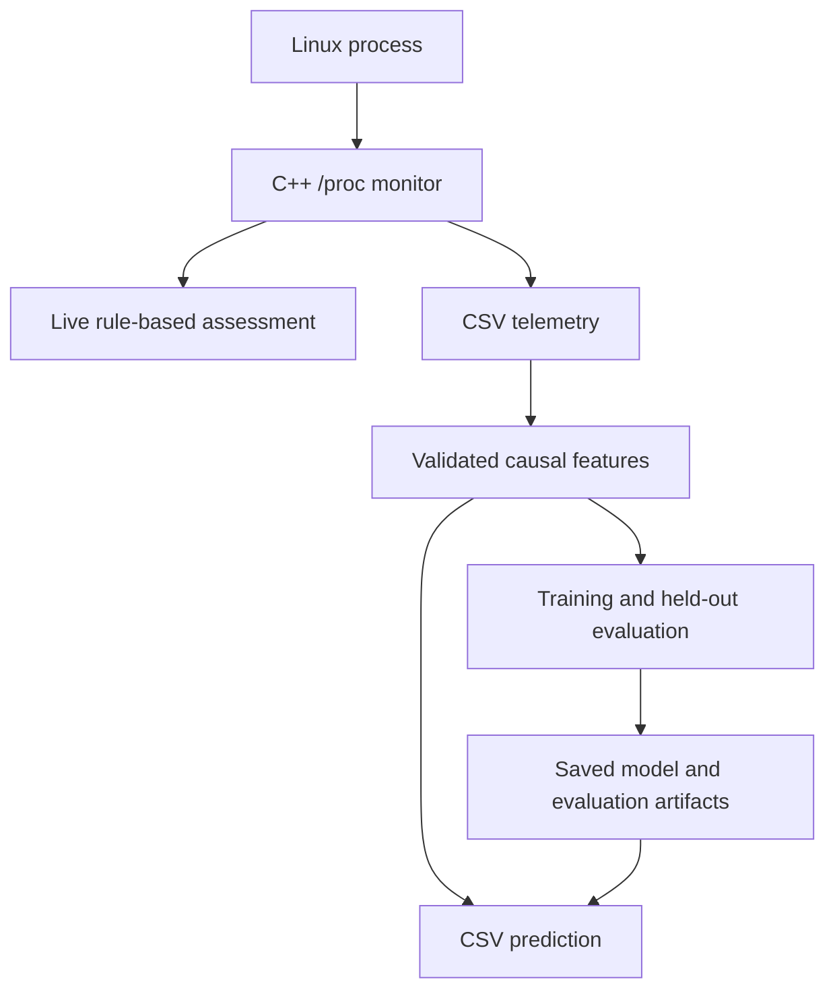
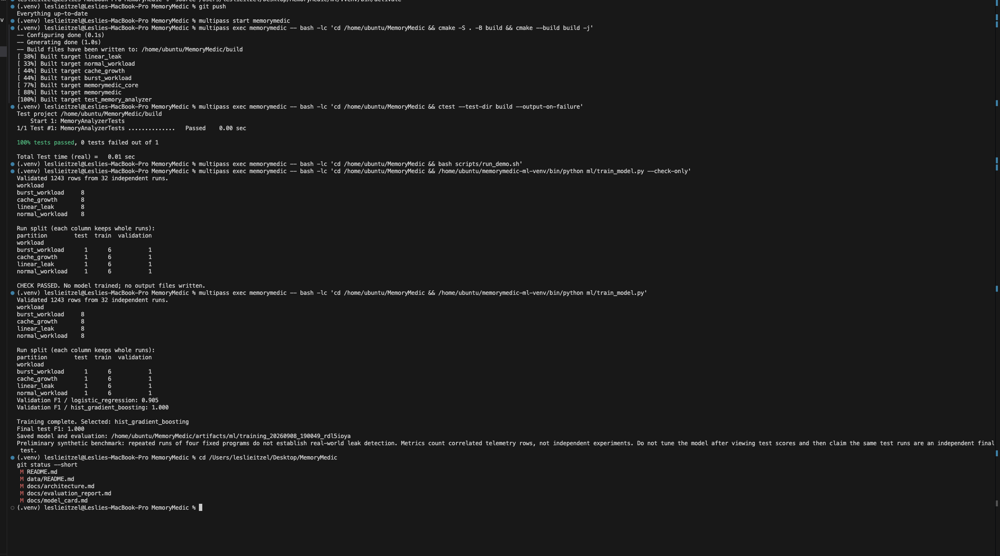

# MemoryMedic

<!-- File: README.md | Author: Leslie Raya | Documentation updated: October 26, 2026 -->

[](https://github.com/leslieraya555/MemoryMedic/actions/workflows/ci.yml)

**Author: Leslie Raya**

MemoryMedic monitors the memory behavior of a Linux process and classifies recorded telemetry as `normal` or `leak`. A C++ application reads Linux `/proc` statistics, estimates recent memory growth, displays a rule-based risk assessment, and writes measurements to CSV. A Python pipeline validates independent workload runs, builds causal features, compares classifiers, and generates predictions from a saved model.

Stable allocation, temporary bursts, and bounded cache growth provide normal examples. Continuous unreleased allocation provides the synthetic leak example. These behaviors make it possible to investigate why growing memory use sometimes indicates a problem and sometimes reflects expected application activity.

**Status:** Experimental prototype evaluated on four controlled synthetic workloads. The September benchmark and October software verification are documented separately. Broader application testing and performance measurements remain future work.

## Contents

- [Capabilities and implementation](#capabilities-and-implementation)
- [Architecture](#architecture)
- [Workloads](#workloads)
- [Repository guide](#repository-guide)
- [Requirements](#requirements)
- [Build and test on Linux](#build-and-test-on-linux)
- [Use Ubuntu from macOS](#use-ubuntu-from-macos)
- [Run the demonstration](#run-the-demonstration)
- [Collect and validate training data](#collect-and-validate-training-data)
- [Train and save a model](#train-and-save-a-model)
- [Generate predictions](#generate-predictions)
- [Features and data quality](#features-and-data-quality)
- [Recorded evaluation](#recorded-evaluation)
- [Verified tests and continuous integration](#verified-tests-and-continuous-integration)
- [Troubleshooting](#troubleshooting)
- [Challenges and lessons](#challenges-and-lessons)
- [Limitations and next experiments](#limitations-and-next-experiments)
- [Documentation and author](#documentation-and-author)

## Capabilities and implementation

| Capability | Current implementation |
| --- | --- |
| Process monitoring | Monitor one selected Linux PID per invocation. |
| Memory measurements | RSS, virtual memory, peak RSS, and thread count from `/proc/<pid>/status`. |
| Page-fault measurements | Cumulative minor/major faults from `/proc/<pid>/stat`, converted to rates. |
| Live assessment | C++ regression slope and growth stability produce a heuristic score and risk category. |
| Telemetry storage | Timestamped CSV rows with a label and `run_id`. |
| Training data | Separate executions of four controlled workload programs. |
| Feature engineering | Twelve numerical inputs with rolling calculations isolated by run. |
| Model comparison | Logistic regression and histogram-based gradient boosting, selected by validation F1. |
| Evaluation | Complete runs assigned to training, validation, and held-out test partitions. |
| Prediction | Python loads a trusted saved model and adds probabilities and labels to telemetry rows. |
| Automation | C++ tests, 21 Python regression tests, Python syntax/import checks, and shell syntax checks in GitHub Actions. |

The C++ risk score and Python classifier are separate assessments. The live C++ monitor does not load the Python model. eBPF collection, a web dashboard, and automatic remediation are proposed extensions.

## Architecture



`ProcReader` collects snapshots, `MemoryMedic` calculates rates and coordinates the loop, and `MemoryAnalyzer` examines a bounded recent history. `RiskAssessment` holds the result, while `TelemetryLogger` writes measurements and metadata. Python handles feature engineering, model selection, evaluation, persistence, and later inference.

## Workloads

| Program | Controlled behavior | Label |
| --- | --- | --- |
| `NormalWorkload.cpp` | Allocates approximately 64 MiB once and repeatedly accesses it. | `normal` |
| `BurstWorkload.cpp` | Allocates approximately 256 MiB temporarily, releases it, and repeats. | `normal` |
| `CacheGrowth.cpp` | Adds approximately 8 MiB per second for 16 allocations, then holds a bounded cache. | `normal` |
| `LinearLeak.cpp` | Retains approximately 1 MiB every 500 ms without deleting the blocks. | `leak` |

The leak workload deliberately models sustained unbounded allocation. Telemetry classification does not identify an allocation site or prove that an arbitrary program has lost references to memory. The demonstration and collection scripts limit the duration of these test processes.

## Repository guide

| Path | Purpose |
| --- | --- |
| `README.md` | Overview, setup, operation, testing, and result interpretation. |
| `START_HERE.md` | Instructions for applying and verifying the documentation update. |
| `data/README.md` | Dataset organization, labels, and collection guidance. |
| `include/memorymedic/` | C++ public interfaces and sample/result structures. |
| `src/` | Process reading, analysis, logging, orchestration, and CLI implementation. |
| `workloads/` | Four controlled memory behaviors. |
| `tests/test_memory_analyzer.cpp` | Eight analyzer/risk-text scenarios in one registered CTest suite. |
| `ml/feature_engineering.py` | Strict validation and per-run causal features. |
| `ml/train_model.py` | Completed-batch loading, grouped partitioning, training, evaluation, and artifacts. |
| `ml/predict_csv.py` | Saved-model prediction for a telemetry CSV. |
| `ml/tests/test_ml_pipeline.py` | Twenty-one Python regression tests. |
| `ml/requirements.txt` | Supported dependency ranges. |
| `scripts/run_demo.sh` | Short demonstration that produces four CSVs and workload logs. |
| `scripts/collect_dataset.sh` | Longer independent runs with manifests and completion markers. |
| `docs/` | Architecture, evaluation, model card, interview guide, and verification image. |
| `.github/workflows/ci.yml` | GitHub Actions workflow. |

Build output, completed collector batches, virtual environments, and training artifacts are excluded through `.gitignore`. Generated demonstration directories can still appear in `git status`; review paths before staging changes.

## Requirements

- Linux with the `/proc` filesystem and permission to read the selected process.
- CMake 3.20 or newer and a C++17 compiler.
- Python and the packages in `ml/requirements.txt`.
- Git for cloning and version control.

CI uses Python 3.12. The saved September training reports record Python 3.14.4 and their exact package versions. Dependency ranges are suitable for installation but do not guarantee identical numerical results across environments. Use the recorded environment when reproducing a historical artifact, particularly when loading a scikit-learn model.

## Build and test on Linux

Run these commands in a Linux terminal. For the existing macOS/Multipass setup, enter Ubuntu using the next section first.

For a fresh clone:

```bash
git clone https://github.com/leslieraya555/MemoryMedic.git
cd MemoryMedic
```

Install the build tools and Python environment support if they are missing. On Ubuntu:

```bash
sudo apt-get update
sudo apt-get install -y build-essential cmake git python3 python3-venv python3-pip
```

Configure, build, and run the C++ tests:

```bash
cmake -S . -B build -DCMAKE_BUILD_TYPE=Release -DBUILD_TESTING=ON
cmake --build build --parallel 2
ctest --test-dir build --output-on-failure
./build/memorymedic --help
```

Create the Python environment outside the repository, which is particularly useful when the repository is mounted from macOS:

```bash
python3 -m venv "$HOME/memorymedic-ml-venv"
source "$HOME/memorymedic-ml-venv/bin/activate"
python -m pip install --upgrade pip
python -m pip install -r ml/requirements.txt
```

Run the Python regression suite from the repository root:

```bash
python -m unittest discover -s ml/tests -p 'test_*.py' -v
```

The verified suite contains 21 tests and ends with `OK` when they pass. These tests use temporary synthetic fixtures rather than the historical benchmark dataset. CTest reports one registered suite, `MemoryAnalyzerTests`, containing eight C++ test scenarios.

## Use Ubuntu from macOS

The following commands assume an existing Multipass instance named `memorymedic` and a project copy or mount at `/home/ubuntu/MemoryMedic`.

In the **Mac terminal**:

```bash
multipass start memorymedic
multipass shell memorymedic
```

Once the prompt begins with `ubuntu@memorymedic`, run:

```bash
cd /home/ubuntu/MemoryMedic
source /home/ubuntu/memorymedic-ml-venv/bin/activate
```

If that environment does not exist, create it using the Python setup commands above. A Mac project folder and an Ubuntu project folder are the same files only when an appropriate mount is configured; otherwise changes must be transferred or committed and pulled between the copies.

The remaining operational commands run inside Ubuntu. Enter `exit` to return to the Mac terminal.

## Run the demonstration

From the Linux repository root after building:

```bash
bash scripts/run_demo.sh
```

The default demonstration runs each workload for 25 seconds, uses a 500 ms sampling interval, and configures an eight-sample analysis window. Allow approximately two minutes for all four workloads and startup/shutdown time.

Optional arguments set the duration, sampling interval, and analysis window:

```bash
bash scripts/run_demo.sh 25 500 8
```

Output is written to a newly timestamped `data/demo_<timestamp>/` directory containing `normal_workload.csv`, `burst_workload.csv`, `cache_growth.csv`, `linear_leak.csv`, and workload logs. The script prints the output path. Inspect the CSVs before using them for predictions; a non-empty file alone does not prove that every measurement is valid.

To monitor another process, view the supported options:

```bash
./build/memorymedic monitor --help
```

Supply a live PID, a unique output file and run ID, and label unfamiliar applications `unknown` rather than inventing training labels.

## Collect and validate training data

The trainer requires **at least five completed independent runs of each workload**. On a fresh clone, collect five repetitions:

```bash
bash scripts/collect_dataset.sh 5 40
```

This requests 20 total runs at 40 seconds each: approximately 14 minutes including overhead. Existing completed batches can contribute additional runs. The collector accepts 1–20 repetitions and 40–300 seconds per run, so a smaller collection is valid even when it is insufficient for training by itself.

Each collection contains:

| Entry | Contents |
| --- | --- |
| `raw/` | One original telemetry CSV per independent execution. |
| `logs/` | Workload and monitor output. |
| `runs.csv` | File names, run IDs, labels, workloads, sample counts, and durations. |
| `COMPLETE.txt` | Created after all planned runs finish and pass collection checks. |

Validate completed batches without training:

```bash
python ml/train_model.py --check-only
```

Successful validation ends with:

```text
CHECK PASSED. No model trained; no output files written.
```

The loader checks raw CSVs against the manifest, skips incomplete batches, and rejects malformed or invalid data. Training discovers `data/collection_*/raw/*.csv` by default. Short `data/demo_*` runs and the older top-level example CSVs are separate from this training input.

## Train and save a model

After successful dataset validation:

```bash
python ml/train_model.py
```

Training assigns complete runs to partitions within each workload, fits both candidates on training runs, selects by validation F1, and refits the selected model on training plus validation runs. It then evaluates that model on the held-out test runs. Test data is excluded from fitting and candidate selection.

For eight runs per workload, the split is six training, one validation, and one test run. Counts change with dataset size; the code reserves `max(1, runs_per_workload // 5)` runs each for validation and test. A fixed seed makes a split repeatable for the same input run identities.

Each completed training directory under `artifacts/ml/` contains:

| File | Purpose |
| --- | --- |
| `memorymedic_model.joblib` | Fitted model, feature names, decision threshold, and metadata. |
| `evaluation.json` | Selection results, test metrics, versions, source hashes, and partition information. |
| `splits.csv` | Exact input run identities, source CSV checksums, and partition assignments. |
| `requirements-used.txt` | Package versions from that training environment. |
| `COMPLETE.txt` | Marker written after the training outputs finish successfully. |

New collections and retraining create a new experiment. Their row counts and scores may differ from the historical results below. Keep the original evaluation and split records when comparing experiments.

## Generate predictions

Use the activated Python environment from the repository root. The following command selects the most recently modified completed training directory and the newest generated demonstration directory, then displays recent predictions for all four workloads:

```bash
python - <<'PY'
from pathlib import Path
import subprocess
import sys

models = [
    path for path in Path("artifacts/ml").glob("training_*")
    if (path / "COMPLETE.txt").is_file()
    and (path / "memorymedic_model.joblib").is_file()
]
demos = [path for path in Path("data").glob("demo_*") if path.is_dir()]
if not models or not demos:
    raise SystemExit("Complete model training and run the demonstration first.")

model = max(models, key=lambda path: path.stat().st_mtime_ns) / "memorymedic_model.joblib"
demo = max(demos, key=lambda path: path.stat().st_mtime_ns)
for workload in ("normal_workload", "burst_workload", "cache_growth", "linear_leak"):
    csv_path = demo / f"{workload}.csv"
    if not csv_path.is_file():
        raise SystemExit(f"Missing demonstration CSV: {csv_path}")
    print(f"\n{workload}: {csv_path}", flush=True)
    subprocess.run([
        sys.executable, "ml/predict_csv.py", "--model", str(model),
        "--rows", "10", str(csv_path),
    ], check=True)
PY
```

Prediction adds `ml_leak_probability` and `ml_prediction`. The saved threshold defaults to 0.50: probabilities at or above the threshold produce `leak`. `--rows` changes the number of recent rows displayed; it does not restrict which input rows are validated and classified. The CLI also supports `--out` for saving results.

The displayed probabilities are model scores and have not been calibrated for real production applications. Load only trusted joblib artifacts. Preserve a compatible dependency environment for saved models.

## Features and data quality

The feature schema is `2-strict-per-run`:

| Feature | Meaning |
| --- | --- |
| `rss_kb` | Resident memory from `VmRSS`. |
| `virtual_memory_kb` | Virtual address-space size from `VmSize`. |
| `peak_rss_kb` | Peak resident memory from `VmHWM`. |
| `threads` | Current thread count. |
| `rss_growth_kb_s` | Regression slope over the C++ analyzer's recent window. |
| `minor_faults_s` | Minor page faults per second between samples. |
| `major_faults_s` | Major page faults per second between samples. |
| `rss_delta` | RSS difference from the preceding sample in the same run. |
| `rss_mean_10` | Mean of the current and up to nine preceding RSS observations. |
| `rss_std_10` | Sample standard deviation within that rolling window. |
| `vm_to_rss_ratio` | Virtual memory divided by RSS. |
| `fault_ratio` | Major-fault rate divided by total minor-plus-major fault rate; zero when both rates are zero. |

Memory fields retain the Linux `kB` scale, conventionally 1,024-byte units. The rolling window contains ten observations; its elapsed duration depends on sampling frequency. Early observations use the available history. The first RSS delta and an unavailable early standard deviation are initialized to zero.

Invalid raw measurements, missing fields, duplicate timestamps within a run, and non-finite values are rejected. Raw invalid measurements are not silently repaired with zeros. Rolling features use current and preceding observations in the same run. Labels, workload names, run IDs, heuristic risk scores, and targets are excluded from model inputs.

## Recorded evaluation

The September 2026 benchmark used **1,243 telemetry rows from 32 independent executions**, with eight runs of each workload. All runs came from the four controlled programs.

| Partition | Independent runs | Telemetry rows |
| --- | ---: | ---: |
| Training | 24 | 933 |
| Validation | 4 | 154 |
| Test | 4 | 156 |

| Candidate | Validation F1 |
| --- | ---: |
| Logistic regression | 0.904762 |
| Histogram-based gradient boosting | 1.000000 |

The selected gradient-boosting model produced the following aggregate test results at threshold 0.50:

| Metric | Recorded value |
| --- | ---: |
| Accuracy, precision, recall, and F1 | 1.000 each |
| Average precision and ROC AUC | 1.000 each |
| True negatives / true positives | 117 / 39 |
| False positives / false negatives | 0 / 0 |

These scores describe additional executions of the same fixed programs. They do not establish detection performance on unfamiliar applications. The rows within a run are correlated; there are four independent test executions, not 156 independent experiments. Repeated training using the same held-out runs does not create another independent benchmark.

See [the evaluation report](docs/evaluation_report.md) for methods, the confusion matrix, verification evidence, and unresolved measurements.

## Verified tests and continuous integration

On October 23, 2026, the 21-test Python suite passed locally and the updated [CI run for commit `d71ad06`](https://github.com/leslieraya555/MemoryMedic/actions/runs/40029177958) completed successfully.

| GitHub Actions job | Checks |
| --- | --- |
| C++ Build and Tests | Configure and compile with CMake, run CTest, and check executable help. |
| Python Validation | Install dependencies, run all 21 regression tests, compile Python syntax, and import ML modules. |
| Shell Script Validation | Run `bash -n` on the collector and demonstration scripts. |

Python tests cover causal rolling calculations, separation between runs, strict input/manifest validation, reproducible grouped partitions, metric calculations, probability bounds, model serialization, and the exclusion of test data from model selection and fitting. The last check changes only test inputs/labels and verifies that the fitted model and selection remain unchanged.

Shell syntax checks do not execute the workloads. CI does not rerun the historical benchmark or measure production detection accuracy, monitoring overhead, or detection latency. Manual demonstration and prediction checks provide separate functional evidence.

Historical C++ build, dataset validation, training, and evaluation output:



The image predates the October Python regression tests. The linked Actions run records the newer automated checks.

## Troubleshooting

| Symptom | What to check |
| --- | --- |
| `/proc` is unavailable | Run the monitor inside Linux; on macOS enter the configured Ubuntu instance. |
| `cmake` is missing | Install the Ubuntu build dependencies listed above. |
| `python` is not found | Activate the Ubuntu virtual environment or use its full interpreter path. |
| `Start directory is not importable` or zero tests run | Confirm `ml/tests/test_ml_pipeline.py` exists in the Ubuntu project copy and run discovery from the repository root. Zero discovered tests does not verify the pipeline. |
| A workload executable is missing | Complete the CMake build before running collection or demonstration scripts. |
| No usable collections or too few runs | Use the collector and obtain at least five completed runs of every workload. Keep its raw files, manifest, and completion marker together. |
| Prediction rejects zero RSS or another invalid row | Preserve the original file, inspect the collector/process logs, and collect a fresh run. The strict validator intentionally reports invalid input. |
| A saved model cannot be loaded | Check the exact artifact path and the recorded Python/package environment. |
| `git push` says `Everything up-to-date` after editing | Save the file, inspect `git status`, stage intended files, and create a commit before pushing. |

## Challenges and lessons

- **Linux telemetry from a Mac:** Multipass supplied the Linux environment needed for `/proc` access.
- **Environment separation:** Keeping the Python environment outside the mounted repository avoided shared-filesystem environment problems.
- **Independent experiments:** More workload executions were needed before separate training, validation, and test groups were possible.
- **Misleading data splits:** Grouping complete `run_id` values prevented neighboring samples from appearing across partitions.
- **Invalid telemetry:** Strict rejection preserved evidence of bad measurements instead of disguising them as valid zeros.
- **Reproducibility:** Manifests, source/data hashes, split records, and dependency versions make recorded results easier to audit.
- **Interpreting perfect scores:** Strong results on a small synthetic dataset motivate broader evaluation rather than a production-reliability claim.

## Limitations and next experiments

Current evidence covers one synthetic leak implementation, three normal implementations, and a single grouped benchmark. There is no grouped k-fold implementation, measured performance budget, calibrated production probability, or evaluation on unfamiliar real applications.

Useful next experiments are additional leak implementations, slower growth rates, longer sessions, unfamiliar normal applications, monitoring overhead measurements, and detection latency. Grouped cross-validation can assess variation on development runs while retaining a separate final test set. A change to sampling interval or feature definitions requires new compatibility and evaluation checks.

Proposed infrastructure use, including banking services, would begin in staging with approved process telemetry and developer-reviewed alerts. Operational deployment, service restarts, container support, central dashboards, and eBPF collection require additional implementation and validation.

## Documentation and author

| Document | Contents |
| --- | --- |
| [Architecture](docs/architecture.md) | Component responsibilities and data flow. |
| [Evaluation report](docs/evaluation_report.md) | Historical model evaluation and October software verification. |
| [Model card](docs/model_card.md) | Intended use, inputs, outputs, and limitations. |
| [Interview guide](docs/interview_guide.md) | Technical explanations, verified results, and discussion questions. |
| [Dataset README](data/README.md) | Dataset files, labels, and organization. |
| [Documentation update guide](START_HERE.md) | Saving, reviewing, committing, and verifying these documents. |

**Leslie Raya** — [GitHub](https://github.com/leslieraya555) · [Repository](https://github.com/leslieraya555/MemoryMedic)