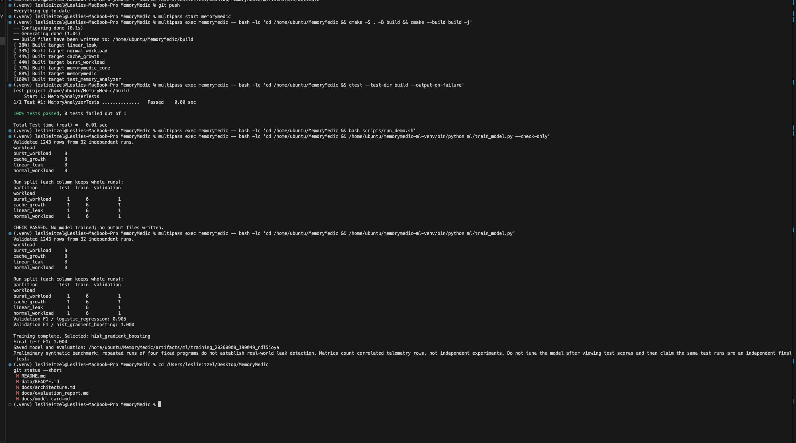
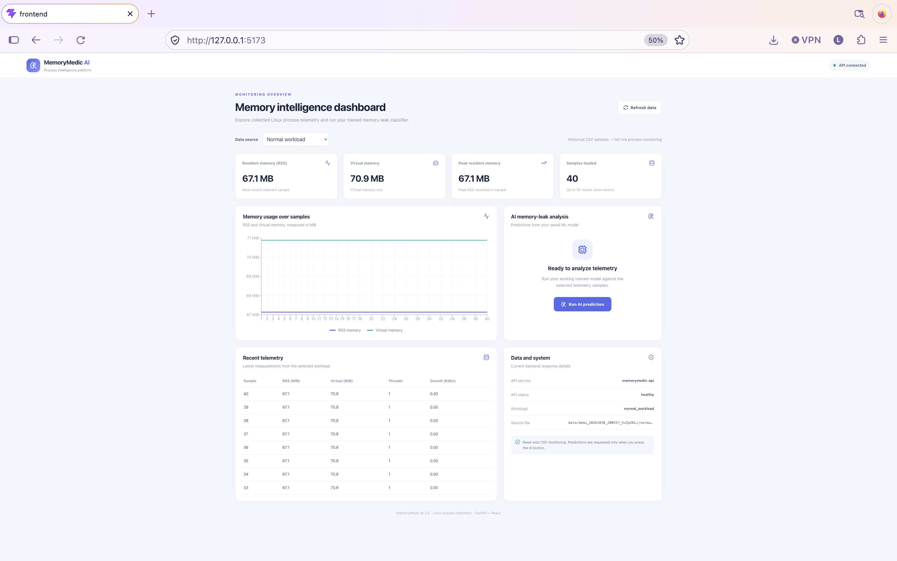
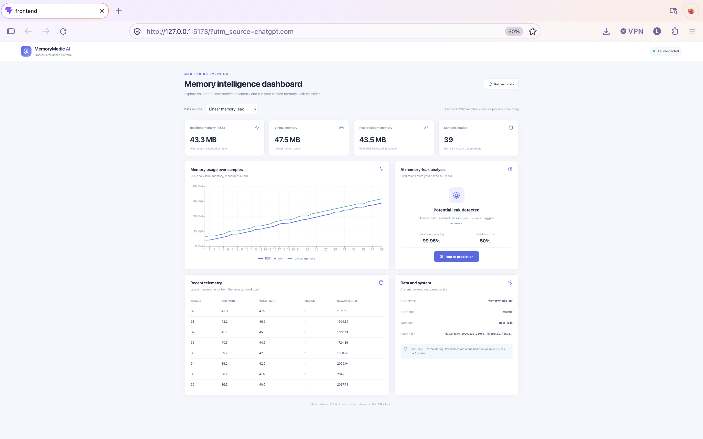
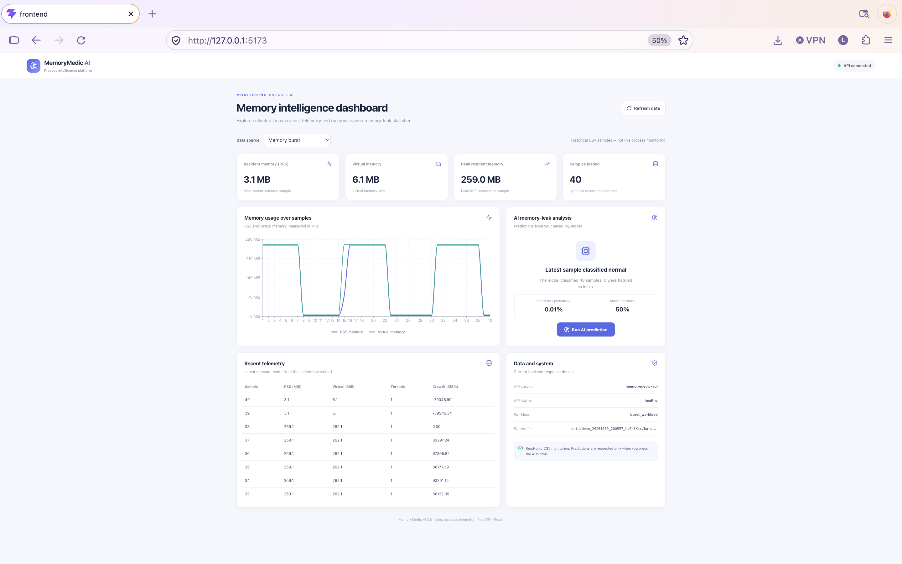
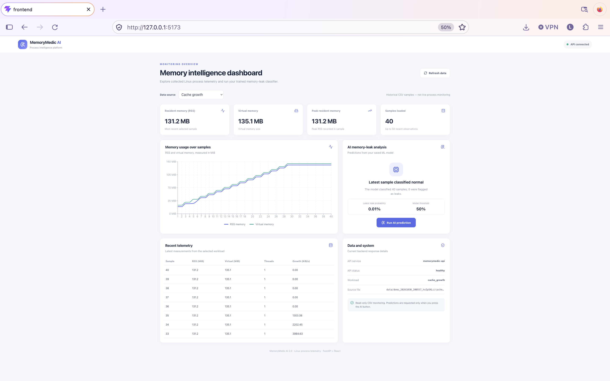

# MemoryMedic AI 2.0 — Evaluation and Verification Report

**Author:** Leslie Raya
**Project:** MemoryMedic / MemoryMedic AI 2.0
**Report Updated:** November 3, 2026
**Historical Model Benchmark:** September 2026
**Software Verification:** October 23–November 3, 2026
**Repository:** [MemoryMedic on GitHub](https://github.com/leslieraya555/MemoryMedic)

---

## Executive Summary

MemoryMedic is a Linux-based process-memory monitoring and machine-learning system designed to detect patterns associated with abnormal memory growth and potential memory leaks.

The project integrates:

- C++ process monitoring and Linux `/proc` telemetry.
- Automated telemetry collection and CSV validation.
- Python feature engineering and supervised machine learning.
- Model training, evaluation, and serialized model persistence.
- A FastAPI backend with historical telemetry and prediction endpoints.
- A React dashboard with memory visualization and AI predictions.
- Automated testing and GitHub Actions continuous integration.

MemoryMedic AI 2.0 builds on the original C++ monitoring and machine-learning pipeline by adding an interactive API and dashboard.

### Key Verified Results

| Component | Result |
|---|---|
| Historical dataset | 1,243 telemetry observations |
| Independent monitoring runs | 32 |
| Synthetic workload types | 4 |
| Training runs | 24 |
| Validation runs | 4 |
| Held-out test runs | 4 |
| Selected ML model | Histogram-based gradient boosting |
| Historical held-out accuracy | 100% |
| Historical held-out precision | 100% |
| Historical held-out recall | 100% |
| Historical held-out F1-score | 1.000 |
| Original Python regression tests | 21 passed |
| MemoryMedic AI 2.0 backend tests | 13 passed |
| Frontend production build | Successful |
| API prediction demonstration | Successful |
| GitHub Actions | Successful checks observed |

**Overall assessment:** MemoryMedic AI 2.0 is a functioning research and portfolio prototype with verified components and an integrated monitoring dashboard.

The perfect historical classification results apply only to the controlled synthetic test dataset. They should not be interpreted as proof of perfect memory-leak detection in unfamiliar production software.

---

# 1. Evaluation Objectives

The primary objective of this evaluation is to assess the correctness, performance, reproducibility, and integration of the MemoryMedic system.

The evaluation addresses five questions:

1. Can MemoryMedic collect and validate Linux process-memory telemetry?
2. Can its machine-learning classifier distinguish normal memory behaviors from the included synthetic leak behavior?
3. Can the FastAPI backend load the trained model and return predictions?
4. Can the React dashboard retrieve telemetry, visualize memory behavior, and display model predictions?
5. Can the system's components be tested automatically and verified through GitHub Actions?

The evaluation separates **machine-learning performance** from **software functionality**.

Successful software tests demonstrate that implemented components behave as expected under tested conditions. They do not independently establish the accuracy of a trained machine-learning model.

# 2. System Architecture

MemoryMedic follows a modular architecture separating operating-system monitoring, feature engineering, machine learning, API services, and frontend visualization.

## 2.1 High-Level Architecture

```text
              MEMORYMEDIC AI 2.0
           Process Intelligence System

                 Linux Process
                       |
                       v
              Linux /proc Filesystem
                       |
                       v
                C++ ProcReader
                       |
                       v
               MemoryAnalyzer
                       |
             +---------+---------+
             |                   |
             v                   v
       RiskAssessment      TelemetryLogger
             |                   |
             v                   v
       Risk Information       CSV Dataset
                                 |
                                 v
                         Data Validation
                                 |
                                 v
                       Feature Engineering
                                 |
                                 v
                         Model Training
                                 |
                      +----------+----------+
                      |                     |
                      v                     v
                Evaluation Results    Saved ML Model
                                            |
                                            v
                                       FastAPI
                                            ^
                                            |
                            +---------------+--------------+
                            |                              |
                            v                              v
                     Telemetry API                   Prediction API
                            ^                              ^
                            |                              |
                            +---------------+--------------+
                                            |
                                            v
                                    React Dashboard
                                            |
                      +---------------------+----------------+
                      |                     |                |
                      v                     v                v
                 Memory Charts       AI Predictions     System Status
```

## 2.2 Architectural Responsibilities

| Component | Responsibility |
|---|---|
| Linux `/proc` | Provides process-memory statistics |
| `ProcReader` | Reads memory and process measurements |
| `MemoryAnalyzer` | Calculates memory-growth behavior |
| `RiskAssessment` | Produces rule-based risk information |
| `TelemetryLogger` | Records measurements to CSV |
| `feature_engineering.py` | Validates telemetry and creates ML features |
| `train_model.py` | Trains and evaluates classifiers |
| `predict_csv.py` | Performs offline inference on telemetry |
| FastAPI | Exposes telemetry and prediction endpoints |
| React | Provides the graphical dashboard |
| Recharts | Visualizes historical measurements |
| GitHub Actions | Automates configured validation workflows |

The original monitoring component operates on Linux.

The current React dashboard displays collected historical CSV measurements rather than continuously streaming live measurements from arbitrary processes.

# 3. Dataset and Experimental Design

## 3.1 Synthetic Workload Categories

The historical benchmark uses four controlled workloads.

| Workload | Behavior | Label | Independent Runs |
|---|---|---|---:|
| `normal_workload` | Maintains approximately 64 MiB of memory | Normal | 8 |
| `burst_workload` | Temporarily allocates approximately 256 MiB and releases it | Normal | 8 |
| `cache_growth` | Adds sixteen approximately 8 MiB cache entries before stabilizing | Normal | 8 |
| `linear_leak` | Retains approximately 1 MiB every 500 ms | Leak | 8 |
| **Total** | | | **32** |

The normal, burst, and cache workloads provide examples of legitimate memory behavior.

The linear leak workload provides a controlled positive example of sustained memory retention.

These workloads are useful for prototype validation because their intended behavior is known.

However, they do not cover every memory-allocation pattern found in production applications.

## 3.2 Dataset Summary

| Property | Recorded Value |
|---|---:|
| Total telemetry observations | 1,243 |
| Total independent executions | 32 |
| Workload implementations | 4 |
| Normal workload implementations | 3 |
| Leak workload implementations | 1 |
| Runs per implementation | 8 |

Each monitoring execution has a unique `run_id`.

Measurements from the same execution are treated as a group during dataset partitioning.

## 3.3 Dataset Structure

Collected datasets are organized into completed collection directories.

```text
data/
└── collection_<identifier>/
    ├── raw/
    │   ├── workload_run_01.csv
    │   ├── workload_run_02.csv
    │   └── ...
    ├── logs/
    ├── runs.csv
    └── COMPLETE.txt
```

The directory shown above illustrates the structure. Actual generated filenames depend on the collection.

The collection manifest records information such as run identities, workload labels, sample counts, and durations.

The completion marker identifies a successfully completed collection batch.

# 4. Data Collection and Validation

## 4.1 Collected Telemetry

MemoryMedic collects measurements from Linux process statistics.

Important measurements include:

| Measurement | Description |
|---|---|
| `timestamp_ms` | Measurement timestamp |
| `rss_kb` | Resident memory in kilobytes |
| `virtual_memory_kb` | Virtual memory in kilobytes |
| `peak_rss_kb` | Peak resident memory |
| `threads` | Number of threads |
| `rss_growth_kb_s` | Estimated RSS growth rate |
| `minor_faults_s` | Minor page-fault rate |
| `major_faults_s` | Major page-fault rate |
| `run_id` | Monitoring execution identifier |

These measurements provide inputs for subsequent feature engineering.

## 4.2 Data Validation

The validation pipeline checks for:

- Missing required columns.
- Duplicate column names.
- Invalid or non-finite numerical values.
- Missing or blank run identifiers.
- Duplicate timestamps within a run.
- Invalid memory and thread measurements.
- Inconsistent labels and run identities.
- Collection-manifest inconsistencies.
- Invalid durations or incomplete collections.

Invalid raw measurements are rejected rather than silently replaced with arbitrary values.

This protects the model from certain forms of malformed telemetry and helps preserve the integrity of the original measurements.

**Result:** The historical training pipeline produced a validated dataset containing 1,243 observations from 32 independent monitoring runs.

# 5. Feature Engineering

MemoryMedic uses a causal feature-engineering pipeline.

Features are calculated using the current observation and preceding observations from the same run.

The feature schema is:

`2-strict-per-run`

## 5.1 Model Features

The classifier uses 12 numerical features.

| Feature | Description |
|---|---|
| `rss_kb` | Current resident memory |
| `virtual_memory_kb` | Current virtual-memory size |
| `peak_rss_kb` | Peak resident memory |
| `threads` | Active thread count |
| `rss_growth_kb_s` | Recent estimated RSS growth rate |
| `minor_faults_s` | Minor page-fault rate |
| `major_faults_s` | Major page-fault rate |
| `rss_delta` | Change in RSS since previous observation |
| `rss_mean_10` | Rolling RSS average over up to ten observations |
| `rss_std_10` | Rolling RSS sample standard deviation |
| `vm_to_rss_ratio` | Virtual-to-resident memory ratio |
| `fault_ratio` | Major-fault rate divided by total fault rate |

## 5.2 Feature Calculation

For each run, observations are sorted by timestamp.

The model then calculates derived features.

Examples include:

**RSS difference**

```text
rss_delta =
    current_rss - previous_rss
```

**Virtual-to-resident memory ratio**

```text
vm_to_rss_ratio =
    virtual_memory_kb / rss_kb
```

**Page-fault ratio**

```text
fault_ratio =
    major_faults_s /
    (minor_faults_s + major_faults_s)
```

When total page-fault activity is zero, the defined derived ratio is zero.

Rolling calculations use up to ten observations, not necessarily ten seconds of data.

## 5.3 Data Leakage Prevention

The following fields are excluded from model inputs:

- Run identifiers.
- Workload names.
- Labels.
- Target variables.
- Existing heuristic risk scores.

Features are calculated within their individual runs.

This reduces the risk of accidentally exposing labels or measurements from other executions to the classifier.

# 6. Dataset Partitioning

The historical dataset uses grouped training, validation, and test partitions.

The split preserves complete monitoring executions.

## 6.1 Partition Results

| Partition | Runs | Rows |
|---|---:|---:|
| Training | 24 | 933 |
| Validation | 4 | 154 |
| Test | 4 | 156 |
| **Total** | **32** | **1,243** |

Each workload contributes:

- Six training runs.
- One validation run.
- One test run.

The recorded random seed is `42`.

## 6.2 Partitioning Method

Run-level grouping prevents observations from the same monitoring execution from appearing in both training and testing.

The evaluation follows this procedure:

1. Validate all eligible collected runs.
2. Assign complete runs to training, validation, and test partitions.
3. Train candidate classifiers on the training partition.
4. Select the classifier using validation F1.
5. Refit the selected configuration on training and validation data.
6. Evaluate once on the held-out test partition.

**Important:** This procedure is grouped holdout evaluation. It is not k-fold cross-validation.

# 7. Machine-Learning Models

Two supervised classification models were evaluated.

## 7.1 Logistic Regression

Logistic regression serves as the baseline.

The implementation uses:

- Standardized numerical features.
- Balanced class weights.
- A fixed random seed.
- A maximum iteration limit.

It provides a relatively interpretable baseline for comparing more complex classification models.

## 7.2 Histogram-Based Gradient Boosting

Histogram-based gradient boosting can model nonlinear relationships and interactions among telemetry features.

The historical implementation uses fixed training settings, including:

```text
learning_rate = 0.06
max_iter = 200
max_leaf_nodes = 15
l2_regularization = 1.0
early_stopping = False
random_state = 42
```

## 7.3 Model Selection Results

| Model | Validation F1 | False Positives | False Negatives |
|---|---:|---:|---:|
| Logistic Regression | 0.904762 | 7 | 1 |
| Histogram-Based Gradient Boosting | **1.000000** | **0** | **0** |

The histogram-based gradient boosting classifier achieved the higher validation F1 score.

It was selected for final fitting and evaluation.

**Selected model:** Histogram-Based Gradient Boosting Classifier.

# 8. Historical Model Evaluation

The selected classifier was evaluated on 156 held-out telemetry observations from four independent executions.

The classification threshold was `0.50`.

## 8.1 Evaluation Metrics

| Metric | Result |
|---|---:|
| Accuracy | **1.000** |
| Precision | **1.000** |
| Recall | **1.000** |
| F1-score | **1.000** |
| Average Precision | **1.000** |
| ROC AUC | **1.000** |
| False Positive Rate | **0.000** |
| False Negative Rate | **0.000** |

These scores are taken from the recorded historical synthetic evaluation.

## 8.2 Confusion Matrix

| Actual / Predicted | Normal | Leak |
|---|---:|---:|
| Normal | 117 | 0 |
| Leak | 0 | 39 |

### Confusion Matrix Interpretation

| Classification Outcome | Count |
|---|---:|
| True Negatives | 117 |
| True Positives | 39 |
| False Positives | 0 |
| False Negatives | 0 |

All 156 held-out telemetry observations were classified correctly.

The test partition contained 117 normal observations and 39 leak observations.

## 8.3 Results by Workload

| Workload | Actual Label | Correct Predictions |
|---|---|---:|
| `normal_workload` | Normal | 39/39 |
| `burst_workload` | Normal | 39/39 |
| `cache_growth` | Normal | 39/39 |
| `linear_leak` | Leak | 39/39 |

Each workload's test subset contains observations from one execution.

The observations are correlated. They should not be treated as 156 independent experiments.

## 8.4 Interpretation

The results demonstrate that the model classified all recorded observations in the held-out synthetic test partition correctly.

However:

- Only four independent test executions were evaluated.
- The test programs were already represented by other executions during training.
- Only one leak-style implementation was included.
- The dataset does not establish performance on unrelated real applications.

The historical result supports the feasibility of the implemented prototype, not a claim of universally perfect detection.

# 9. Historical Functional Verification

Additional verification was performed in October 2026.

These checks exercised the original MemoryMedic monitoring and prediction pipeline.

| Test | Recorded Result |
|---|---|
| Linux CMake build | Passed |
| Registered C++ tests | Passed |
| Normal workload CSV generation | Successful |
| Burst workload CSV generation | Successful |
| Cache-growth CSV generation | Successful |
| Linear-leak CSV generation | Successful |
| Normal-workload prediction smoke test | Expected normal classification |
| Burst-workload prediction smoke test | Expected normal classification |
| Cache-growth prediction smoke test | Expected normal classification |
| Linear-leak prediction smoke test | Expected leak classification |
| Python regression suite | 21 passed |

The prediction smoke tests confirmed that a saved model could be loaded and used to classify newly generated demonstration telemetry.

These checks were not a separately designed independent benchmark.

# 10. Original Python Regression Testing

The original regression suite includes 21 test methods.

| Test Category | Tests | Result |
|---|---:|---|
| Feature engineering | 11 | Passed |
| Grouped dataset partitioning | 4 | Passed |
| CSV and dataset validation | 3 | Passed |
| Metrics and model persistence | 3 | Passed |
| **Total** | **21** | **Passed** |

The tests cover behavior including:

- Correct feature calculations.
- Causal rolling features.
- Run-boundary isolation.
- Rejection of invalid measurements.
- Grouped data splitting.
- Reproducibility of partition assignments.
- Model persistence.
- Test-data isolation.

These tests verify implemented behaviors using synthetic fixtures.

No numerical source-code coverage percentage has been established.

# 11. MemoryMedic AI 2.0 Backend Integration

MemoryMedic AI 2.0 introduces a FastAPI application that exposes the monitoring and machine-learning pipeline through HTTP endpoints.

## 11.1 Backend Architecture

```text
backend/
├── app/
│   ├── __init__.py
│   ├── main.py
│   ├── metrics.py
│   └── predictions.py
├── tests/
│   ├── test_main.py
│   ├── test_metrics.py
│   └── test_predictions.py
└── requirements.txt
```

## 11.2 API Endpoints

| Method | Endpoint | Purpose |
|---|---|---|
| GET | `/` | Retrieve API information |
| GET | `/health` | Check API responsiveness |
| GET | `/api/v1/metrics` | Retrieve historical telemetry |
| POST | `/api/v1/predict` | Generate memory-leak predictions |
| GET | `/docs` | Access Swagger API documentation |

## 11.3 API Verification

The following behaviors were observed during local testing.

| Verification | Result |
|---|---|
| FastAPI documentation loads | Successful |
| Health endpoint responds | Successful |
| Historical metrics endpoint responds | Successful |
| Prediction endpoint returns JSON | Successful |
| Valid prediction request | HTTP 200 |
| Missing required measurements | HTTP 422 |
| Duplicate timestamps | HTTP 422 |
| Missing trained model | HTTP 503 |

## 11.4 Prediction Processing

The prediction endpoint performs the following operations:

1. Receives telemetry measurements.
2. Validates request fields.
3. Converts observations into a pandas DataFrame.
4. Applies the original feature-engineering pipeline.
5. Locates and loads a trusted local trained-model artifact.
6. Verifies the expected feature schema.
7. Generates probabilities using the trained classifier.
8. Applies the saved classification threshold.
9. Returns predictions as JSON.

The returned response includes the model-run identifier, threshold, number of predictions, and individual prediction results.

A missing model produces an error rather than fabricated classification data.

# 12. MemoryMedic AI 2.0 Backend Testing

The updated FastAPI backend was tested locally using `pytest`.

## 12.1 Test Results

```text
================ test session starts ================

Collected 13 items

backend/tests/test_main.py          PASSED
backend/tests/test_metrics.py       PASSED
backend/tests/test_predictions.py   PASSED

================ warnings summary ===================

1 deprecation warning

============== 13 passed, 1 warning ================
```

The output above summarizes the observed test results rather than reproducing the full original terminal log.

## 12.2 Prediction API Tests

The prediction suite checks:

| Test | Expected Result | Observed Result |
|---|---|---|
| Successful inference response | HTTP 200 | Passed |
| Missing required feature | HTTP 422 | Passed |
| Duplicate timestamp | HTTP 422 | Passed |
| Missing saved model | HTTP 503 | Passed |

Some automated tests use a predictable fake estimator to isolate API behavior.

Therefore, these tests establish that the API behaves as expected for those test conditions, not that the actual trained model achieves a new accuracy score.

## 12.3 Testing Conclusion

The 13 passing tests provide evidence that the implemented backend routes, telemetry validation, and prediction-handling behavior work under the tested conditions.

The single deprecation warning does not represent a failed test.

# 13. React Dashboard Implementation

The MemoryMedic AI 2.0 frontend uses React and Vite.

The dashboard communicates with the backend through locally proxied API requests.

## 13.1 Frontend Structure

```text
frontend/
├── public/
├── src/
│   ├── assets/
│   ├── App.jsx
│   ├── App.css
│   ├── index.css
│   └── main.jsx
├── index.html
├── package.json
├── package-lock.json
└── vite.config.js
```

## 13.2 Dashboard Features

The current dashboard provides:

- Backend connectivity status.
- Selection of historical workload data.
- Resident memory summaries.
- Virtual memory summaries.
- Peak resident memory summaries.
- Number of telemetry observations.
- Memory usage visualization.
- Recent telemetry table.
- AI memory-leak predictions.
- Model classification threshold.
- Model-generated leak probabilities.

## 13.3 Historical Telemetry Visualization

The dashboard plots measurements from the selected workload.

The visualized series include:

- Resident memory.
- Virtual memory.

These charts help users inspect trends in the collected process telemetry.

The data represents recorded observations, not an automatically updating live monitor.

# 14. Dashboard Functional Verification

The React dashboard was opened locally at:

`http://127.0.0.1:5173`

The FastAPI backend was available at:

`http://127.0.0.1:8001`

The browser screenshots demonstrate that the dashboard successfully displayed historical telemetry and a model prediction.

## 14.1 Observed Normal-Workload Results

| Measurement | Displayed Result |
|---|---:|
| Selected workload | `normal_workload` |
| Samples analyzed | 40 |
| Latest RSS | Approximately 67.1 MiB |
| Virtual memory | Approximately 70.9 MiB |
| Peak RSS | Approximately 67.1 MiB |
| Latest classification | Normal |
| Latest leak probability | Approximately 0.02% |
| Classification threshold | 50% |
| Samples predicted as leaks | 0 |

## 14.2 Interpretation

The demonstrated normal workload produced stable RSS measurements.

The API classified the submitted observations as normal.

The dashboard displayed:

- The classification result.
- The latest leak probability.
- The model threshold.
- The number of observations classified.

This demonstrates functioning communication among the frontend, backend, and saved model under the tested local conditions.

It does not establish an independently measured false-positive rate, real-world accuracy, or probability calibration.

## 14.3 Dashboard Verification Checklist

- [x] React dashboard renders.
- [x] Backend health status appears.
- [x] Historical telemetry loads.
- [x] Memory summary cards display.
- [x] Memory chart displays.
- [x] Recent telemetry table displays.
- [x] Prediction request completes.
- [x] Prediction results display.
- [x] Frontend production build completes.
- [ ] Add automated browser-based end-to-end tests.
- [ ] Evaluate dashboard behavior with additional independent workloads.
- [ ] Implement and evaluate live monitoring if required.

# 15. Frontend Production Build

The frontend was verified using Vite's production build command.

## 15.1 Command

From the `frontend` directory:

```bash
npm run build
```

## 15.2 Recorded Outcome

The terminal output demonstrated:

```text
vite building client environment for production...

Modules transformed successfully.

Build completed successfully.
```

The build generated the frontend `dist` directory.

The local build demonstrated that the React application could be bundled for production.

This does not independently verify runtime connectivity or production deployment.

## 15.3 Build Warning

One observed build reported that some chunks exceeded Vite's size warning threshold.

The warning did not prevent compilation.

Possible future improvements include:

- Dynamic imports.
- Route-level or component-level code splitting.
- Reducing large dependencies.
- Separating infrequently used UI modules.

These optimizations remain future performance work unless a separate change verifies them.

# 16. Continuous Integration and GitHub Actions

MemoryMedic uses GitHub Actions to execute automated checks.

The project has separate workflows for the original system, backend, and dashboard.

## 16.1 CI Workflows

| Workflow | Primary Responsibility |
|---|---|
| `ci.yml` | C++ builds, Python validation, and shell-script checks |
| `backend-ci.yml` | FastAPI backend syntax and automated tests |
| `frontend-ci.yml` | React dashboard dependency installation and production build |

## 16.2 Backend CI

The backend workflow:

1. Checks out the repository.
2. Sets up Python.
3. Installs the project dependencies.
4. Checks Python syntax.
5. Executes the backend test suite.

The configured test command is:

```bash
python -m pytest backend/tests -v
```

## 16.3 Frontend CI

The dashboard workflow:

1. Checks out the repository.
2. Sets up Node.js.
3. Installs frontend dependencies.
4. Builds the React application.
5. Verifies the build output.

The frontend workflow includes:

```bash
npm ci
npm run build
test -f dist/index.html
```

## 16.4 Observed CI Results

GitHub Actions screenshots demonstrated successful workflow runs for the MemoryMedic core project, FastAPI integration, and dashboard build.

The backend feature branch was also successfully merged into `main` after its checks passed.

Successful CI execution verifies the checks configured in each workflow.

It does not substitute for independent model benchmarking.

**GitHub Actions:**
https://github.com/leslieraya555/MemoryMedic/actions

# 17. Reproducibility

Reproducibility is an important objective of the MemoryMedic project.

The historical training procedure records dataset identities, partition assignments, model settings, dependencies, and evaluation results.

## 17.1 Historical Training Artifacts

| Artifact | Purpose |
|---|---|
| `evaluation.json` | Stores model evaluation results |
| `splits.csv` | Records training, validation, and test assignments |
| `memorymedic_model.joblib` | Stores the fitted model and metadata |
| `requirements-used.txt` | Records dependency versions |
| `COMPLETE.txt` | Marks completed training output |

Historical training artifacts were recorded locally under:

```text
artifacts/ml/training_<timestamp>_<identifier>/
```

Full generated artifacts are not guaranteed to exist in a fresh GitHub clone.

## 17.2 Historical Environment

The saved historical training reports record:

| Component | Version |
|---|---|
| Python | 3.14.4 |
| NumPy | 2.5.2 |
| pandas | 3.0.5 |
| scikit-learn | 1.9.0 |
| joblib | 1.6.0 |
| SciPy | 1.18.1 |
| threadpoolctl | 3.6.0 |

The GitHub CI environment may use different compatible dependency versions.

Reproducing historical model results exactly requires compatible code, original data, partition assignments, model settings, and dependencies.

## 17.3 Verify Backend Tests

From the project root:

```bash
cd ~/Desktop/MemoryMedic

PYTHONPATH=. backend/.venv/bin/python -m pytest backend/tests -v
```

## 17.4 Verify Frontend Build

```bash
cd ~/Desktop/MemoryMedic/frontend

npm ci

npm run build
```

## 17.5 Start the API

Only start a new server if port 8001 is available.

```bash
cd ~/Desktop/MemoryMedic

backend/.venv/bin/python -m uvicorn backend.app.main:app \
  --reload \
  --host 127.0.0.1 \
  --port 8001
```

The API documentation is available at:

http://127.0.0.1:8001/docs

The health endpoint is available at:

http://127.0.0.1:8001/health

## 17.6 Start the Frontend

In a separate terminal:

```bash
cd ~/Desktop/MemoryMedic/frontend

npm run dev -- --host 127.0.0.1 --port 5173
```

The dashboard is available at:

http://127.0.0.1:5173

If a port is already occupied by the intended running service, use the existing service rather than starting a duplicate.

# 18. Evidence and Verification Records

| Backend pytest verification log | [13 passing backend tests and warning details](memorymedic-terminal-output.txt) |

The following evidence supports the documented project evaluation.

| Evidence | Location |
|---|---|
| Original evaluation | `docs/evaluation_report.md` |
| Original architecture | `docs/architecture.md` |
| Machine-learning training | `ml/train_model.py` |
| Feature engineering | `ml/feature_engineering.py` |
| Offline predictions | `ml/predict_csv.py` |
| API application | `backend/app/main.py` |
| Historical metrics API | `backend/app/metrics.py` |
| Prediction API | `backend/app/predictions.py` |
| Backend tests | `backend/tests/` |
| Dashboard application | `frontend/src/App.jsx` |
| Frontend build configuration | `frontend/vite.config.js` |
| CI workflows | `.github/workflows/` |
| Original build screenshot | `docs/images/memorymedic-build-test-training-results.png` |
| Historical model evaluations | `artifacts/ml/training_*/evaluation.json` |

## 18.1 Historical Verification Screenshot



The image documents historical project build and training verification.

## 18.2 Additional Screenshot Evidence

Recommended documentation files for the updated system include:

```text
docs/images/
├── memorymedic-api-swagger.png
├── memorymedic-api-health.png
├── memorymedic-dashboard-overview.png
├── memorymedic-dashboard-prediction.png
├── memorymedic-backend-tests.png
├── memorymedic-frontend-build.png
└── memorymedic-github-actions.png
```

These are suggested filenames. Include references to them only after saving actual matching images in `docs/images/`.

Each screenshot should preserve enough interface context to identify what was tested.

# 19. Limitations and Threats to Validity

MemoryMedic currently has several important limitations.

## 19.1 Limited Synthetic Workloads

The original benchmark uses four controlled applications.

These workloads do not represent the full range of memory behavior found in real-world applications.

## 19.2 Limited Leak Diversity

Only one synthetic leak-style implementation is included in the historical benchmark.

Different leak rates, allocation patterns, and application architectures may require additional training examples.

## 19.3 Small Independent Test Set

Although the test dataset contains 156 observations, only four independent monitoring runs were held out.

Adjacent observations are correlated.

Therefore, the number of independent experimental units is much smaller than the number of rows.

## 19.4 Unknown Real-World Generalization

The historical model has not been independently evaluated on a broad collection of unrelated production applications.

Its real-world precision, recall, and false-alarm rates remain unknown.

## 19.5 Historical Dashboard Data

The current dashboard displays historical CSV observations.

It is not yet a general-purpose live process-monitoring platform.

## 19.6 No Measured Operational Overhead

The available report does not establish:

- CPU overhead from monitoring.
- Memory overhead from monitoring.
- End-to-end detection latency.
- False alerts per monitoring hour.
- Production service reliability.

## 19.7 Limited Cross-Validation

The documented historical model evaluation uses grouped training, validation, and holdout partitions.

Grouped k-fold cross-validation has not been reported.

## 19.8 Probability Calibration

The displayed probability is a model output.

A 0.02% reported leak probability does not establish that the real-world probability of a memory leak is exactly 0.02%.

Probability calibration has not been independently demonstrated.

## 19.9 Deployment Limitations

The project has been demonstrated in a local development environment.

A production deployment would require additional security, monitoring, operational testing, and reliability engineering.

# 20. Recommended Future Evaluations

The next stage should focus on testing MemoryMedic beyond its original controlled benchmark.

## 20.1 Expand Workload Diversity

Add independent workloads representing:

- Slow memory leaks.
- Rapid memory leaks.
- Temporary high-memory usage.
- Long-running bounded caches.
- Periodic allocation and release.
- Multithreaded memory activity.
- Unfamiliar applications with different allocation patterns.

## 20.2 Evaluate Unseen Applications

Introduce applications not represented during training.

Preserve a final independent test set while selecting models and thresholds.

## 20.3 Evaluate False Positives

Measure how often normal applications are incorrectly classified as leaks.

Recommended metrics include:

- False positives per independent run.
- False alerts per monitoring hour.
- Specificity.
- Precision.

## 20.4 Measure Detection Latency

Record the time between the beginning of a controlled leak and its detection.

Compare detection performance across multiple leak rates.

## 20.5 Measure Monitoring Overhead

Compare monitored and unmonitored runs under similar conditions.

Record:

- CPU utilization.
- Memory utilization.
- Execution time.
- Monitoring resource consumption.

## 20.6 Evaluate Model Robustness

Test variations in:

- Sample intervals.
- Run durations.
- Memory-allocation rates.
- Application workloads.
- Operating conditions.

## 20.7 Add Frontend Integration Tests

Automate checks for:

- Dashboard loading.
- API connectivity.
- Workload selection.
- Memory visualization.
- Prediction requests.
- Error and loading states.

## 20.8 Add Grouped Cross-Validation if Required

If additional model evaluation is required, use grouping that prevents the same run from appearing in multiple folds.

Report fold membership and performance variation while preserving a separate final test partition.

# 21. Future Development Roadmap

| Priority | Development Task | Status |
|---|---|---|
| High | Verify predictions across additional workload types | Further testing needed |
| High | Expand independent benchmark workloads | Planned |
| High | Measure false alarms and detection latency | Planned |
| High | Measure monitoring overhead | Planned |
| Medium | Implement browser-based integration tests | Planned |
| Medium | Evaluate probability calibration | Planned |
| Medium | Add live process-monitoring integration | Future development |
| Medium | Implement configurable alerting | Future development |
| Low | Optimize frontend bundle size | Future enhancement |
| Low | Prepare a deployment architecture | Future enhancement |

These are development goals, not claims of completed functionality.

# 22. Final Assessment

MemoryMedic successfully demonstrates an integrated software pipeline combining operating-system process monitoring, machine-learning classification, backend services, automated testing, and interactive data visualization.

The historical benchmark achieved the following results:

- 1,243 telemetry observations.
- 32 independent monitoring runs.
- Four synthetic workload implementations.
- A grouped train/validation/test split.
- Histogram-based gradient boosting selected by validation F1.
- Perfect classification of the 156 held-out synthetic test observations.

Subsequent software verification demonstrated:

- Successful C++ and Python component testing.
- Functional saved-model inference.
- Successful FastAPI integration.
- 13 passing backend tests.
- Successful React dashboard rendering.
- Successful frontend production builds.
- Successful configured GitHub Actions checks.

The MemoryMedic AI 2.0 dashboard also successfully displayed normal-workload telemetry and model predictions.

**Conclusion:** MemoryMedic AI 2.0 is a functioning, modular, and tested research/portfolio prototype under the documented conditions.

Its current evaluation provides evidence that the implemented system works on controlled synthetic workloads and selected local demonstrations.

Additional independent benchmarking is required before making strong claims about general-purpose memory-leak detection, real-world reliability, calibrated risk probabilities, or production readiness.

---

# References and Project Documentation

## Project Repository

[MemoryMedic GitHub Repository](https://github.com/leslieraya555/MemoryMedic)

## Source Code

- [Model Training](../ml/train_model.py)
- [Feature Engineering](../ml/feature_engineering.py)
- [Offline Predictions](../ml/predict_csv.py)
- [FastAPI Application](../backend/app/main.py)
- [Prediction API](../backend/app/predictions.py)
- [React Dashboard](../frontend/src/App.jsx)
- [Vite Configuration](../frontend/vite.config.js)

## Related Documentation

- [System Architecture](architecture.md)
- [Model Card](model_card.md)
- [Interview Guide](interview_guide.md)

## Continuous Integration

[MemoryMedic GitHub Actions](https://github.com/leslieraya555/MemoryMedic/actions)

[Historical CI Verification — October 23, 2026](https://github.com/leslieraya555/MemoryMedic/actions/runs/40029177958)

---

**Report Prepared By:** Leslie Raya
**Project:** MemoryMedic AI 2.0
**Last Updated:** November 3, 2026
**Document:** `docs/evaluation_report.md`

**End of Evaluation Report**
---

## Appendix: Dashboard Workload Verification Screenshots

The following screenshots document the MemoryMedic AI 2.0
dashboard using four controlled synthetic workloads.
They provide visual evidence of the historical telemetry
display and locally demonstrated prediction behavior.

### A. Normal Workload



### B. Linear Memory-Leak Workload



### C. Memory-Burst Workload



### D. Cache-Growth Workload



### Evidence Interpretation

These images demonstrate dashboard functionality on
selected synthetic workloads. They do not establish
real-world detection accuracy, probability calibration,
or production readiness.

