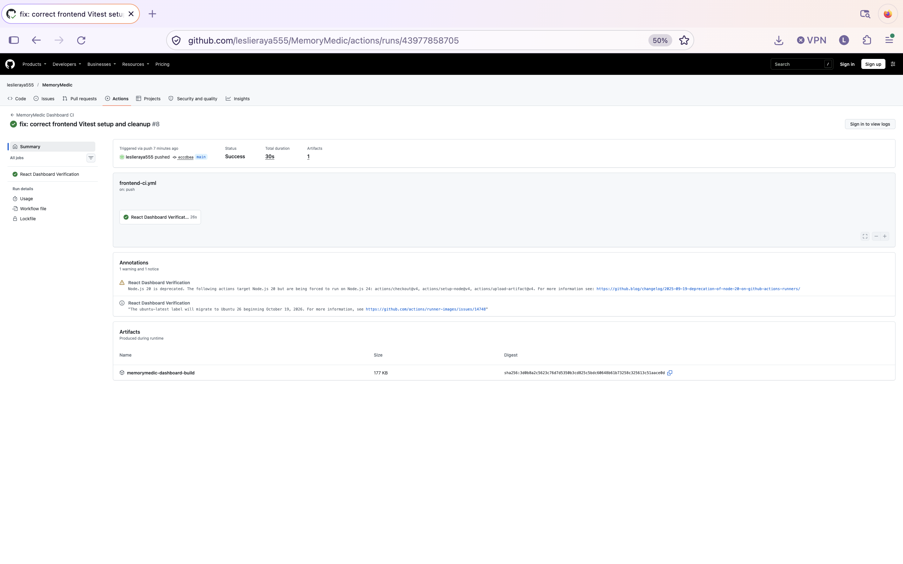
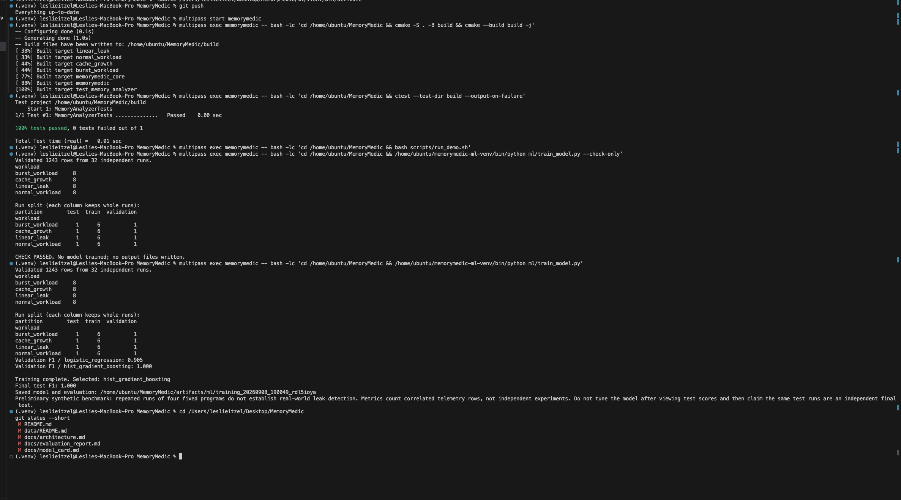
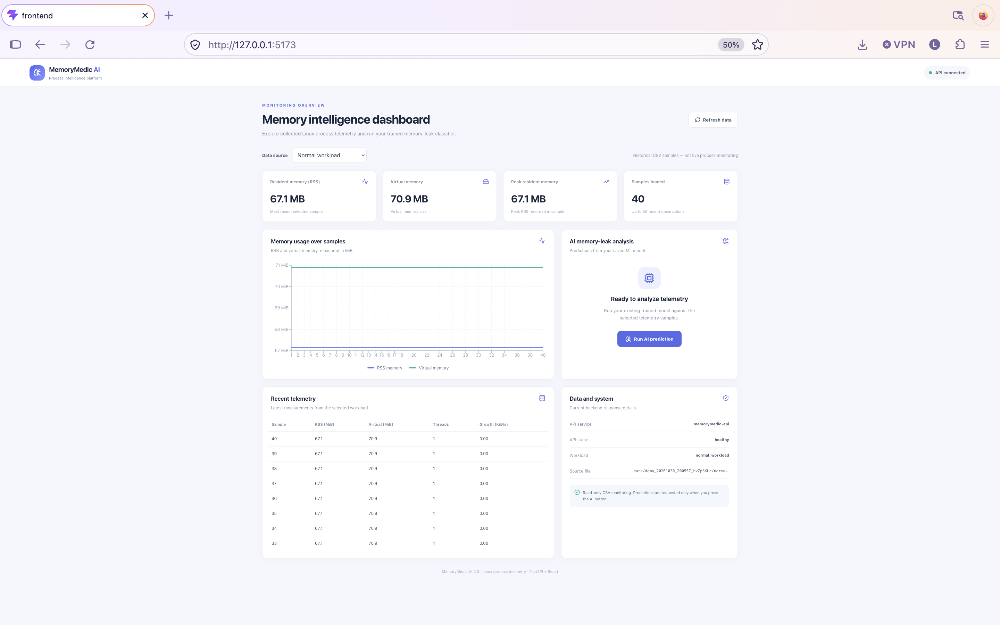
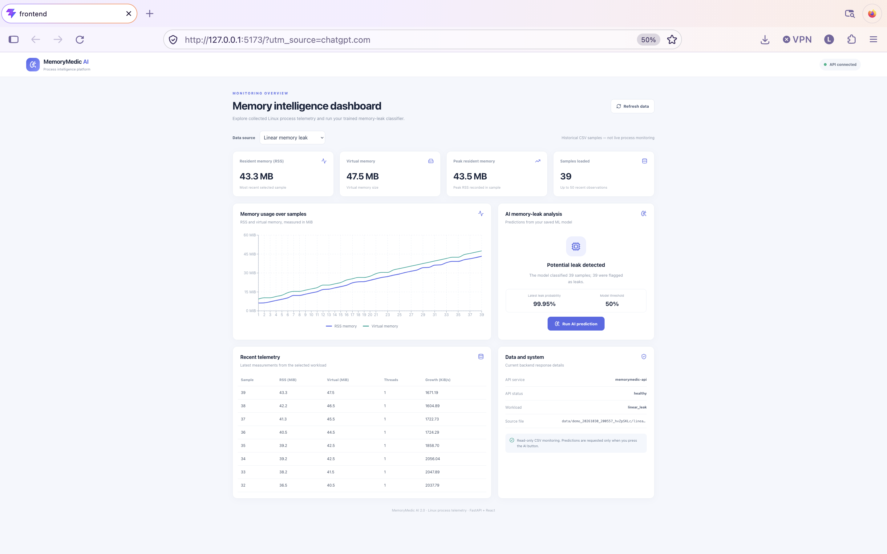
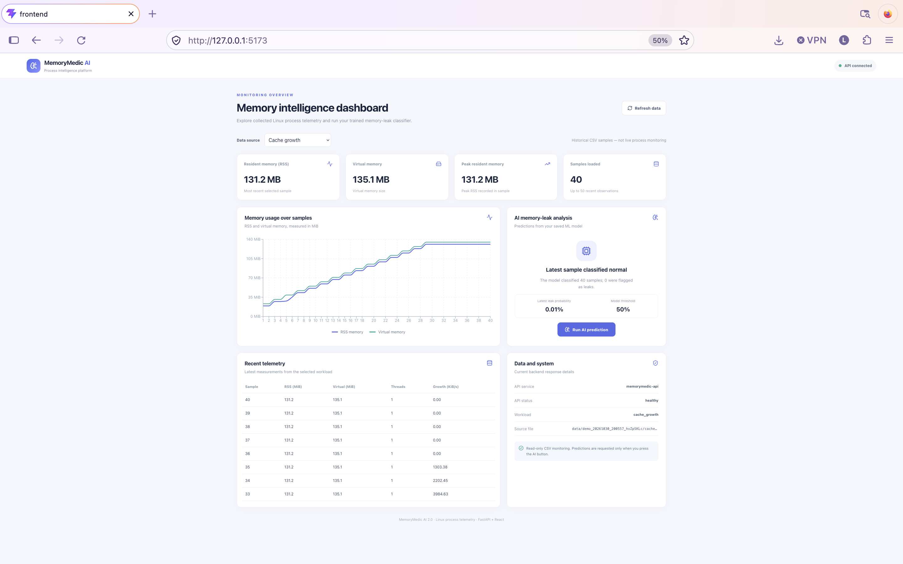

# MemoryMedic AI 2.0 — Evaluation and Verification Report

**Author:** Leslie Raya  
**Project:** MemoryMedic / MemoryMedic AI 2.0  
**Last Updated:** November 16, 2026  
**Historical Model Benchmark:** September 2026  
**Software Verification:** October–November 2026  
**Status:** Research and portfolio prototype  
**Repository:** [MemoryMedic on GitHub](https://github.com/leslieraya555/MemoryMedic)

---

## Executive Summary

MemoryMedic AI 2.0 is an experimental Linux process-memory monitoring and machine-learning system designed to identify patterns associated with abnormal memory growth and potential memory leaks.

The system integrates:

- A C++ Linux process-memory monitoring application.
- Memory statistics collected from the Linux `/proc` filesystem.
- Automated telemetry collection and CSV validation.
- Python feature engineering and machine-learning classification.
- Grouped training, validation, and held-out testing.
- Saved-model inference.
- A FastAPI backend for telemetry and prediction requests.
- A React/Vite dashboard for visualization and classification.
- Automated tests and GitHub Actions continuous integration.

MemoryMedic AI 2.0 builds upon the original C++ monitoring system by introducing a web-based interface for examining recorded telemetry and requesting machine-learning predictions.

### Key Verified Results

| Component | Recorded Result |
|---|---|
| Historical telemetry observations | 1,243 |
| Independent monitoring runs | 32 |
| Synthetic workload implementations | 4 |
| Training runs | 24 |
| Validation runs | 4 |
| Held-out test runs | 4 |
| Selected classifier | Histogram-based gradient boosting |
| Historical held-out accuracy | 100% |
| Historical held-out precision | 100% |
| Historical held-out recall | 100% |
| Historical held-out F1-score | 1.000 |
| Original Python regression tests | 21 passed |
| FastAPI backend tests | 13 passed |
| React/Vitest tests | 4 passed |
| Frontend lint | Passed |
| Frontend production build | Successful |
| Local API demonstration | Successful |
| GitHub Actions | Successful configured checks observed |

### Overall Assessment

MemoryMedic AI 2.0 demonstrates a functioning, modular software prototype that combines Linux systems programming, feature engineering, machine learning, backend development, frontend development, and software verification.

The historical classifier correctly classified all 156 observations in its held-out synthetic test partition.

However, this performance applies to a limited set of controlled synthetic workloads. It does not establish equivalent accuracy on unfamiliar or production applications.

The recorded frontend tests use mocked API responses and verify component behavior rather than live browser end-to-end functionality.

Additional independent benchmarking is required before making claims about general-purpose memory-leak detection, production reliability, or calibrated risk probabilities.

---

# 1. Evaluation Objectives

The primary objective of this evaluation is to assess the functionality, correctness, reproducibility, and integration of MemoryMedic AI 2.0.

The evaluation addresses the following questions:

1. Can MemoryMedic collect Linux process-memory telemetry?
2. Can the collected measurements be validated and transformed into machine-learning features?
3. Can a supervised classifier distinguish the included synthetic leak behavior from normal memory-use behaviors?
4. Can the trained model be saved and loaded for subsequent inference?
5. Can the FastAPI backend retrieve telemetry and generate predictions?
6. Can the React dashboard visualize historical measurements and display classifier outputs?
7. Can automated software tests verify the implemented components?
8. Can GitHub Actions reproduce the configured software checks?

### Evaluation Categories

The evaluation separates three categories of evidence.

**Machine-learning evaluation**

Measures classifier behavior on controlled training, validation, and held-out test partitions.

**Software verification**

Confirms that individual components and interfaces behave as expected under tested conditions.

**Integration demonstrations**

Demonstrate how the dashboard, API, and saved model interact using selected synthetic workloads.

These categories must not be treated as interchangeable evidence.

A successful software test does not independently establish machine-learning accuracy.

---

# 2. System Architecture

MemoryMedic uses a modular architecture separating process monitoring, feature engineering, model training, inference, and visualization.

## 2.1 High-Level Architecture

```text
                  MemoryMedic AI 2.0
                           |
                           v
                    Linux Process
                           |
                           v
                    Linux /proc
                           |
                           v
                     ProcReader
                           |
                           v
                    MemoryAnalyzer
                           |
                  +--------+--------+
                  |                 |
                  v                 v
            RiskAssessment    TelemetryLogger
                  |                 |
                  v                 v
            Heuristic Risk       CSV Data
                                    |
                                    v
                              Data Validation
                                    |
                                    v
                             Feature Engineering
                                    |
                                    v
                               ML Training
                                    |
                         +----------+----------+
                         |                     |
                         v                     v
                  Model Evaluation       Saved Model
                                               |
                                               v
                                         FastAPI Backend
                                               |
                                    +----------+----------+
                                    |                     |
                                    v                     v
                               Metrics API          Prediction API
                                    |                     |
                                    +----------+----------+
                                               |
                                               v
                                         React Dashboard
                                               |
                                    +----------+----------+
                                    |          |          |
                                    v          v          v
                                  Charts    Predictions  Status
```

## 2.2 Component Responsibilities

| Component | Responsibility |
|---|---|
| Linux `/proc` | Supplies process statistics |
| `ProcReader` | Reads process measurements |
| `MemoryAnalyzer` | Calculates memory-growth behavior |
| `RiskAssessment` | Produces heuristic risk information |
| `TelemetryLogger` | Records telemetry to CSV |
| `feature_engineering.py` | Creates model features |
| `train_model.py` | Trains and evaluates classifiers |
| `predict_csv.py` | Performs offline inference |
| FastAPI | Provides telemetry and prediction endpoints |
| React | Displays the monitoring dashboard |
| Recharts | Visualizes historical measurements |
| GitHub Actions | Runs configured automated checks |

The C++ rule-based risk assessment and Python machine-learning classifier are separate systems.

The original C++ monitor does not directly load the Python classifier.

The current dashboard displays historical telemetry rather than streaming newly collected process measurements in real time.

---

# 3. Dataset and Experimental Design

## 3.1 Synthetic Workloads

The historical benchmark contains four controlled workload implementations.

| Workload | Memory Behavior | Label | Independent Runs |
|---|---|---|---:|
| `normal_workload` | Approximately stable memory allocation | Normal | 8 |
| `burst_workload` | Temporary large allocation followed by release | Normal | 8 |
| `cache_growth` | Bounded cache growth followed by stabilization | Normal | 8 |
| `linear_leak` | Sustained unreleased memory allocation | Leak | 8 |
| **Total** | | | **32** |

The normal workload maintains approximately 64 MiB.

The memory-burst workload temporarily allocates approximately 256 MiB.

The cache-growth workload adds sixteen approximately 8 MiB entries before stabilizing.

The linear-leak workload retains approximately 1 MiB every 500 milliseconds.

These workloads provide controlled examples of different memory-use patterns.

## 3.2 Dataset Summary

| Property | Value |
|---|---:|
| Total observations | 1,243 |
| Independent executions | 32 |
| Workload implementations | 4 |
| Normal workload types | 3 |
| Leak workload types | 1 |
| Runs per implementation | 8 |

Each execution is assigned a `run_id`.

Run identifiers support reproducible partitioning and prevent observations from the same execution from appearing in multiple dataset partitions.

## 3.3 Dataset Limitations

The dataset contains only four synthetic programs.

Three represent normal behavior and one represents a controlled memory leak.

These examples do not cover the complete range of allocation patterns in real applications.

The original benchmark also does not independently evaluate generalization to completely unseen application implementations.

---

# 4. Data Collection and Validation

## 4.1 Telemetry Measurements

MemoryMedic collects measurements from Linux process statistics.

| Measurement | Description |
|---|---|
| `timestamp_ms` | Observation timestamp |
| `rss_kb` | Resident memory |
| `virtual_memory_kb` | Virtual-memory size |
| `peak_rss_kb` | Peak resident memory |
| `threads` | Thread count |
| `rss_growth_kb_s` | Estimated resident-memory growth rate |
| `minor_faults_s` | Minor page-fault rate |
| `major_faults_s` | Major page-fault rate |
| `run_id` | Independent execution identifier |

These measurements are recorded in CSV files for subsequent processing.

## 4.2 Data Validation

The validation process checks for problems including:

- Missing required columns.
- Duplicate column names.
- Invalid numerical values.
- Non-finite measurements.
- Invalid memory or thread counts.
- Missing run identifiers.
- Duplicate timestamps within the same run.
- Inconsistent workload labels.
- Incomplete collection records.
- Invalid collection metadata.

Malformed measurements are rejected instead of being silently replaced with arbitrary values.

## 4.3 Recorded Outcome

The historical benchmark produced a validated dataset containing:

- 1,243 observations.
- 32 independent runs.
- Four synthetic workload implementations.

The validated dataset was used for subsequent feature engineering and model evaluation.

---

# 5. Feature Engineering

MemoryMedic uses causal, per-run feature engineering.

Features are calculated using the current observation and preceding observations from the same monitoring run.

## 5.1 Model Features

The classifier uses twelve numerical features.

| Feature | Description |
|---|---|
| `rss_kb` | Resident-memory size |
| `virtual_memory_kb` | Virtual-memory size |
| `peak_rss_kb` | Peak resident memory |
| `threads` | Thread count |
| `rss_growth_kb_s` | Estimated RSS growth rate |
| `minor_faults_s` | Minor page-fault rate |
| `major_faults_s` | Major page-fault rate |
| `rss_delta` | Change in RSS |
| `rss_mean_10` | Rolling RSS mean |
| `rss_std_10` | Rolling RSS standard deviation |
| `vm_to_rss_ratio` | Virtual-to-resident memory ratio |
| `fault_ratio` | Major page-fault ratio |

## 5.2 Derived Features

RSS difference:

```text
rss_delta = current_rss - previous_rss
```

Virtual-to-resident memory ratio:

```text
vm_to_rss_ratio = virtual_memory_kb / rss_kb
```

Major page-fault ratio:

```text
fault_ratio =
    major_faults_s /
    (minor_faults_s + major_faults_s)
```

When the denominator of the fault ratio is zero, the defined ratio is zero.

Rolling statistics use up to ten observations from the same execution.

They do not necessarily represent ten seconds of data.

## 5.3 Leakage Prevention

The following fields are not included as classifier inputs:

- Run identifiers.
- Workload names.
- Classification labels.
- Target variables.
- Existing heuristic risk scores.

Feature calculations are isolated by monitoring execution.

This helps prevent unintended sharing of information between unrelated runs.

---

# 6. Dataset Partitioning

The historical evaluation uses grouped training, validation, and test partitions.

## 6.1 Recorded Partitions

| Partition | Runs | Observations |
|---|---:|---:|
| Training | 24 | 933 |
| Validation | 4 | 154 |
| Held-out test | 4 | 156 |
| **Total** | **32** | **1,243** |

Each workload contributes:

- Six training executions.
- One validation execution.
- One held-out test execution.

The recorded random seed is `42`.

## 6.2 Evaluation Procedure

1. Validate the collected telemetry.
2. Identify independent monitoring runs.
3. Assign entire runs to dataset partitions.
4. Train candidate models using the training partition.
5. Evaluate candidates using the validation partition.
6. Select the model using validation F1-score.
7. Refit the selected configuration using training and validation data.
8. Evaluate the selected classifier on the held-out test partition.

## 6.3 Importance of Grouped Splitting

Observations collected from the same execution are correlated.

A row-level random split could place highly related observations in both training and testing.

Run-level grouping reduces this source of evaluation leakage.

The historical procedure is a grouped holdout evaluation, not grouped k-fold cross-validation.

---

# 7. Machine-Learning Models

Two supervised classifiers were compared.

## 7.1 Logistic Regression

Logistic regression serves as the baseline model.

The implementation uses standardized numerical features and balanced class weights.

It provides a simpler classification model for comparison.

## 7.2 Histogram-Based Gradient Boosting

Histogram-based gradient boosting models nonlinear relationships among telemetry features.

Recorded model settings include:

```python
learning_rate = 0.06
max_iter = 200
max_leaf_nodes = 15
l2_regularization = 1.0
early_stopping = False
random_state = 42
```

## 7.3 Model Comparison

| Model | Validation F1 | False Positives | False Negatives |
|---|---:|---:|---:|
| Logistic Regression | 0.904762 | 7 | 1 |
| Histogram-Based Gradient Boosting | **1.000000** | **0** | **0** |

Histogram-based gradient boosting achieved the higher validation F1-score.

It was selected for final model fitting and held-out evaluation.

---

# 8. Historical Model Evaluation

The selected classifier was evaluated on 156 observations from four held-out synthetic executions.

The recorded classification threshold was `0.50`.

## 8.1 Classification Metrics

| Metric | Result |
|---|---:|
| Accuracy | 1.000 |
| Precision | 1.000 |
| Recall | 1.000 |
| F1-score | 1.000 |
| Average precision | 1.000 |
| ROC AUC | 1.000 |
| False-positive rate | 0.000 |
| False-negative rate | 0.000 |

These are the recorded historical synthetic benchmark results.

## 8.2 Confusion Matrix

| Actual / Predicted | Normal | Leak |
|---|---:|---:|
| Normal | 117 | 0 |
| Leak | 0 | 39 |

Equivalent classification counts:

| Outcome | Count |
|---|---:|
| True negatives | 117 |
| True positives | 39 |
| False positives | 0 |
| False negatives | 0 |

## 8.3 Results by Workload

| Workload | Actual Class | Correct Predictions |
|---|---|---:|
| `normal_workload` | Normal | 39/39 |
| `burst_workload` | Normal | 39/39 |
| `cache_growth` | Normal | 39/39 |
| `linear_leak` | Leak | 39/39 |

## 8.4 Interpretation

The classifier correctly identified all observations in the recorded held-out synthetic test partition.

Nevertheless, only four independent executions were held out.

The individual telemetry observations are correlated and must not be interpreted as 156 independent experiments.

The workload implementations in the test partition were also represented by other executions during training.

Consequently, the reported performance does not establish equivalent accuracy on unfamiliar software.

---

# 9. Historical Functional Verification

Additional software verification was recorded in October 2026.

| Verification | Recorded Result |
|---|---|
| Linux CMake build | Passed |
| Registered C++ tests | Passed |
| Normal-workload collection | Successful |
| Burst-workload collection | Successful |
| Cache-growth collection | Successful |
| Linear-leak collection | Successful |
| Normal-workload prediction smoke test | Expected normal classification |
| Burst-workload prediction smoke test | Expected normal classification |
| Cache-growth prediction smoke test | Expected normal classification |
| Linear-leak prediction smoke test | Expected leak classification |
| Original Python regression suite | 21 passed |

The prediction smoke tests demonstrate that the saved model could be loaded and applied to generated telemetry.

These checks are functional verification, not a new independent generalization benchmark.

---

# 10. Original Python Regression Testing

The original Python regression suite contains 21 tests.

| Category | Tests | Result |
|---|---:|---|
| Feature engineering | 11 | Passed |
| Dataset partitioning | 4 | Passed |
| CSV and dataset validation | 3 | Passed |
| Metrics and model persistence | 3 | Passed |
| **Total** | **21** | **Passed** |

The tests check functionality including:

- Feature calculations.
- Rolling-window behavior.
- Isolation between runs.
- Input validation.
- Grouped dataset splitting.
- Reproducibility of partitions.
- Model saving and loading.
- Isolation of held-out data.

These tests use controlled inputs and fixtures.

A numerical source-code coverage percentage has not been established.

---

# 11. MemoryMedic AI 2.0 Backend Integration

MemoryMedic AI 2.0 uses FastAPI to expose telemetry and saved-model prediction functionality.

## 11.1 Backend Structure

```text
backend/
├── app/
│   ├── __init__.py
│   ├── main.py
│   ├── metrics.py
│   └── predictions.py
├── tests/
│   ├── test_main.py
│   ├── test_metrics.py
│   └── test_predictions.py
└── requirements.txt
```

## 11.2 API Endpoints

| Method | Endpoint | Purpose |
|---|---|---|
| GET | `/` | API information |
| GET | `/health` | Health check |
| GET | `/api/v1/metrics` | Historical telemetry |
| POST | `/api/v1/predict` | Model predictions |
| GET | `/docs` | Swagger documentation |

## 11.3 Prediction Processing

The prediction endpoint:

1. Receives telemetry measurements.
2. Validates request fields.
3. Converts observations into a DataFrame.
4. Applies feature engineering.
5. Loads the trusted saved model.
6. Verifies the expected feature schema.
7. Generates model scores.
8. Applies the classification threshold.
9. Returns predictions as JSON.

The response includes prediction results and model-related metadata.

## 11.4 Observed API Behavior

| Verification | Recorded Result |
|---|---|
| API documentation | Successful |
| Health endpoint | Successful |
| Historical metrics endpoint | Successful |
| Prediction response | Successful |
| Valid inference request | HTTP 200 |
| Invalid required measurements | HTTP 422 |
| Duplicate timestamps | HTTP 422 |
| Missing trained model | HTTP 503 |

The missing-model behavior is important because the API must not fabricate predictions when the required model artifact is unavailable.

---

# 12. MemoryMedic AI 2.0 Backend Testing

## 12.1 Automated Tests

The backend uses `pytest`.

Recorded local verification:

```text
Collected 13 items

backend/tests/test_main.py        PASSED
backend/tests/test_metrics.py     PASSED
backend/tests/test_predictions.py PASSED

13 passed, 1 warning
```

The output above is a summary of the recorded result, not a verbatim complete terminal transcript.

## 12.2 Test Coverage

The backend test suite checks:

- Root route behavior.
- Health endpoint behavior.
- Historical metrics retrieval.
- Invalid workload rejection.
- Missing and invalid numerical measurements.
- Successful prediction responses.
- Missing model handling.
- Invalid prediction requests.
- Duplicate timestamp rejection.

Some prediction tests use a deterministic fake estimator.

This allows API logic to be tested without depending on the actual trained classifier.

Therefore, passing backend tests do not establish a new machine-learning accuracy result.

## 12.3 Recorded Warning

The recorded backend test run produced one non-failing deprecation warning involving FastAPI/Starlette test infrastructure.

All 13 tests passed in that run.

## 12.4 Verification Command

```bash
cd ~/Desktop/MemoryMedic
PYTHONPATH=. backend/.venv/bin/python -m pytest backend/tests -v
```

The command requires the corresponding local virtual environment and dependencies.

---

# 13. React Dashboard Implementation

MemoryMedic AI 2.0 uses React and Vite for the frontend.

## 13.1 Frontend Structure

```text
frontend/
├── public/
├── src/
│   ├── assets/
│   ├── App.jsx
│   ├── App.test.jsx
│   ├── App.css
│   ├── index.css
│   ├── main.jsx
│   └── setupTests.js
├── index.html
├── package.json
├── package-lock.json
├── vite.config.js
└── vitest.config.js
```

## 13.2 Dashboard Capabilities

The implemented dashboard includes:

- API connectivity status.
- Historical workload selection.
- Resident-memory summary.
- Virtual-memory summary.
- Peak resident-memory summary.
- Number of observations loaded.
- Historical memory charts.
- Recent telemetry table.
- AI prediction button.
- Latest classification.
- Model-generated leak score.
- Classification threshold.
- Count of observations flagged as leaks.

## 13.3 Supported Workloads

The dashboard provides historical telemetry demonstrations for:

- Normal workload.
- Linear memory leak.
- Memory burst.
- Cache growth.

## 13.4 Data Source Limitations

The dashboard reads previously collected CSV telemetry through the backend.

It is not a continuously streaming production-monitoring service.

The displayed measurements should not be described as live observations from arbitrary running processes.

---

# 14. Dashboard Functional Verification

The dashboard was demonstrated locally using a FastAPI backend and React frontend.

The recorded local development addresses were:

```text
Backend:  http://127.0.0.1:8001
Frontend: http://127.0.0.1:5173
```

## 14.1 Normal-Workload Demonstration

| Measurement | Recorded Value |
|---|---:|
| Samples analyzed | 40 |
| Latest RSS | Approximately 67.1 MiB |
| Virtual memory | Approximately 70.9 MiB |
| Peak RSS | Approximately 67.1 MiB |
| Latest classification | Normal |
| Latest leak score | Approximately 0.02% |
| Threshold | 50% |
| Samples flagged | 0 |

The plotted resident-memory measurements remained approximately stable.

The dashboard displayed the normal classification and associated model output.

## 14.2 Linear-Leak Demonstration

| Measurement | Recorded Value |
|---|---:|
| Samples analyzed | 39 |
| Latest RSS | Approximately 43.3 MiB |
| Virtual memory | Approximately 47.5 MiB |
| Peak RSS | Approximately 43.5 MiB |
| Latest classification | Potential leak detected |
| Latest leak score | Approximately 99.95% |
| Threshold | 50% |
| Samples flagged | 39 |

The historical memory chart showed increasing memory usage.

The dashboard displayed a potential-leak classification.

This demonstrates the integrated prediction path for the selected synthetic workload.

The displayed score has not been independently established as a calibrated real-world probability.

## 14.3 Other Workload Demonstrations

The following additional workloads were displayed:

- Memory burst.
- Cache growth.

Their recorded screenshots are included in the appendix.

These demonstrations provide evidence of dashboard functionality with differing historical telemetry patterns.

They are not a separate statistically independent model benchmark.

## 14.4 Verification Checklist

- [x] React dashboard loads.
- [x] Backend connection status appears.
- [x] Historical telemetry loads.
- [x] Workload selector displays.
- [x] Memory summary cards display.
- [x] Memory chart displays.
- [x] Recent telemetry table displays.
- [x] AI prediction request completes in recorded demonstrations.
- [x] Prediction results display.
- [x] Four workload screenshots recorded.
- [x] Automated frontend component tests implemented.
- [ ] Real-browser end-to-end tests against a running backend.
- [ ] Testing against additional unfamiliar applications.
- [ ] Live process-monitoring integration.

## 14.5 Frontend Automated Tests

The frontend uses Vitest and React Testing Library.

Test files include:

```text
frontend/src/App.test.jsx
frontend/src/setupTests.js
frontend/vitest.config.js
```

Four tests passed in the recorded local run.

| Test | Verification | Result |
|---|---|---|
| Dashboard loading | Mocked telemetry and UI rendering | Passed |
| Workload selection | Switching to linear-leak telemetry | Passed |
| AI prediction | Prediction request and result display | Passed |
| Error handling | HTTP 503 response display | Passed |

The tests use mocked network responses and mocked chart components.

Consequently, they verify frontend component behavior, not complete live-browser operation or classifier accuracy.

## 14.6 Frontend Test Commands

```bash
cd ~/Desktop/MemoryMedic/frontend

npm ci
npm test
npm run lint
npm run build
```

Recorded local results:

- Four Vitest tests passed.
- Oxlint completed without warnings or errors.
- The Vite production build completed successfully.

---

# 15. Frontend Production Build

## 15.1 Build Command

```bash
cd ~/Desktop/MemoryMedic/frontend
npm run build
```

## 15.2 Recorded Results

The frontend build completed successfully and generated the `dist` directory.

The build demonstrates that the application can be bundled for production distribution.

It does not independently demonstrate a production deployment.

## 15.3 Build Warnings

An earlier recorded build warned that some generated chunks exceeded Vite's recommended size threshold.

The warning did not prevent the build from completing.

Potential future improvements include:

- Dynamic imports.
- Application code splitting.
- Reducing large dependencies.
- Optimizing chart-related dependencies.

These remain future enhancements unless independently implemented and verified.

---

# 16. Continuous Integration and GitHub Actions

MemoryMedic uses GitHub Actions for automated software verification.

## 16.1 Workflows

| Workflow | Purpose |
|---|---|
| `ci.yml` | Original C++, Python, and shell checks |
| `backend-ci.yml` | FastAPI backend verification |
| `frontend-ci.yml` | React frontend verification |

## 16.2 Original Project CI

The original workflow includes checks for:

- C++ compilation and tests.
- Python validation.
- Shell-script syntax.
- Other configured project verification tasks.

## 16.3 Backend CI

The backend workflow checks the FastAPI implementation and runs its automated tests.

Relevant test command:

```bash
python -m pytest backend/tests -v
```

## 16.4 Dashboard CI

The updated frontend workflow performs:

1. Repository checkout.
2. Node.js environment setup.
3. Dependency installation.
4. Frontend linting.
5. Vitest execution.
6. Production build.
7. Build-output verification.

Relevant commands include:

```bash
npm ci
npm run lint
npm test
npm run build
test -f dist/index.html
```

## 16.5 Recorded GitHub Actions Results

Successful workflow runs were observed for the core MemoryMedic project, FastAPI backend, and React dashboard.

The updated dashboard workflow passed following the frontend Vitest configuration and cleanup changes.

A successful workflow confirms that its configured checks passed for the tested commit.

It does not establish production readiness or independent model generalization.

## 16.6 Dashboard CI Screenshot



**Evidence file:** `docs/images/memorymedic-frontend-ci-passed.png`

**Workflow:** [MemoryMedic Dashboard CI](https://github.com/leslieraya555/MemoryMedic/actions/workflows/frontend-ci.yml)

**All workflows:** [GitHub Actions](https://github.com/leslieraya555/MemoryMedic/actions)

---

# 17. Reproducibility

Reproducibility is an important objective of the MemoryMedic project.

The historical benchmark records dataset partitions, model settings, dependencies, and evaluation results.

## 17.1 Historical Artifacts

| Artifact | Purpose |
|---|---|
| `evaluation.json` | Stores evaluation results |
| `splits.csv` | Stores dataset partition assignments |
| `memorymedic_model.joblib` | Stores the trained model |
| `requirements-used.txt` | Records dependency versions |
| `COMPLETE.txt` | Identifies completed training output |

Generated training artifacts are stored locally in timestamped directories under `artifacts/ml/`.

They are not guaranteed to be present in a fresh GitHub clone.

## 17.2 Historical Software Environment

The historical training records include:

| Dependency | Version |
|---|---|
| Python | 3.14.4 |
| NumPy | 2.5.2 |
| pandas | 3.0.5 |
| scikit-learn | 1.9.0 |
| joblib | 1.6.0 |
| SciPy | 1.18.1 |
| threadpoolctl | 3.6.0 |

These versions describe the recorded historical environment.

GitHub Actions may use different compatible versions.

## 17.3 Backend Reproduction

From the project root:

```bash
cd ~/Desktop/MemoryMedic
PYTHONPATH=. backend/.venv/bin/python -m pytest backend/tests -v
```

## 17.4 Frontend Reproduction

```bash
cd ~/Desktop/MemoryMedic/frontend

npm ci
npm test
npm run lint
npm run build
```

## 17.5 Start the API

From the project root:

```bash
cd ~/Desktop/MemoryMedic

backend/.venv/bin/python -m uvicorn backend.app.main:app \
  --reload \
  --host 127.0.0.1 \
  --port 8001
```

API documentation:

http://127.0.0.1:8001/docs

Health endpoint:

http://127.0.0.1:8001/health

## 17.6 Start the Dashboard

In a separate terminal:

```bash
cd ~/Desktop/MemoryMedic/frontend

npm run dev -- --host 127.0.0.1 --port 5173
```

Dashboard:

http://127.0.0.1:5173

If either port is already occupied by the intended service, use the existing server rather than starting a duplicate.

## 17.7 Reproducibility Limitations

Exact historical benchmark reproduction requires the original dataset, partition assignments, model configuration, and compatible dependency environment.

A fresh clone does not automatically reproduce historical results if the required generated datasets and trained artifacts are unavailable.

The existing documentation and CI checks provide partial reproducibility evidence.

---

# 18. Evidence and Verification Records

The project includes source files, test results, screenshots, and workflow records supporting the evaluation.

## 18.1 Evidence Inventory

| Evidence | Location |
|---|---|
| Evaluation report | `docs/evaluation_report.md` |
| Architecture documentation | `docs/architecture.md` |
| Model documentation | `docs/model_card.md` |
| Backend test log | `docs/memorymedic-terminal-output.txt` |
| Training pipeline | `ml/train_model.py` |
| Feature engineering | `ml/feature_engineering.py` |
| Prediction CLI | `ml/predict_csv.py` |
| FastAPI application | `backend/app/main.py` |
| Backend tests | `backend/tests/` |
| React dashboard | `frontend/src/App.jsx` |
| Frontend tests | `frontend/src/App.test.jsx` |
| Vitest configuration | `frontend/vitest.config.js` |
| CI workflow definitions | `.github/workflows/` |
| Workload screenshots | `docs/images/` |

## 18.2 Historical Build Evidence



The screenshot documents an earlier build, test, and training demonstration.

## 18.3 Backend Test Log

The checked-in backend test log records:

```text
13 passed, 1 warning
```

[View Backend Test Log](memorymedic-terminal-output.txt)

This result documents the recorded local backend test execution.

## 18.4 Screenshot Inventory

| Screenshot | Verification |
|---|---|
| `memorymedic-build-test-training-results.png` | Historical build and training |
| `memorymedic-normal-workload-prediction.png` | Normal workload |
| `memorymedic-linear-leak-prediction.png` | Linear memory leak |
| `memorymedic-memory-burst-prediction.png` | Memory burst |
| `memorymedic-cache-growth-prediction.png` | Cache growth |
| `memorymedic-frontend-ci-passed.png` | Successful frontend CI |

These screenshots provide visual evidence of the implemented system.

Screenshots of additional benchmarks should be added only after completing those evaluations.

---

# 19. Limitations and Threats to Validity

## 19.1 Limited Synthetic Dataset

The original benchmark evaluates four synthetic workload implementations.

These programs do not represent the complete range of real-world memory behavior.

## 19.2 Limited Leak Diversity

Only one leak-style implementation is represented.

Different leak rates and allocation patterns may produce different model behavior.

## 19.3 Small Independent Test Set

The held-out dataset contains 156 observations but only four independent executions.

Adjacent observations are correlated.

Therefore, the effective number of independent experiments is substantially smaller than 156.

## 19.4 Unknown Generalization

The historical model was not independently benchmarked on a broad collection of unfamiliar production applications.

Real-world precision, recall, and false-alarm rates remain unknown.

## 19.5 Historical Dashboard Data

The current dashboard visualizes recorded telemetry rather than automatically streaming live process measurements.

## 19.6 Unknown Operational Overhead

The report does not establish comprehensive measurements of:

- CPU monitoring overhead.
- Memory monitoring overhead.
- End-to-end detection latency.
- False alerts per monitoring hour.
- Production service reliability.

## 19.7 Limited Cross-Validation

The recorded evaluation uses grouped training, validation, and held-out testing.

Grouped k-fold cross-validation has not been reported.

## 19.8 Probability Calibration

A model-generated leak score is not necessarily a calibrated probability.

The displayed scores have not been independently calibrated against real-world event frequencies.

## 19.9 Production Deployment

The project was demonstrated in a local development environment.

A production implementation would require additional security, operational monitoring, reliability testing, and deployment engineering.

---

# 20. Recommended Future Evaluations

## 20.1 Expand Workload Diversity

Introduce additional independent workloads involving:

- Slow leaks.
- Rapid leaks.
- Short-lived memory bursts.
- Bounded caches.
- Periodic allocation and release.
- Multithreaded allocation.
- Different application architectures.
- Unfamiliar real-world applications.

## 20.2 Evaluate Unseen Applications

Use application implementations that were not represented during training.

Maintain a separate final test partition that is not used for model selection.

## 20.3 Measure False-Positive Behavior

Record:

- False positives per independent run.
- False alerts per monitoring hour.
- Specificity.
- Precision on new workloads.

## 20.4 Measure Detection Latency

Measure the time between the beginning of a controlled memory leak and the first positive detection.

Compare different allocation rates and sampling intervals.

## 20.5 Measure Monitoring Overhead

Compare monitored and unmonitored executions.

Record:

- CPU usage.
- Memory usage.
- Execution time.
- Collector resource consumption.

## 20.6 Evaluate Robustness

Test different:

- Collection intervals.
- Execution durations.
- Leak rates.
- Workload sizes.
- Application environments.

## 20.7 Add Real-Browser End-to-End Tests

The current frontend includes four Vitest tests using mocked network responses.

Future browser-based tests should verify:

- Dashboard startup.
- Real backend connectivity.
- Historical workload selection.
- Chart rendering.
- Prediction requests.
- Loading indicators.
- Error handling.
- Recovery after backend failures.

A tool such as Playwright could be used for these tests.

## 20.8 Evaluate Probability Calibration

Investigate how well the classifier's reported scores correspond to observed event frequencies.

Potential evaluation methods include calibration curves and Brier scores.

## 20.9 Grouped Cross-Validation

Consider grouped cross-validation for additional model-development experiments.

Keep all observations from one run within the same fold.

Preserve a separate final holdout set.

---

# 21. Future Development Roadmap

| Priority | Task | Status |
|---|---|---|
| High | Test unfamiliar applications | Planned |
| High | Expand independent benchmark workloads | Planned |
| High | Measure false positives | Planned |
| High | Measure detection latency | Planned |
| High | Measure monitoring overhead | Planned |
| Medium | Real-browser end-to-end tests | Planned |
| Medium | Probability calibration | Planned |
| Medium | Live process monitoring in dashboard | Future development |
| Medium | Automatic configurable alerts | Future development |
| Medium | Broader grouped cross-validation | Planned |
| Low | Reduce frontend bundle size | Future enhancement |
| Low | Production deployment architecture | Future enhancement |

The items in this table describe proposed development work.

They should not be interpreted as completed functionality.

---

# 22. Final Assessment

MemoryMedic AI 2.0 demonstrates an integrated software system combining:

- Linux systems programming.
- C++ process-memory monitoring.
- Telemetry collection and validation.
- Python feature engineering.
- Supervised machine learning.
- Saved-model inference.
- FastAPI backend services.
- React frontend visualization.
- Automated software testing.
- GitHub Actions continuous integration.

## 22.1 Historical Benchmark

The historical benchmark recorded:

- 1,243 telemetry observations.
- 32 independent monitoring runs.
- Four synthetic workload implementations.
- Grouped training, validation, and test partitions.
- Histogram-based gradient boosting selected by validation F1-score.
- Perfect classification of the 156 held-out synthetic observations.

## 22.2 Software Verification

Subsequent verification demonstrated:

- Successful original C++ component tests.
- 21 passing original Python regression tests.
- Successful saved-model inference.
- Successful FastAPI integration.
- 13 passing backend tests.
- Four passing React/Vitest tests.
- Successful frontend linting.
- Successful frontend production builds.
- Successful configured GitHub Actions workflows.

## 22.3 Dashboard Integration

The dashboard demonstrated historical telemetry visualization and model predictions using:

1. Normal workload.
2. Linear memory leak.
3. Memory burst.
4. Cache growth.

The corresponding screenshots are preserved in the project documentation.

## 22.4 Conclusion

MemoryMedic AI 2.0 is a functioning, modular, and tested research and portfolio prototype under the documented experimental conditions.

The project demonstrates the integration of operating-system monitoring, data engineering, machine learning, API development, frontend visualization, and automated verification.

The recorded results support the feasibility of the implemented system.

They do not establish production readiness or reliable general-purpose detection of memory leaks in unfamiliar applications.

Additional independent benchmarking, robustness testing, false-alarm measurement, and operational evaluation are required before making stronger claims.

---

# References and Project Documentation

## Project Repository

[MemoryMedic GitHub Repository](https://github.com/leslieraya555/MemoryMedic)

## Source Code

- [Model Training](../ml/train_model.py)
- [Feature Engineering](../ml/feature_engineering.py)
- [Offline Predictions](../ml/predict_csv.py)
- [FastAPI Application](../backend/app/main.py)
- [Historical Metrics API](../backend/app/metrics.py)
- [Prediction API](../backend/app/predictions.py)
- [React Dashboard](../frontend/src/App.jsx)
- [Dashboard Tests](../frontend/src/App.test.jsx)
- [Vitest Configuration](../frontend/vitest.config.js)
- [Vite Configuration](../frontend/vite.config.js)
- [Frontend CI](../.github/workflows/frontend-ci.yml)

## Related Documentation

- [System Architecture](architecture.md)
- [Model Card](model_card.md)
- [Interview Guide](interview_guide.md)
- [Backend Test Evidence](memorymedic-terminal-output.txt)
- [Getting Started](START_HERE.md)

## Continuous Integration

[MemoryMedic GitHub Actions](https://github.com/leslieraya555/MemoryMedic/actions)

---

# Appendix A. Dashboard Workload Verification

The following screenshots document the behavior of the MemoryMedic AI 2.0 dashboard with four controlled synthetic workload types.

## A.1 Normal Workload



The normal workload demonstration displays stable historical memory measurements and a normal model classification.

## A.2 Linear Memory Leak



The linear-leak demonstration displays increasing historical memory usage and a potential-leak classification.

## A.3 Memory Burst


The burst demonstration displays temporary allocation behavior.

## A.4 Cache Growth



The cache-growth demonstration displays increasing memory usage associated with a bounded synthetic cache.

## A.5 Evidence Interpretation

These screenshots demonstrate the operation of the dashboard on selected historical telemetry.

They do not establish real-world detection accuracy, model calibration, or production readiness.

---

# Appendix B. GitHub Actions Verification

## B.1 Frontend Workflow


The screenshot records a successful configured frontend CI workflow.

## B.2 Verification Links

- [Dashboard CI](https://github.com/leslieraya555/MemoryMedic/actions/workflows/frontend-ci.yml)
- [Backend CI](https://github.com/leslieraya555/MemoryMedic/actions/workflows/backend-ci.yml)
- [Core MemoryMedic CI](https://github.com/leslieraya555/MemoryMedic/actions/workflows/ci.yml)

## B.3 Verification Scope

Successful CI checks support the correctness of the tested software components under their configured test conditions.

They are not a substitute for independent model benchmarking or production validation.

---

**Report prepared by:** Leslie Raya  
**Last updated:** November 16, 2026  
**Document:** `docs/evaluation_report.md`  
**Project:** MemoryMedic AI 2.0  
**Status:** Functioning research and portfolio prototype; further independent evaluation required.
