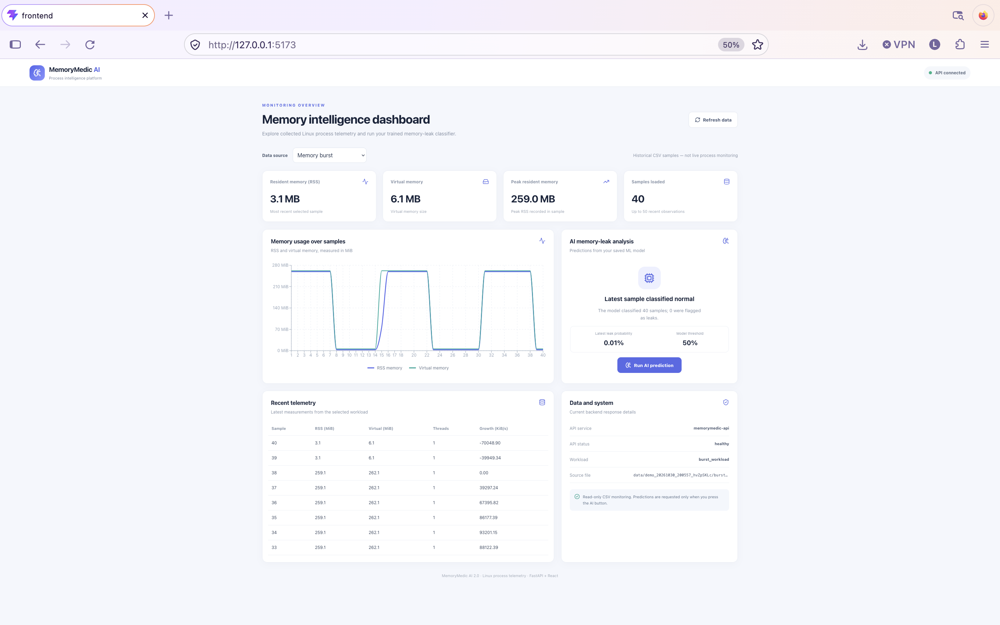

# MemoryMedic AI 2.0 — Evaluation and Verification Report

**Author:** Leslie Raya  
**Project:** MemoryMedic / MemoryMedic AI 2.0  
**Last Updated:** November 16, 2026  
**Historical Model Benchmark:** September 2026  
**Software Verification:** October–November 2026  
**Project Status:** Research and portfolio prototype  
**Repository:** [MemoryMedic on GitHub](https://github.com/leslieraya555/MemoryMedic)

---

## Executive Summary

MemoryMedic AI 2.0 is an experimental Linux process-memory monitoring and machine-learning system designed to identify patterns associated with abnormal memory growth and potential memory leaks.

The project integrates:

- C++ process monitoring through the Linux `/proc` filesystem.
- Automated telemetry collection and CSV validation.
- Python feature engineering and supervised classification.
- Grouped training, validation, and held-out testing.
- Saved-model inference.
- FastAPI backend services.
- A React/Vite monitoring dashboard.
- Automated backend and frontend testing.
- GitHub Actions continuous integration.

MemoryMedic AI 2.0 extends the original monitoring system with an interactive API and dashboard for examining historical process telemetry and requesting machine-learning predictions.

### Key Verified Results

| Component | Recorded Result |
|---|---|
| Historical telemetry observations | 1,243 |
| Independent monitoring executions | 32 |
| Synthetic workload types | 4 |
| Training runs | 24 |
| Validation runs | 4 |
| Held-out test runs | 4 |
| Selected classifier | Histogram-based gradient boosting |
| Historical held-out accuracy | 100% |
| Historical held-out precision | 100% |
| Historical held-out recall | 100% |
| Historical held-out F1-score | 1.000 |
| Original Python regression tests | 21 passed |
| FastAPI backend tests | 13 passed |
| React/Vitest tests | 4 passed |
| Frontend lint | 0 errors, 0 warnings |
| Frontend production build | Successful |
| Local API demonstration | Successful |
| Dashboard visualization | Successful |
| GitHub Actions | Successful configured checks observed |

### Overall Assessment

MemoryMedic AI 2.0 demonstrates a functioning, modular software prototype combining Linux systems programming, telemetry processing, machine learning, backend development, frontend development, and automated software verification.

The historical classifier correctly classified all 156 telemetry observations in its held-out synthetic test partition.

However, this result applies only to controlled synthetic workloads. It does not establish equivalent performance on unfamiliar production applications.

The React automated tests use mocked API responses, while separate local dashboard demonstrations provide evidence of backend integration.

Additional independent benchmarking is required before claiming general-purpose memory-leak detection, production reliability, or calibrated risk probabilities.

---

# 1. Evaluation Objectives

The purpose of this evaluation is to assess the functionality, correctness, reproducibility, and experimental performance of MemoryMedic.

The evaluation addresses five primary questions:

1. Can the system collect and validate Linux process-memory telemetry?
2. Can the machine-learning pipeline distinguish the included normal and leak behaviors?
3. Can the FastAPI backend load a trained model and generate predictions?
4. Can the React dashboard display telemetry and prediction results?
5. Can the system be verified through automated tests and continuous integration?

## 1.1 Evaluation Categories

The evaluation covers:

- Data collection correctness.
- Data validation.
- Feature-engineering correctness.
- Dataset partitioning.
- Model comparison.
- Historical classifier performance.
- Saved-model inference.
- Backend API verification.
- Frontend component testing.
- Dashboard integration.
- Production build verification.
- Continuous integration.
- Reproducibility.
- Limitations and threats to validity.

Machine-learning evaluation and software verification are reported separately to avoid interpreting successful software tests as new evidence of classifier accuracy.

---

# 2. System Architecture

MemoryMedic uses a modular architecture separating process monitoring, feature engineering, machine learning, API services, and user-interface visualization.

## 2.1 High-Level Architecture

```text
                  MEMORYMEDIC AI 2.0
                  ------------------

                    Linux Process
                          |
                          v
                 Linux /proc Filesystem
                          |
                          v
                     ProcReader
                          |
                          v
                   MemoryAnalyzer
                          |
                +---------+---------+
                |                   |
                v                   v
          RiskAssessment      TelemetryLogger
                |                   |
                v                   v
          Heuristic Risk         CSV Data
                                    |
                                    v
                              Data Validation
                                    |
                                    v
                            Feature Engineering
                                    |
                                    v
                              Model Training
                                    |
                         +----------+----------+
                         |                     |
                         v                     v
                  Model Evaluation       Saved ML Model
                                               |
                                               v
                                          FastAPI API
                                               |
                          +--------------------+------------------+
                          |                                       |
                          v                                       v
                    Telemetry API                          Prediction API
                          |                                       |
                          +--------------------+------------------+
                                               |
                                               v
                                         React Dashboard
                                               |
                      +------------------------+------------------+
                      |                        |                  |
                      v                        v                  v
                 Memory Charts            Predictions       API Status
```

## 2.2 Component Responsibilities

| Component | Responsibility |
|---|---|
| Linux `/proc` | Provides process-memory statistics |
| `ProcReader` | Reads process telemetry |
| `MemoryAnalyzer` | Calculates memory-growth behavior |
| `RiskAssessment` | Produces heuristic risk information |
| `TelemetryLogger` | Records measurements to CSV |
| `feature_engineering.py` | Validates input and constructs model features |
| `train_model.py` | Trains, selects, and evaluates classifiers |
| `predict_csv.py` | Performs offline saved-model inference |
| FastAPI | Exposes telemetry and prediction endpoints |
| React | Provides the dashboard interface |
| Recharts | Visualizes memory measurements |
| GitHub Actions | Automates configured verification checks |

The C++ risk assessment and Python machine-learning classifier are separate components.

The C++ executable does not directly load the Python classifier.

The FastAPI service connects saved-model inference to the React dashboard.

**Current limitation:** The dashboard displays historical CSV data rather than continuously streaming measurements from arbitrary running processes.

---

# 3. Dataset and Experimental Design

## 3.1 Synthetic Workloads

The historical dataset includes four controlled workload implementations.

| Workload | Intended Behavior | Label | Runs |
|---|---|---|---:|
| `normal_workload` | Maintains approximately 64 MiB | Normal | 8 |
| `burst_workload` | Temporarily allocates and releases memory | Normal | 8 |
| `cache_growth` | Adds bounded cache entries before stabilizing | Normal | 8 |
| `linear_leak` | Retains approximately 1 MiB every 500 ms | Leak | 8 |
| **Total** | | | **32** |

The normal, burst, and cache-growth workloads provide examples of legitimate process-memory behavior.

The linear-leak workload provides a controlled example of sustained memory retention.

These workloads are useful for validating a prototype because their expected behavior is known.

They are not a representative sample of all real-world memory-allocation patterns.

## 3.2 Dataset Summary

| Property | Recorded Value |
|---|---:|
| Total observations | 1,243 |
| Independent executions | 32 |
| Workload implementations | 4 |
| Normal workload implementations | 3 |
| Leak workload implementations | 1 |
| Runs per implementation | 8 |

Each monitoring execution has a unique `run_id`.

Measurements from the same execution are treated as a group during dataset partitioning.

## 3.3 Dataset Structure

Generated collections use a structure similar to:

```text
data/
└── collection_<identifier>/
    ├── raw/
    │   ├── workload_run_01.csv
    │   ├── workload_run_02.csv
    │   └── ...
    ├── logs/
    ├── runs.csv
    └── COMPLETE.txt
```

The structure above is illustrative. Actual generated filenames depend on the collection.

The collection manifest records run identities, workload labels, sampling information, and execution metadata.

The completion marker identifies a successfully completed collection batch.

---

# 4. Data Collection and Validation

## 4.1 Collected Telemetry

The Linux monitoring component collects process measurements from `/proc`.

| Field | Description |
|---|---|
| `timestamp_ms` | Measurement timestamp |
| `rss_kb` | Resident memory in kilobytes |
| `virtual_memory_kb` | Virtual-memory size |
| `peak_rss_kb` | Peak resident memory |
| `threads` | Number of threads |
| `rss_growth_kb_s` | Estimated RSS growth rate |
| `minor_faults_s` | Minor page-fault rate |
| `major_faults_s` | Major page-fault rate |
| `run_id` | Monitoring execution identifier |

## 4.2 Data Validation

The validation pipeline checks for:

- Missing required columns.
- Duplicate column names.
- Missing run identifiers.
- Invalid numerical values.
- Non-finite numerical measurements.
- Duplicate timestamps within a run.
- Invalid memory measurements.
- Invalid thread measurements.
- Inconsistent labels and run identities.
- Invalid collection metadata.
- Incomplete collection outputs.

Invalid records are rejected rather than silently replaced with arbitrary values.

This helps prevent malformed telemetry from entering the training pipeline.

## 4.3 Recorded Outcome

The historical training pipeline produced a validated dataset containing:

- 1,243 observations.
- 32 independent executions.
- Four workload implementations.

These results form the basis of the September 2026 benchmark.

---

# 5. Feature Engineering

MemoryMedic uses causal feature engineering.

Derived features use the current observation and preceding observations from the same execution.

## 5.1 Model Features

The classifier uses 12 numerical features.

| Feature | Description |
|---|---|
| `rss_kb` | Current resident memory |
| `virtual_memory_kb` | Virtual-memory size |
| `peak_rss_kb` | Peak resident memory |
| `threads` | Active thread count |
| `rss_growth_kb_s` | Recent RSS growth rate |
| `minor_faults_s` | Minor page-fault rate |
| `major_faults_s` | Major page-fault rate |
| `rss_delta` | RSS difference from the preceding observation |
| `rss_mean_10` | Rolling RSS mean |
| `rss_std_10` | Rolling RSS standard deviation |
| `vm_to_rss_ratio` | Virtual-to-resident memory ratio |
| `fault_ratio` | Ratio of major faults to total faults |

The recorded feature schema identifier is:

`2-strict-per-run`

## 5.2 Derived Features

RSS difference:

```text
rss_delta = current_rss - previous_rss
```

Virtual-to-resident ratio:

```text
vm_to_rss_ratio = virtual_memory_kb / rss_kb
```

Page-fault ratio:

```text
fault_ratio = major_faults_s /
              (minor_faults_s + major_faults_s)
```

When total page-fault activity is zero, the derived ratio is defined as zero.

Rolling features use up to ten observations from the same run.

They do not necessarily represent a fixed ten-second interval.

## 5.3 Leakage Prevention

The following fields are excluded from the machine-learning feature matrix:

- Run identifiers.
- Workload names.
- Ground-truth labels.
- Target variables.
- Existing heuristic risk scores.

Rolling calculations are isolated within each run.

The training process uses grouped partitions to prevent observations from a single execution from appearing in multiple evaluation partitions.

These controls reduce certain forms of data leakage, although they do not eliminate every possible source of experimental bias.

---

# 6. Dataset Partitioning

The historical benchmark used grouped training, validation, and held-out test partitions.

## 6.1 Partition Results

| Partition | Runs | Observations |
|---|---:|---:|
| Training | 24 | 933 |
| Validation | 4 | 154 |
| Held-out test | 4 | 156 |
| **Total** | **32** | **1,243** |

Each workload contributed:

- Six training runs.
- One validation run.
- One held-out test run.

The recorded random seed was `42`.

## 6.2 Evaluation Procedure

The evaluation procedure was:

1. Validate the collected telemetry.
2. Assign complete runs to partitions.
3. Train candidate classifiers using the training partition.
4. Compare classifiers using validation F1-score.
5. Select the preferred classifier.
6. Refit the selected configuration using training and validation data.
7. Evaluate on the held-out test partition.

The test partition was not used for model selection.

## 6.3 Grouped Splitting

Grouping is important because measurements from the same process execution are correlated.

A random row-level split could place observations from the same run in both training and testing, producing an overly optimistic estimate.

The recorded evaluation uses grouped holdout testing, not grouped k-fold cross-validation.

---

# 7. Machine-Learning Models

Two supervised classification approaches were evaluated.

## 7.1 Logistic Regression

Logistic regression was used as the baseline classifier.

The implementation uses:

- Standardized numerical features.
- Balanced class weights.
- A fixed random seed.
- A configured maximum iteration limit.

Logistic regression provides a useful baseline for comparing nonlinear classification methods.

## 7.2 Histogram-Based Gradient Boosting

Histogram-based gradient boosting was evaluated as a nonlinear classification model.

Recorded settings included:

```text
learning_rate       = 0.06
max_iter            = 200
max_leaf_nodes      = 15
l2_regularization   = 1.0
early_stopping      = False
random_state        = 42
```

## 7.3 Model Comparison

| Classifier | Validation F1 | False Positives | False Negatives |
|---|---:|---:|---:|
| Logistic Regression | 0.904762 | 7 | 1 |
| Histogram-Based Gradient Boosting | **1.000000** | **0** | **0** |

Histogram-based gradient boosting achieved the higher recorded validation F1-score and was selected for final evaluation.

**Selected classifier:** Histogram-Based Gradient Boosting.

---

# 8. Historical Model Evaluation

The selected classifier was evaluated using 156 held-out synthetic telemetry observations.

The recorded classification threshold was `0.50`.

## 8.1 Held-Out Metrics

| Metric | Recorded Result |
|---|---:|
| Accuracy | 1.000 |
| Precision | 1.000 |
| Recall | 1.000 |
| F1-score | 1.000 |
| Average precision | 1.000 |
| ROC AUC | 1.000 |
| False-positive rate | 0.000 |
| False-negative rate | 0.000 |

These values describe the historical synthetic benchmark.

They are not estimates of performance on unfamiliar production applications.

## 8.2 Confusion Matrix

| Actual / Predicted | Normal | Leak |
|---|---:|---:|
| Normal | 117 | 0 |
| Leak | 0 | 39 |

Classification outcomes:

| Outcome | Count |
|---|---:|
| True negatives | 117 |
| True positives | 39 |
| False positives | 0 |
| False negatives | 0 |

All 156 observations in the recorded held-out test partition were classified correctly.

## 8.3 Results by Workload

| Workload | Actual Label | Correct Predictions |
|---|---|---:|
| `normal_workload` | Normal | 39/39 |
| `burst_workload` | Normal | 39/39 |
| `cache_growth` | Normal | 39/39 |
| `linear_leak` | Leak | 39/39 |

Each workload's test subset came from one independent execution.

## 8.4 Interpretation

The results support the conclusion that MemoryMedic correctly distinguished the included synthetic normal and leak behaviors within the recorded experiment.

However:

- Only four independent test runs were evaluated.
- The workload implementations were also represented in training through separate executions.
- Only one synthetic leak implementation was included.
- Adjacent telemetry observations are correlated.
- The experiment does not measure generalization to unfamiliar applications.

The results demonstrate successful prototype classification under controlled conditions, not universally perfect memory-leak detection.

---

# 9. Historical Functional Verification

Additional software verification was performed in October 2026.

The checks exercised the original C++ monitoring and Python prediction pipeline.

| Verification | Recorded Result |
|---|---|
| Linux CMake build | Passed |
| Registered C++ tests | Passed |
| Normal workload collection | Successful |
| Burst workload collection | Successful |
| Cache-growth collection | Successful |
| Linear-leak collection | Successful |
| Normal prediction smoke test | Expected normal classification |
| Burst prediction smoke test | Expected normal classification |
| Cache-growth prediction smoke test | Expected normal classification |
| Linear-leak prediction smoke test | Expected leak classification |
| Python regression tests | 21 passed |

These functional checks demonstrate that the implemented pipeline operated under its recorded test conditions.

They are not a new independent benchmark of generalization performance.

---

# 10. Original Python Regression Testing

The original Python test suite contains 21 recorded passing tests.

| Test Category | Tests | Result |
|---|---:|---|
| Feature engineering | 11 | Passed |
| Grouped dataset partitioning | 4 | Passed |
| CSV and dataset validation | 3 | Passed |
| Metrics and model persistence | 3 | Passed |
| **Total** | **21** | **Passed** |

The regression suite verifies behavior including:

- Feature calculation correctness.
- Causal rolling-feature construction.
- Isolation between monitoring runs.
- Invalid-data rejection.
- Reproducible dataset partitioning.
- Grouped holdout protection.
- Model persistence.
- Evaluation-data isolation.

The suite verifies software behavior using controlled test fixtures.

A numerical source-code coverage percentage has not been established by these results.

---

# 11. MemoryMedic AI 2.0 Backend Integration

MemoryMedic AI 2.0 introduces a FastAPI backend for historical telemetry retrieval and machine-learning predictions.

## 11.1 Backend Structure

```text
backend/
├── app/
│   ├── __init__.py
│   ├── main.py
│   ├── metrics.py
│   └── predictions.py
├── tests/
│   ├── test_main.py
│   ├── test_metrics.py
│   └── test_predictions.py
└── requirements.txt
```

## 11.2 API Endpoints

| Method | Endpoint | Purpose |
|---|---|---|
| GET | `/` | API information |
| GET | `/health` | Health check |
| GET | `/api/v1/metrics` | Historical telemetry |
| POST | `/api/v1/predict` | ML predictions |
| GET | `/docs` | Interactive API documentation |

## 11.3 Observed API Behavior

| Verification | Recorded Result |
|---|---|
| API documentation | Loaded successfully |
| Health endpoint | Responded successfully |
| Historical metrics | Returned telemetry |
| Valid prediction request | HTTP 200 |
| Invalid measurement request | HTTP 422 |
| Duplicate timestamp | HTTP 422 |
| Missing model artifact | HTTP 503 |

## 11.4 Prediction Pipeline

The prediction endpoint:

1. Receives telemetry measurements.
2. Validates the request.
3. Converts observations into a pandas DataFrame.
4. Applies feature engineering.
5. Loads the trusted saved model.
6. Verifies the required feature schema.
7. Generates model scores or probabilities.
8. Applies the stored classification threshold.
9. Returns prediction results as JSON.

A missing model causes a service error rather than fabricated prediction output.

---

# 12. MemoryMedic AI 2.0 Backend Testing

## 12.1 Automated Verification

The FastAPI backend was tested using `pytest`.

The recorded local run reported:

```text
Collected 13 items

backend/tests/test_main.py          PASSED
backend/tests/test_metrics.py       PASSED
backend/tests/test_predictions.py   PASSED

13 passed, 1 warning
```

This is a summary of the recorded test result rather than a verbatim terminal transcript.

## 12.2 Backend Test Coverage

The backend suite verifies:

- Root endpoint behavior.
- Health endpoint behavior.
- Historical telemetry retrieval.
- Invalid workload handling.
- Missing required measurements.
- Invalid numerical inputs.
- Successful prediction responses.
- Duplicate timestamp rejection.
- Missing saved-model handling.
- Prediction request validation.

Some tests use a deterministic fake estimator to isolate API behavior.

Passing these tests verifies the tested API contracts; it does not establish a new accuracy result for the actual trained classifier.

## 12.3 Recorded Warning

The backend reported one non-failing dependency deprecation warning involving FastAPI/Starlette testing infrastructure.

All 13 tests passed.

## 12.4 Reproduction Command

From the project root:

```bash
cd ~/Desktop/MemoryMedic
PYTHONPATH=. backend/.venv/bin/python -m pytest backend/tests -v
```

The command requires the corresponding local virtual environment and installed dependencies.

**Evidence:** [Saved backend terminal log](memorymedic-terminal-output.txt)

---

# 13. React Dashboard Implementation

MemoryMedic AI 2.0 uses React, Vite, and Recharts for the frontend.

## 13.1 Frontend Structure

```text
frontend/
├── public/
├── src/
│   ├── assets/
│   ├── App.jsx
│   ├── App.css
│   ├── App.test.jsx
│   ├── index.css
│   ├── main.jsx
│   └── setupTests.js
├── index.html
├── package.json
├── package-lock.json
├── vite.config.js
└── vitest.config.js
```

## 13.2 Dashboard Capabilities

The dashboard includes:

- API connectivity information.
- Historical workload selection.
- RSS memory summaries.
- Virtual-memory summaries.
- Peak RSS summaries.
- Telemetry sample counts.
- Memory usage charts.
- Recent telemetry tables.
- AI classification results.
- Model-generated leak scores.
- Classification threshold display.
- Refresh functionality.
- Error-handling behavior.

## 13.3 Supported Workloads

The current demonstration includes:

1. Normal workload.
2. Linear memory leak.
3. Memory burst.
4. Cache growth.

## 13.4 Data Source Limitation

The dashboard presents previously collected CSV measurements.

It does not currently provide continuous live telemetry streaming from arbitrary Linux processes.

---

# 14. Dashboard Functional Verification

The dashboard was demonstrated locally using:

- Frontend: `http://127.0.0.1:5173`
- Backend: `http://127.0.0.1:8001`

## 14.1 Normal Workload

The recorded normal-workload demonstration displayed:

| Measurement | Result |
|---|---:|
| Workload | `normal_workload` |
| Samples | 40 |
| Resident memory | Approximately 67.1 MiB |
| Virtual memory | Approximately 70.9 MiB |
| Peak RSS | Approximately 67.1 MiB |
| Classification | Normal |
| Latest leak score | Approximately 0.02% |
| Model threshold | 50% |
| Samples flagged as leaks | 0 |


The demonstration shows that the dashboard could display stable telemetry and the expected normal classification.

## 14.2 Linear Memory Leak

The recorded linear-leak demonstration displayed increasing memory consumption.

The local screenshot showed:

| Measurement | Result |
|---|---:|
| Workload | `linear_leak` |
| Samples | 39 |
| Latest RSS | Approximately 43.3 MiB |
| Virtual memory | Approximately 47.5 MiB |
| Peak RSS | Approximately 43.5 MiB |
| Classification | Potential leak detected |
| Latest leak score | Approximately 99.95% |
| Model threshold | 50% |
| Samples flagged as leaks | 39 |


These results demonstrate the model's response to a controlled memory-leak example.

They do not establish equivalent accuracy on unfamiliar software.

## 14.3 Memory Burst

The burst workload demonstrates temporary increases in memory usage followed by decreases.



The screenshot provides visual evidence of the dashboard presenting the selected synthetic workload.

## 14.4 Cache Growth

The cache-growth workload demonstrates increasing memory usage associated with a bounded synthetic cache.


The demonstration helps distinguish sustained but bounded allocation behavior from the included unbounded synthetic leak pattern.

## 14.5 Dashboard Verification Checklist

- [x] React dashboard renders.
- [x] Backend connectivity status displays.
- [x] Historical telemetry loads.
- [x] Workload selection is available.
- [x] Memory summary cards display.
- [x] Memory chart renders.
- [x] Recent telemetry table displays.
- [x] Prediction request completes.
- [x] Prediction result appears.
- [x] Four synthetic workload screenshots are recorded.
- [x] Frontend automated tests pass.
- [x] Frontend production build succeeds.
- [ ] Real-browser automated end-to-end testing.
- [ ] Independent evaluation on unfamiliar applications.
- [ ] Live telemetry streaming implementation and evaluation.

## 14.6 Frontend Automated Testing — November 16, 2026

The frontend uses Vitest and React Testing Library.

Relevant files:

```text
frontend/src/App.test.jsx
frontend/src/setupTests.js
frontend/vitest.config.js
```

The recorded local verification reported four passing tests.

| Test | Verification | Result |
|---|---|---|
| Dashboard loading | Mocked API responses and telemetry display | Passed |
| Workload selection | Switching to linear-leak data | Passed |
| AI prediction | Request and classification display | Passed |
| Error handling | HTTP 503 error display | Passed |

The tests use mocked network responses and chart components.

They verify selected frontend component behavior rather than real-browser end-to-end behavior.

### Reproduction Commands

```bash
cd ~/Desktop/MemoryMedic/frontend

npm ci
npm test
npm run lint
npm run build
```

### Recorded Local Results

| Verification | Recorded Result |
|---|---|
| Vitest | 4 passed |
| Oxlint | 0 warnings, 0 errors |
| Vite build | Successful |

---

# 15. Frontend Production Build

## 15.1 Build Command

```bash
cd ~/Desktop/MemoryMedic/frontend
npm run build
```

## 15.2 Recorded Result

The local verification completed successfully.

The recorded output showed:

```text
Vite building client environment for production

Modules transformed successfully

Production assets generated

Build completed successfully
```

The generated files were placed in the frontend `dist` directory.

## 15.3 Build Advisory

The build reported a non-failing advisory about generated JavaScript chunk size.

Possible improvements include:

- Dynamic imports.
- Component-level code splitting.
- Reducing unnecessary dependencies.
- Separating infrequently used dashboard modules.
- Optimizing chart-related dependencies.

The build advisory does not indicate a failed production build.

A successful build does not by itself establish production deployment readiness.

---

# 16. Continuous Integration and GitHub Actions

MemoryMedic uses GitHub Actions to automate software verification.

## 16.1 Workflow Inventory

| Workflow | Responsibility |
|---|---|
| `ci.yml` | C++ and original Python verification |
| `backend-ci.yml` | FastAPI backend checks |
| `frontend-ci.yml` | React frontend checks |

## 16.2 Backend CI

The backend workflow verifies configured Python application checks and backend tests.

Typical verification includes:

- Repository checkout.
- Python environment setup.
- Dependency installation.
- Python syntax validation.
- Backend regression testing.

## 16.3 Dashboard CI

The updated dashboard workflow includes:

```bash
npm ci
npm run lint
npm test
npm run build
```

The workflow also verifies the expected build output.

## 16.4 Recorded CI Evidence

Successful configured workflow checks were observed in GitHub Actions.

The recorded screenshot for the dashboard workflow is:


**Evidence file:** `docs/images/memorymedic-frontend-ci-passed.png`

## 16.5 Verification Links

- [MemoryMedic GitHub Actions](https://github.com/leslieraya555/MemoryMedic/actions)
- [Core CI](https://github.com/leslieraya555/MemoryMedic/actions/workflows/ci.yml)
- [Backend CI](https://github.com/leslieraya555/MemoryMedic/actions/workflows/backend-ci.yml)
- [Dashboard CI](https://github.com/leslieraya555/MemoryMedic/actions/workflows/frontend-ci.yml)

Successful CI checks establish that the configured commands completed for their associated revisions.

They are not independent model-performance evaluations or production certifications.

---

# 17. Reproducibility

MemoryMedic records information needed to reproduce its controlled experiments.

## 17.1 Historical Training Artifacts

| Artifact | Purpose |
|---|---|
| `evaluation.json` | Model evaluation metrics |
| `splits.csv` | Dataset partition assignments |
| `memorymedic_model.joblib` | Saved model and metadata |
| `requirements-used.txt` | Dependency information |
| `COMPLETE.txt` | Training completion marker |

Historical artifacts were generated under directories similar to:

```text
artifacts/ml/training_<timestamp>_<identifier>/
```

Generated model artifacts may not be present in a fresh GitHub clone.

## 17.2 Historical Environment

The historical benchmark recorded environment and dependency information including:

| Component | Recorded Version |
|---|---|
| Python | 3.14.4 |
| NumPy | 2.5.2 |
| pandas | 3.0.5 |
| scikit-learn | 1.9.0 |
| joblib | 1.6.0 |
| SciPy | 1.18.1 |
| threadpoolctl | 3.6.0 |

Exact reproduction requires compatible source code, dataset files, model settings, partition assignments, and dependencies.

## 17.3 Backend Verification

```bash
cd ~/Desktop/MemoryMedic

PYTHONPATH=. backend/.venv/bin/python \
  -m pytest backend/tests -v
```

## 17.4 Frontend Verification

```bash
cd ~/Desktop/MemoryMedic/frontend

npm ci
npm test
npm run lint
npm run build
```

## 17.5 Start the Backend

Run from the project root:

```bash
cd ~/Desktop/MemoryMedic

backend/.venv/bin/python -m uvicorn \
  backend.app.main:app \
  --reload \
  --host 127.0.0.1 \
  --port 8001
```

API documentation:

`http://127.0.0.1:8001/docs`

Health endpoint:

`http://127.0.0.1:8001/health`

## 17.6 Start the Frontend

Use a separate terminal:

```bash
cd ~/Desktop/MemoryMedic/frontend

npm run dev -- --host 127.0.0.1 --port 5173
```

Dashboard:

`http://127.0.0.1:5173`

Only start another server if the required port is available.

## 17.7 Reproducibility Limitations

A fresh clone does not automatically reproduce every historical result.

Model benchmarking requires the original data and the correct training environment.

MacOS development verification does not replace Linux verification of `/proc`-dependent process monitoring.

---

# 18. Evidence and Verification Records

## 18.1 Evidence Inventory

| Evidence | Repository Location |
|---|---|
| Evaluation report | `docs/evaluation_report.md` |
| Architecture documentation | `docs/architecture.md` |
| Model card | `docs/model_card.md` |
| Backend test log | `docs/memorymedic-terminal-output.txt` |
| Training pipeline | `ml/train_model.py` |
| Feature engineering | `ml/feature_engineering.py` |
| Prediction CLI | `ml/predict_csv.py` |
| FastAPI application | `backend/app/main.py` |
| Backend tests | `backend/tests/` |
| React dashboard | `frontend/src/App.jsx` |
| React automated tests | `frontend/src/App.test.jsx` |
| Vitest configuration | `frontend/vitest.config.js` |
| CI workflows | `.github/workflows/` |
| Workload screenshots | `docs/images/` |

## 18.2 Historical Build and Training Evidence


This screenshot documents an earlier build, testing, and model-training demonstration.

## 18.3 Backend Test Evidence

The checked-in backend terminal log reports:

```text
13 passed, 1 warning
```

[View the backend test log](memorymedic-terminal-output.txt)

This log documents recorded local backend test execution.

## 18.4 Screenshot Inventory

| Screenshot | Evidence |
|---|---|
| `memorymedic-build-test-training-results.png` | Historical build and training |
| `memorymedic-normal-workload-prediction.png` | Normal-workload dashboard |
| `memorymedic-linear-leak-prediction.png` | Linear-leak dashboard |
| `memorymedic-memory-burst-prediction.png` | Memory-burst dashboard |
| `memorymedic-cache-growth-prediction.png` | Cache-growth dashboard |
| `memorymedic-frontend-ci-passed.png` | Successful frontend CI |

These screenshots provide visual evidence of implemented behavior.

They do not replace independent experimental measurements.

---

# 19. Limitations and Threats to Validity

## 19.1 Limited Synthetic Dataset

The historical benchmark includes only four controlled workload implementations.

It does not represent the diversity of memory behavior found in real-world software.

## 19.2 Limited Leak Diversity

Only one synthetic leak-style workload was included.

Additional leak patterns, allocation rates, and execution durations are needed.

## 19.3 Small Independent Test Set

Although the held-out test partition contains 156 observations, it contains only four independent executions.

Measurements within each execution are correlated.

The number of independent experimental units is therefore smaller than the number of observations.

## 19.4 Unknown Generalization

The classifier has not been independently benchmarked on a broad collection of unrelated production applications.

General-purpose detection performance remains unknown.

## 19.5 Historical Dashboard Data

The dashboard displays recorded telemetry rather than continuously streaming measurements from active arbitrary processes.

## 19.6 Monitoring Overhead

The available evidence does not establish:

- Monitoring CPU overhead.
- Monitoring memory overhead.
- Detection latency across leak rates.
- False alerts per monitoring hour.
- Operational reliability under production load.

## 19.7 Limited Cross-Validation

The historical experiment uses grouped training, validation, and held-out testing.

Grouped k-fold cross-validation has not been reported.

## 19.8 Probability Calibration

The dashboard displays model-generated probabilities or scores.

A displayed score of 0.02% does not prove that the true real-world probability of a memory leak is exactly 0.02%.

Independent probability calibration has not been established.

## 19.9 Production Deployment

The current system is a research and portfolio prototype.

Production deployment would require additional security, operational monitoring, error handling, performance testing, and reliability evaluation.

---

# 20. Recommended Future Evaluations

## 20.1 Expand Workload Diversity

Create additional independent workloads representing:

- Slow memory leaks.
- Rapid memory leaks.
- Intermittent leaks.
- Large temporary memory bursts.
- Periodic allocation and release.
- Long-running bounded caches.
- Multithreaded memory behavior.
- Unfamiliar application workloads.

## 20.2 Evaluate Unseen Applications

Evaluate applications not represented in training.

Keep a final independent test set separate from model selection and threshold selection.

## 20.3 Measure False Positives

Record:

- False positives per independent execution.
- False alerts per monitoring hour.
- Specificity.
- Precision.
- Classification behavior on unfamiliar normal workloads.

## 20.4 Measure Detection Latency

Measure elapsed time between the start of a controlled leak and the first qualifying detection.

Compare detection latency across leak rates and monitoring intervals.

## 20.5 Measure Monitoring Overhead

Compare monitored and unmonitored executions.

Measure:

- CPU utilization.
- Memory consumption.
- Execution time.
- Collector resource consumption.
- Performance differences across sampling intervals.

## 20.6 Evaluate Robustness

Test changes in:

- Sampling frequency.
- Run duration.
- Allocation rate.
- Background system load.
- Application behavior.
- Operating conditions.

## 20.7 Expand Frontend Testing

The existing React/Vitest suite covers selected dashboard behavior with mocked data.

Future browser-based tests should verify:

- Dashboard loading.
- Live API connectivity.
- Workload selection.
- Chart rendering.
- Prediction requests.
- Loading indicators.
- HTTP errors.
- Missing model handling.
- Recovery after failed requests.

A tool such as Playwright could support real-browser integration testing.

## 20.8 Probability Calibration

Evaluate whether model-generated scores correspond to observed frequencies on independent data.

If appropriate, investigate calibration methods using a separate calibration partition.

## 20.9 Grouped Cross-Validation

If model selection is expanded, consider grouped cross-validation that prevents observations from the same run appearing in multiple folds.

Report fold membership, performance variation, and final held-out test results separately.

---

# 21. Future Development Roadmap

| Priority | Development Task | Status |
|---|---|---|
| High | Expand independent benchmark workloads | Planned |
| High | Evaluate unfamiliar applications | Planned |
| High | Measure false-positive behavior | Planned |
| High | Measure detection latency | Planned |
| High | Measure monitoring overhead | Planned |
| Medium | Add real-browser integration tests | Planned |
| Medium | Evaluate model calibration | Planned |
| Medium | Add live process-monitoring integration | Future development |
| Medium | Implement configurable alerts | Future development |
| Low | Optimize frontend bundle size | Future enhancement |
| Low | Prepare deployment architecture | Future enhancement |

The roadmap identifies future development goals.

It does not imply those features have already been implemented or verified.

---

# 22. Final Assessment

MemoryMedic AI 2.0 demonstrates an integrated software pipeline combining Linux process monitoring, telemetry processing, machine-learning classification, FastAPI services, automated testing, and interactive visualization.

## 22.1 Historical Benchmark

The recorded benchmark included:

- 1,243 telemetry observations.
- 32 independent executions.
- Four controlled synthetic workloads.
- Grouped training, validation, and testing.
- Histogram-based gradient boosting selected by validation F1-score.
- Correct classification of all 156 held-out synthetic test observations.

## 22.2 Software Verification

Subsequent software verification demonstrated:

- Successful C++ component verification.
- 21 passing original Python regression tests.
- Successful saved-model inference.
- Successful FastAPI integration.
- 13 passing backend tests.
- Four passing React/Vitest tests.
- Successful frontend lint validation.
- Successful frontend production builds.
- Successful configured GitHub Actions checks.

## 22.3 Dashboard Integration

The dashboard demonstrated historical telemetry visualization and model predictions using:

1. Normal workload.
2. Linear memory leak.
3. Memory burst.
4. Cache growth.

Screenshots are preserved in the project documentation.

## 22.4 Conclusion

**MemoryMedic AI 2.0 is a functioning, modular, and tested research and portfolio prototype under the documented experimental conditions.**

The project demonstrates practical integration of operating-system monitoring, data engineering, supervised machine learning, API development, frontend visualization, automated software testing, and continuous integration.

The recorded results support the feasibility of the implemented system.

They do not establish production readiness or reliable general-purpose detection of memory leaks in unfamiliar applications.

Further independent benchmarking, robustness testing, false-positive measurement, detection-latency evaluation, monitoring-overhead measurement, and real-world application testing are required before making stronger claims.

---

# References and Project Documentation

## Project Repository

[MemoryMedic GitHub Repository](https://github.com/leslieraya555/MemoryMedic)

## Source Code

- [Model Training](../ml/train_model.py)
- [Feature Engineering](../ml/feature_engineering.py)
- [Offline Predictions](../ml/predict_csv.py)
- [FastAPI Application](../backend/app/main.py)
- [Prediction API](../backend/app/predictions.py)
- [React Dashboard](../frontend/src/App.jsx)
- [React Automated Tests](../frontend/src/App.test.jsx)
- [Vite Configuration](../frontend/vite.config.js)
- [Vitest Configuration](../frontend/vitest.config.js)

## Related Documentation

- [System Architecture](architecture.md)
- [Model Card](model_card.md)
- [Interview Guide](interview_guide.md)
- [Backend Test Log](memorymedic-terminal-output.txt)

## Continuous Integration

- [MemoryMedic GitHub Actions](https://github.com/leslieraya555/MemoryMedic/actions)
- [Core CI Workflow](https://github.com/leslieraya555/MemoryMedic/actions/workflows/ci.yml)
- [Backend CI Workflow](https://github.com/leslieraya555/MemoryMedic/actions/workflows/backend-ci.yml)
- [Frontend CI Workflow](https://github.com/leslieraya555/MemoryMedic/actions/workflows/frontend-ci.yml)

---

# Appendix A. Dashboard Workload Verification

The following screenshots document MemoryMedic AI 2.0 dashboard behavior using four controlled synthetic workloads.

## A.1 Normal Workload


The demonstration shows stable resident-memory behavior and a normal classification.

## A.2 Linear Memory Leak


The demonstration shows increasing memory usage and a potential-leak classification.

## A.3 Memory Burst


The demonstration presents temporary memory-allocation behavior.

## A.4 Cache Growth


The demonstration presents increasing memory usage associated with a bounded cache.

## A.5 Evidence Interpretation

These screenshots demonstrate dashboard functionality on selected historical synthetic workloads.

They do not establish general-purpose detection accuracy, calibrated probabilities, or production readiness.

---

# Appendix B. GitHub Actions Verification

## B.1 Frontend CI Evidence


The screenshot records a successful configured frontend verification workflow.

## B.2 Workflow Links

- [Dashboard CI](https://github.com/leslieraya555/MemoryMedic/actions/workflows/frontend-ci.yml)
- [Backend CI](https://github.com/leslieraya555/MemoryMedic/actions/workflows/backend-ci.yml)
- [Core MemoryMedic CI](https://github.com/leslieraya555/MemoryMedic/actions/workflows/ci.yml)

## B.3 Verification Scope

A successful CI workflow provides evidence that the configured checks passed for the associated revision.

It does not independently demonstrate classifier generalization or production service reliability.

---

# Appendix C. November 16, 2026 — Local Verification Record

## C.1 Backend Tests

**Command:**

```bash
PYTHONPATH=. backend/.venv/bin/python -m pytest backend/tests -v
```

**Recorded outcome:**

```text
13 passed, 1 warning
```

The warning concerned deprecated test infrastructure and did not cause test failure.

## C.2 Frontend Automated Tests

**Command:**

```bash
cd frontend
npm test
```

**Recorded outcome:**

```text
Test Files  1 passed
Tests       4 passed
```

The four automated tests use mocked API responses.

## C.3 Frontend Lint

**Command:**

```bash
npm run lint
```

**Recorded outcome:**

```text
0 warnings
0 errors
```

## C.4 Frontend Production Build

**Command:**

```bash
npm run build
```

**Recorded outcome:**

```text
Build successful
```

A bundle-size advisory remained non-failing.

## C.5 Overall Verification Conclusion

The November 16, 2026 verification demonstrates successful local backend testing, frontend component testing, lint validation, and production compilation.

These results strengthen evidence of software correctness under tested conditions.

They do not constitute a new independent machine-learning benchmark.

---

**Report Prepared By:** Leslie Raya  
**Project:** MemoryMedic AI 2.0  
**Last Updated:** November 16, 2026  
**Document:** `docs/evaluation_report.md`  
**Status:** Functioning research and portfolio prototype; independent benchmarking remains necessary.
