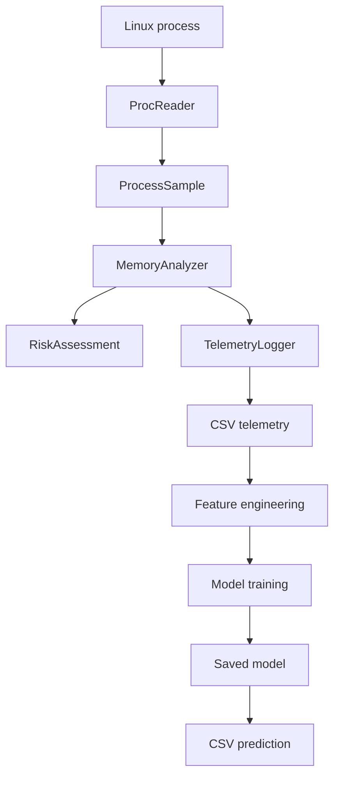

# MemoryMedic — Interview Guide

**Project:** MemoryMedic
**Author:** Leslie Raya

## Purpose of This Guide

This guide explains the technical decisions, operating-system concepts, machine-learning workflow, evaluation results, limitations, and possible improvements behind MemoryMedic. It can be used to prepare for technical interviews, demonstrations, presentations, and code reviews.

## 1. What Is MemoryMedic?

MemoryMedic is a Linux process-monitoring and memory-leak classification system written in C++ and Python.

The C++ portion reads process information from the Linux `/proc` filesystem, calculates memory-growth behavior, assigns a rule-based risk assessment, and records timestamped telemetry in CSV files.

The Python portion validates the collected data, creates time-series features, separates independent workload runs, compares classification models, evaluates the selected model, saves training artifacts, and predicts whether new telemetry resembles `normal` or `leak` behavior.

The goal is not simply to detect high memory usage. MemoryMedic attempts to distinguish sustained unreleased memory growth from legitimate behavior such as caching, application startup, and temporary allocation bursts.

## 2. What Problem Does MemoryMedic Solve?

Traditional memory-monitoring tools can show that a process is consuming a large amount of memory. However, high memory use does not automatically mean that a program has a memory leak.

For example:

* A database may intentionally use available RAM for caching.
* A machine-learning application may load a large model into memory.
* A program may temporarily allocate memory and release it later.
* An application may reserve a large virtual address space without using all of it.
* A genuine memory leak may increase memory consumption slowly over several hours.

A simple rule such as `memory usage > threshold` could create many false alarms.

MemoryMedic examines behavior over time. It considers memory growth, rolling trends, page-fault activity, ratios, and other telemetry before producing a risk assessment or machine-learning prediction.

## 3. System Architecture



The complete workflow is:

1. A controlled workload or another Linux process begins running.
2. `ProcReader` reads information from the process’s `/proc` files.
3. The information is stored in a `ProcessSample`.
4. `MemoryAnalyzer` compares samples and calculates memory-growth behavior.
5. `RiskAssessment` evaluates the calculated behavior.
6. `TelemetryLogger` records the measurements in CSV format.
7. `feature_engineering.py` converts the telemetry into model-ready features.
8. `train_model.py` validates the data, partitions independent runs, compares models, and saves the selected model.
9. `predict_csv.py` loads the saved model and classifies new telemetry.

## 4. What Does Each Major C++ Component Do?

### `ProcessSample`

`ProcessSample` represents one snapshot of a Linux process at a specific time.

A sample can contain information such as:

* Timestamp
* Process ID
* Resident memory
* Virtual memory
* Peak resident memory
* Thread count
* Minor page faults
* Major page faults

Keeping the information in one structured object makes it easier to pass measurements between the reader, analyzer, assessment, and logging components.

### `ProcReader`

`ProcReader` reads process information from the Linux `/proc` filesystem.

Relevant files include:

```text
/proc/<pid>/status
/proc/<pid>/stat
```

It parses operating-system information and converts it into a `ProcessSample`. It must also handle situations in which aiënt فعلreit processlishireadh NCC chup?
